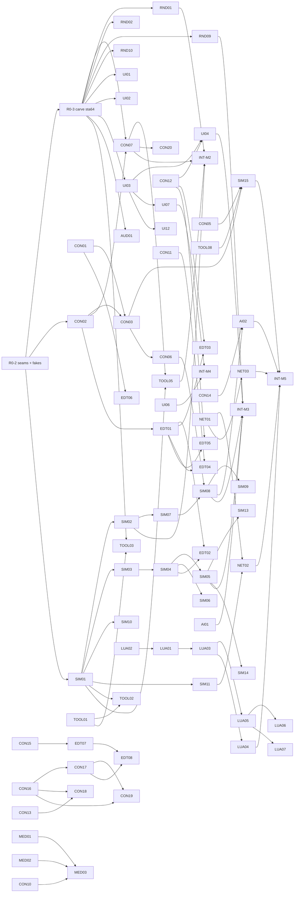

# Work plan: seams and parallel packages

How M2–M5 get built by many agents at once. The plan fixes the contracts
between systems first (the **seams**), gives every lane a fake for each thing
it depends on, and splits the rest into **work packages** that each own their
files and end in a check an agent can run itself.

It builds on [TESTBENCH.md](TESTBENCH.md) (PR #2, not yet merged), whose
scenes, scenarios and digest checks are the done criteria for most packages,
and on PR #1 (merged), which brought `a2fmt::Odf::load_layered`.

## How to use this doc

**Assigning work.** Round 0 runs first and alone. After that, any package
whose *needs* are merged, or whose *can start against* fakes exist, is ready.
Open one GitHub issue per package (title `[SIM-06] Weapons`, label
`lane:sim`), assign it, and let the agent work on its branch. How sessions
check, claim and release packages: [AGENTS.md](../AGENTS.md).

**Picking up a package.** Read its row, the seams it names and the files it
owns. Work only in those files. Start against the listed fakes, not against
another package's unmerged branch. Finish when the *done when* check passes on
your branch, and paste the evidence (test names, scenario report lines,
digest) into the PR. If you need a seam to change, stop and open a seam PR
("Integration and merge protocol").

Status lives in the issues, not here. This file changes only when the plan
changes.

## Where main is (2026-11-08)

Most of M2 landed before this plan, inside `sta64`: `sta_bzn` reads all 517
installed maps; `sta64::map` places objects, sky, starfield, planets
(`planet.rs`, `sta_surface` recipes), volumetric nebulae, asteroid fields and
map lights; `sta64::units` runs `sta_sim` in `FixedUpdate`, interpolates by
`Time<Fixed>::overstep_fraction`, selects and orders moves; `sta_mission`
resolves scripts and dry-runs all 252 installed Lua missions; `docs/data/`
inventories every ODF/CFG/AIP key. What is missing is the separation: ODF
loading for the sim lives in `sta64::map`, the sim is driven from a Bevy
system, and seven systems read Bevy's `Time`. Round 0 carves that apart
before anything else is added.

## Round 0: the serial part

| ID | Package | Contents | Model |
|---|---|---|---|
| R0-1 | This doc | `docs/WORKPLAN.md`, pointers in ROADMAP/README | Opus |
| R0-2 | Seams as code + fakes | below | Opus |
| R0-3 | Carve `sta64` | below | Sonnet |

**R0-2 contains, and nothing else:**

1. New crate `crates/sta_core` (no deps): `Fixed` and `Vec3` moved from
   `sta_sim` (re-exported there, so no caller changes), `EntityId`,
   `PlayerId`, `TeamId`, `Tick`, `TICK_HZ`, `ContentKey`, `SEAM_REV`.
2. New crate `crates/sta_content`: the types of the content seam
   (`ContentDb`, `UnitDef`, `WeaponDef`, `Profile`, `Features`, `OdfIndex`,
   `MapDef`) with `ContentDb::builder()` working and every loader returning
   `Err(Unsupported)`; `sta_content::fake` (below).
3. In `sta_sim`: modules `command`, `event`, `view`, `setup`, `source`;
   `Sim` implements `WorldSource` with today's movement; `Sim::step` returns
   `TickOutput`; `fake::ScriptedSource`, `fake::ViewLog`. Existing tests keep
   their digests (the digest gains nothing new until SIM-01).
4. In `sta64`: `clock.rs` (`AnimClock`, wall mode working), `sim_link.rs`
   (`SimLinkPlugin`, messages, `SimEntity`, `CommandQueue`, `Selection`),
   `plugins.rs`, `app.rs` (`AppState`, `GameSet`, `LaunchConfig` with every
   planned flag parsed; unimplemented ones log `unsupported: <flag>`).
5. Workspace `Cargo.toml`: members and `[workspace.dependencies]` for every
   crate this plan creates (`sta_core`, `sta_content`, `sta_bench`,
   `sta_net`, `sta_ai`), each an empty `lib.rs` with a crate doc stating its
   owner lane; external deps `serde`, `json5`, `postcard`.
6. `clippy.toml` for `sta_core` and `sta_sim`: `disallowed-types`
   (`HashMap`, `HashSet`) and `disallowed-methods` (`f32::sin` and the other
   platform maths, `Instant::now`, `SystemTime::now`); see Determinism.
7. `docs/ARCHITECTURE.md`: `sta_core`/`sta_content` in the layer diagram.

Done when: `cargo test --workspace` and clippy pass on all four CI targets;
`cargo doc` shows every seam type; the fakes have their own tests.

**R0-3 contains:** `git mv` of the existing `sta64` modules into lane
directories (`render/` ← `model_scene`, `sprites`, `particles`, `textures`,
`planet`, `nebula`, `rock`, `space`, `surfaces`, `strategic`, `*.wgsl`;
`viewer/` ← `viewer`; `map/` ← `map`; `input/` ← selection and order code
from `units.rs`; `render/units.rs` ← placement); `units.rs`'s tick and
interpolation replaced by `sim_link` + `AnimClock`; `map.rs`'s ODF cache
replaced by a `ContentRes(Arc<ContentDb>)` built through a temporary
`sta_content::legacy` shim (CON-03 replaces it). Done when the map view
behaves as on main (TODO.md "Needs your check" items unchanged) and the
existing `units.rs` motion tests, ported to `AnimClock`, pass.

Packages that need nothing from round 0 may start while it runs: CON-01,
CON-08, CON-09, TOOL-01, LUA-02's deterministic `math.*` half.

## Seams

Each seam: owner, sketch, invariants, dependency direction, evolution.
Crate direction, enforced by `Cargo.toml`:

```
formats:   a2fmt, sta_fpq, sta_vfs, sta_odf, sta_bzn, sta_assets, sta_surface  (no sta_core)
sta_core   <- sta_content (+ sta_odf, sta_vfs, sta_bzn, json5)
sta_content <- sta_sim <- sta_mission, sta_ai, sta_net, sta_bench
all of the above <- sta64 (the only Bevy crate)
```

No Bevy-free crate depends on `sta64`; `sta_sim` never depends on
`sta_mission`, `sta_ai` or `sta_net` (they plug in through traits).

### S1. Core types — `sta_core`

```rust
pub use fixed::Fixed;                       // 32.32, moved from sta_sim
pub struct Vec3 { pub x: Fixed, pub y: Fixed, pub z: Fixed }
pub struct EntityId(pub u32);               // never reused; 0 = none
pub struct PlayerId(pub u8);                // 0..=7 players, SCRIPT = 254, BENCH = 255
pub struct TeamId(pub u8);
pub type Tick = u64;
pub const TICK_HZ: u32 = 30;
pub struct ContentKey(pub u32);             // index into ContentDb's name-sorted table
pub const SEAM_REV: u32 = 2;                // versions the postcard command/view surface
```

- Space is the maps': Direct3D left-handed, +Y up, ODF/BZN units. Headings
  are unit vectors in XZ (`(x, z)`), as `sta_sim` has them; the sim uses no
  trigonometry. Durations are ticks; ODF seconds convert once, at content
  load, rounding half up.
- `ContentKey`s are equal on every peer that loaded the same content, because
  they index names sorted bytewise. Never persist a key without the
  `ContentDb::hash()` it came from.
- Evolution: additive only. Moving or renaming a type is a breaking change.

The [perceived-team prerequisite](PERCEIVED_TEAM.md) introduces a versioned
command/view boundary at revision 2. Real ownership remains authoritative;
global perceived identity has a separate default-empty view table and edit.
Revision-1 replay/view logs are rejected explicitly. Snapshot format 11 retains
narrow readers for historical formats 8/9/10 with seam 1; this is save migration,
not general backward network/replay compatibility. Desktop and Android share
the same state and rules; the December 2026 desktop alpha remains the priority.

### S2. Commands — `sta_sim::command`

```rust
pub struct Command { pub player: PlayerId, pub seq: u32, pub kind: CommandKind }
#[non_exhaustive] pub enum CommandKind { Order(Order), Edit(Edit) }
#[non_exhaustive] pub enum Order {
    Move { units: Vec<EntityId>, to: Vec3, queue: bool },
    Stop { units: Vec<EntityId> },
    Attack { units: Vec<EntityId>, target: EntityId },
    Build { builder: EntityId, what: ContentKey, at: Option<Vec3> },
    Formation { units: Vec<EntityId>, kind: u8 },
    Special { units: Vec<EntityId>, slot: u8, target: Target },
    Cloak { units: Vec<EntityId>, on: bool },
    Mine { units: Vec<EntityId>, node: EntityId },
}
#[non_exhaustive] pub enum Edit {           // TESTBENCH's Command::Bench
    Spawn { odf: ContentKey, player: PlayerId, pos: Vec3, heading: (Fixed, Fixed) },
    Kill(EntityId), Damage(EntityId, Fixed), Heal(EntityId), Immortal(EntityId, bool),
    SetEnergy(EntityId, Fixed), Tech(PlayerId, ContentKey), Cargo(PlayerId, u8, Fixed), …
    Present(Presentation),                   // missions: shown, not simulated (sta_sim::present)
    Subsystem(EntityId, Subsystem, bool), Alert(EntityId, AlertState),
    MaxSpeed(EntityId, Option<Fixed>), Targetable(EntityId, bool), Decommissionable(EntityId, bool),
}
pub trait CommandRouter {                    // local today, lockstep in sta_net
    fn submit(&mut self, cmd: Command);
    fn take_ready(&mut self, tick: Tick) -> Option<Vec<Command>>; // None = stall
}
pub struct LocalRouter;                      // everything lands on the next tick
```

- Commands are the only input to `Sim::step`. A tick applies its batch
  sorted by `(player, seq)`. Invalid commands (dead unit, wrong owner) are
  ignored deterministically and produce `SimEvent::Rejected`.
- `Edit` is accepted from `PlayerId::BENCH` (bench builds only) and
  `PlayerId::SCRIPT` (missions); lockstep peers reject it from players. Both
  are in the command log and the digest, so edited runs replay (TESTBENCH's
  open question, decided this way; see D4).
- Evolution: new variants and new fields with defaults within a milestone.
  The wire encoding (`postcard`) is versioned by `SEAM_REV`.

### S3. World view — `sta_sim::view`

```rust
pub struct WorldView {
    pub tick: Tick, pub digest: u64,
    pub units: Vec<UnitView>,       // ascending id
    pub players: Vec<PlayerView>,   // resources, officers, eliminated, relation table
}
pub struct UnitView {
    pub id: EntityId, pub def: ContentKey, pub owner: PlayerId,
    pub pos: Vec3, pub heading: (Fixed, Fixed), pub speed: Fixed,
    pub hull: [Fixed; 2], pub shields: [[Fixed; 2]; 4],   // [now, max]; fore/aft/port/stbd
    pub flags: UnitFlags,           // cloaked, dying, building, docked, selectable
    pub progress: Option<Fixed>,    // build/construction 0..1
}
pub struct TickOutput { pub view: Arc<WorldView>, pub events: Vec<SimEvent> }
pub trait WorldSource: Send {
    fn step(&mut self, commands: &[Command]) -> TickOutput;
    fn view(&self) -> Arc<WorldView>;
}
```

- The view is an immutable snapshot built at the end of each tick; readers
  never borrow `Sim`. Render, UI, audio, AI, Lua and the bench read only
  views and events.
- Everything in it is `Fixed`; readers convert with `to_f32` and never feed
  the result back.
- Per-player visibility comes later as `WorldView::visible_to(PlayerId)`
  (SIM-12); until then the view is omniscient.
- Evolution: fields are added, never removed, within a milestone.

### S4. Sim events — `sta_sim::event`

```rust
#[non_exhaustive] pub enum SimEvent {
    Spawned { id: EntityId }, Destroyed { id: EntityId, by: Option<EntityId> },
    Fired { shooter: EntityId, weapon: ContentKey, hardpoint: u8, target: Target },
    Hit { target: EntityId, by: EntityId, weapon: ContentKey, facing: u8,
          shield: Fixed, hull: Fixed, at: Vec3 },
    ShieldsDown { id: EntityId, facing: u8 },
    BuildStarted { builder: EntityId, what: ContentKey },
    Built { builder: EntityId, id: EntityId },
    Delivered { player: PlayerId, resource: u8, amount: Fixed },
    CloakChanged { id: EntityId, on: bool },
    Rejected { player: PlayerId, seq: u32 },
    PlayerEliminated { player: PlayerId },
    Present(Presentation),                   // from Edit::Present, the tick it applies
}
```

- Emitted in deterministic order and identical on every peer, so marks and
  mission triggers can key on them; not hashed separately (they follow from
  state).
- Client-side events that the sim never sees are Bevy messages in
  `sta64::sim_link`: `OrderIssued { units, kind }` (voice acks play on input,
  not on the tick), `SelectionChanged`.
- Evolution: new variants freely (`#[non_exhaustive]`); consumers must
  ignore unknown ones.

### S5. Content database — `sta_content`

```rust
pub struct ContentDb { /* name-sorted defs, profile, features, hash */ }
impl ContentDb {
    pub fn load(vfs: &Vfs, profile: Profile, index: &OdfIndex) -> Result<(ContentDb, Vec<Warning>)>;
    pub fn builder() -> ContentBuilder;             // fakes and JSON5
    pub fn key(&self, odf: &str) -> Option<ContentKey>;
    pub fn unit(&self, k: ContentKey) -> Option<&UnitDef>;
    pub fn weapon(&self, k: ContentKey) -> Option<&WeaponDef>;
    pub fn hash(&self) -> u64;                       // folded into tick 0's digest
    pub fn profile(&self) -> Profile; pub fn features(&self) -> &Features;
}
pub struct UnitDef {
    pub key: ContentKey, pub odf: String, pub class: ClassLabel, pub race: String,
    pub model: String, pub scale: Fixed, pub movement: MoveStats,
    pub hull: Fixed, pub shields: ShieldDef, pub crew: Fixed, pub sensor: Fixed,
    pub hardpoints: Vec<Hardpoint>,                  // weapon key, node name, arc
    pub build: BuildDef,                             // cost, ticks, build list, officers
    pub sounds: SoundRefs, pub fx: FxRefs,           // names only; resolved client-side
    pub raw: Arc<sta_odf::Odf>,                      // unread keys stay reachable
}
pub enum Profile { Native, Fo4, Sta2Classic, Sta1Classic }
pub struct Features { pub directional_shields: bool, pub fire_arcs: bool,
    pub point_defense_cycles: bool, pub pay_on_queue: bool, … }  // one per NATIVE_FEATURES row
pub struct OdfIndex { /* stem -> (path, layer), duplicates */ }
```

- Every number reaches the sim as `Fixed`, converted once here
  (`Fixed::from_f64` of the parsed value, as `sta_sim` already rules). No
  other crate parses ODF numbers for the sim.
- Profile defaults first, then per-ODF keys switch features per unit.
- `ContentDb` is immutable after load and shared as `Arc`.
- Evolution: new defs and fields freely; renaming a field is breaking. Keys
  STA64 reads are marked in `docs/data/odf_keys.csv` by
  `tools/data_inventory.py`.

### S6. Maps — `sta_content::map`

```rust
pub struct MapDef {
    pub name: String, pub label: Option<String>, pub mission: Option<String>,
    pub bounds: (Vec3, Vec3),
    pub starts: Vec<StartPos>,                       // per player slot
    pub objects: Vec<MapObject>,                     // odf, owner slot, pos, heading, label
    pub regions: Vec<Region>,                        // nebula / asteroid field volumes (Fixed)
    pub scenery: Scenery,                            // f32; render only: sky, starfield,
}                                                    //  planets, lights, ambient
impl MapDef {
    pub fn from_bzn(m: &sta_bzn::Map, db: &ContentDb) -> (MapDef, Vec<Warning>);
    // Selected VFS stem relative to bzn/, without .bzn; additive named context.
    pub fn convert_bzn_named_in(m: &sta_bzn::Map, selected_stem: &str,
        db: &ContentDb, vfs: &sta_vfs::Vfs, index: &OdfIndex) -> Conversion;
    pub fn empty() -> MapDef;                        // the bench's built-in empty map
}
```

- `sta_bzn` stays a pure format crate; the conversion lives here because it
  needs ODF classes (`physicsFile`, `dont_load_SOD`, start markers).
- The sim spawns from `objects`, `starts` and `regions` only; `scenery`
  never enters the sim or the digest.
- JSON5 maps (native format) deserialize into the same type.
- Named conversion carries the selected source identity before conversion;
  the A1 MDF adapter and unchanged old APIs follow the
  [selected-map seam contract](SELECTED_MAP_CONVERSION.md).

### S7. Game setup and controllers — `sta_sim::setup`

```rust
pub struct GameSetup { pub seed: u64, pub map: Arc<MapDef>, pub content: Arc<ContentDb>,
    pub players: Vec<PlayerSetup>, pub options: GameOptions }
pub struct PlayerSetup { pub id: PlayerId, pub team: TeamId, pub race: String,
    pub control: Control }                           // Human, Remote, Ai(name), Idle
impl Sim { pub fn from_setup(s: &GameSetup) -> Sim; }
pub trait Controller: Send {                         // AI, missions
    fn think(&mut self, view: &WorldView, events: &[SimEvent], out: &mut Vec<Command>);
}
```

- UI (Instant Action, lobby) produces a `GameSetup`; the sim, net and bench
  consume it. A replay is `GameSetup` + command log + digests.
- Controllers run on one host and send their commands through the
  `CommandRouter` like a player (assumption D3), so AI and Lua need not be
  bit-deterministic and replays never rerun them.

### S8. Client link — `sta64::sim_link`

```rust
#[derive(Resource)] pub struct SimLink { source: Box<dyn WorldSource>, router: Box<dyn CommandRouter>,
                                         prev: Arc<WorldView>, curr: Arc<WorldView> }
#[derive(Component)] pub struct SimEntity(pub EntityId);
#[derive(Resource)] pub struct SimEntities(BTreeMap<EntityId, Entity>);
#[derive(Message)] pub struct SimMsg(pub SimEvent);          // after each tick
#[derive(Message)] pub struct OrderIssued { pub units: Vec<EntityId>, pub kind: OrderKind }
#[derive(Resource)] pub struct CommandQueue(Vec<CommandKind>); // input pushes; link stamps player/seq
#[derive(Resource)] pub struct Selection(pub Vec<EntityId>);
#[derive(Resource)] pub struct ContentRes(pub Arc<ContentDb>);
#[derive(Message)] pub struct PlaySound { pub name: String, pub at: Option<Vec3>, pub bus: Bus }
```

- `SimLinkPlugin` decides how many ticks run this frame from `AnimClock`,
  steps the source, shifts `prev`/`curr`, and sends `SimMsg`s. Nothing else
  calls `step`.
- Interpolation: a thing is drawn at `lerp(prev, curr, AnimClock::alpha())`;
  heading lerps then renormalises. An id only in `curr` appears at `curr`; an
  id only in `prev` is gone (its `Destroyed` event drives the effect).
- Render-side entities link to the sim only by `SimEntity`; nothing keys on
  Bevy `Entity` across frames.
- `PlaySound` is how UI, render and input ask for audio without depending on
  the audio module.

### S9. Animation clock — `sta64::clock`

```rust
#[derive(Resource)] pub struct AnimClock { /* mode, sim_time, alpha, paused, seed */ }
impl AnimClock {
    pub fn now(&self) -> f64;              // sim time at last tick + alpha * tick
    pub fn alpha(&self) -> f32;
    pub fn wall(&self) -> f64;             // only for loops allowed to run while paused (wall mode)
    pub fn seed(&self) -> u64;
    pub fn entity_key(&self, id: EntityId) -> u64;
    pub const SUBSTEP: f64 = 1.0 / 120.0;  // fixed step for anything integrated per frame
}
```

TESTBENCH's rule, verbatim in effect: anything that moves on screen reads
`AnimClock`, never `Time`; cosmetic seeds come from `seed()` and
`entity_key(EntityId)`; integrated effects advance in `SUBSTEP`s. `bench`
mode advances one fixed `Step=` per `App::update`.

### S10. Plugins, sets and app modes — `sta64::{plugins, app}`

```rust
pub enum Mode { Viewer, Map, Game, FrontEnd, Bench { headless: bool, sim_only: bool } }
#[derive(States)] pub enum AppState { Boot, FrontEnd, Loading, InGame, Viewer }
#[derive(SystemSet)] pub enum GameSet { Input, SimLink, Interpolate, Render, Ui, Audio, Bench }
pub fn add_plugins(app: &mut App, cfg: &LaunchConfig) {
    // render — one line per package, append inside your lane's block
    // ui —
    // audio —
}
```

- Each package ships one `pub struct XxxPlugin` in its own module, registers
  systems only in its `GameSet`, gates them on `AppState`, and reads seams,
  not other packages' internals.
- `plugins.rs` adds render/UI/audio plugins only when the mode has a window;
  `--sim-only` adds none.
- Per-package settings: a `#[derive(Resource, Deserialize, Default)]` struct
  under the package's own section of `settings.toml` (`[render.nebula]`),
  loaded by `app.rs`.

### Determinism rules (sim crates: `sta_core`, `sta_content`, `sta_sim`)

1. No `f32`/`f64` in state or in arithmetic that feeds state; floats only at
   load (S5) and out to rendering. No platform maths.
2. `BTreeMap`/sorted `Vec` only; no `HashMap`/`HashSet` (clippy-enforced).
3. One seeded `Rng`; cosmetic randomness never touches it.
4. Commands apply at tick boundaries in `(player, seq)` order; ids are never
   reused; entities iterate by ascending id.
5. No threads, I/O or clocks inside `step`.
6. Golden digests at fixed ticks are committed and checked on all four CI
   targets (TOOL-06).

## Fakes and fixtures

Every fake ships in round 0 (R0-2) unless marked, lives with the seam it
fakes, and contains no game data.

| Fake | Where | Stands in for | Used by |
|---|---|---|---|
| `sta_content::fake::db()`: 6 units (`fx_cruiser`, `fx_frigate`, `fx_station`, `fx_yard`, `fx_miner`, `fx_moon`), 3 weapons (beam, torpedo, point defence), built in Rust | `crates/sta_content/src/fake.rs` | ODF content DB (CON-03) | SIM, AI, LUA, TOOL |
| JSON5 copies of the same units + boxy GLB models | `fixtures/content/`, `fixtures/models/` (CON-04) | real installs in CI | RND, TOOL CI scenes |
| `MapDef::empty()`, `fake::two_bases()` (2 starts, moon, nebula region, asteroid region, sky/planet scenery) | `sta_content::map`, `fake.rs` | BZN → MapDef (CON-07) | SIM-01, RND, UI, TOOL |
| `ScriptedSource`: a `WorldSource` that plays a JSON5 timeline (`at 30: Fired …`, `at 45: Hit …`, units on rails) | `crates/sta_sim/src/fake.rs` | combat/economy sim | RND FX, AUD, UI HUD |
| `ViewLog`: record a real run's `TickOutput`s to `postcard`, replay as a `WorldSource` | same | any sim | render perf, AUD |
| `NullAudio`: records `PlaySound`/positional requests | `sta64/src/audio/null.rs` (AUD-01) | audio backend | UI, tests |
| `LocalRouter`, `LoopbackNet` (two routers over a channel) | `sta_sim::command`; `sta_net` (NET-02) | relay | NET, TOOL |
| `IdleController` | `sta_ai` (AI-01) | skirmish AI | INT-M3 |
| `fixtures/odf/`: hand-written ODFs: includes, FO self-include, A1 `addon/`, `;`/`f` numbers | CON-01/02 | install ODFs | CON |

## Ownership and shared files

Every package owns the paths in its *owns* column. Hotspots and their rules:

| Hotspot | Rule |
|---|---|
| `sta64/src/main.rs`, `app.rs` | R0 and INT packages only, with the narrow TOOL-10 platform-entry exception below. |
| `sta64/src/plugins.rs` | Append-only: one `app.add_plugins(...)` line per package, at the end of its lane's block. Rebase conflicts are resolved by keeping both lines. |
| `sta64/src/sim_link.rs`, `clock.rs`, `sta_core`, the seam modules of `sta_content`/`sta_sim` | Seam files: changed only by seam PRs. |
| Workspace `Cargo.toml` | Members written once in R0-2. A new external dependency is one line appended to `[workspace.dependencies]`, named in the PR description. A new crate needs a seam PR. |
| `sta64/Cargo.toml`, `Cargo.lock` | Append one dependency per line. Never hand-merge `Cargo.lock`: rebase, then `cargo update -w`. |
| `.github/workflows/*` | TOOL lane. Others request a job in their PR description; TOOL-06 adds it. |
| `docs/ROADMAP.md`, `TODO.md` | Ticked only by INT packages and the user. `TODO.md` stays the user's eye-check list; packages add `[?]` lines only under "Needs your check", append-only. |
| `docs/NATIVE_FEATURES.md` | A package may change the Status cell of the rows it implements, nothing else. |
| `docs/data/*` | Generated. Never hand-edited or hand-merged; rerun `tools/data_inventory.py`. |
| `bench/scenes/`, `bench/scenarios/`, `fixtures/` | New files only; a package edits only files it added. Shared fixtures (`fixtures/content/`) are CON-04's; others append new files. |
| Existing `sta64` modules after R0-3 | Owned as listed per package below; one owner each. |

## Lanes and work packages

Android is a planned first-class native platform using the same engine and
gameplay implementation. The December 2026 desktop alpha remains the immediate
priority. TOOL-10 is isolated preparation, not an additional desktop release
gate or permission to simplify gameplay. Its documented entry seam may extract
the existing client launch into `lib.rs`, retain the desktop CLI wrapper, and
route platform storage/lifecycle inputs; it does not authorize a core rewrite.
The Android-only lifecycle condition may also gate the existing viewer/map
update chains and HUD command set, and discard transient input state; it must
not change desktop scheduling or committed commands. The existing theme click
dispatcher may check the same gate because its observers run outside these
sets. Touch, safe-area UI,
device performance and cross-play remain subsequent gates.
See [Android support](ANDROID_SUPPORT.md), [compatibility](ANDROID_COMPATIBILITY.md)
and [roadmap](ANDROID_ROADMAP.md). No Android completion date is assigned.

Columns: **needs** must be merged first; **against** lists the fakes that let
work start earlier; size S ≤ 1 day, M ≤ 1 week, L > 1 week of agent work;
model: Haiku for mechanical work, Sonnet by default, Opus for hard-to-reverse
design. `✓main` marks work already on main that the package moves behind a
seam rather than writes.

**Principle: stock parity and existing mods first, enhancements second.** Every
game starts looking and behaving like its stock self (HUD, nebulae,
hulls, beams, cloak, pathing, cutscenes). Refit-derived effects and the generic
LCARS kit are kept in the repository and stay selectable as options or mods
(UI-17, RND-22); they are not the default and are not deleted. Where a package
below says "Refit" it describes the optional enhancement profile unless it is
a Stock package. Parity is judged against reference frames of the stock games.
Exception: **menus** (front end, in-game options, campaign screens) copy the
stock layout and flow but are our own implementation and art, not the games'
assets; the HUD and in-match effects are the stock-parity part.

### Content and formats (CON)

| ID | Package | Owns | Needs | Against | Unlocks | Done when | Size | Model |
|---|---|---|---|---|---|---|---|---|
| CON-01 | FO self-include rule in `sta_odf::resolve` (adopt `a2fmt::Odf::load_layered` semantics: a file may include its own name from a lower layer) | `crates/sta_odf/` | — | `fixtures/odf/` | CON-02, CON-03 | Fixture test: self-include resolves, true cycle still `IncludeCycle`; install-gated: 0 `IncludeCycle` over all FO4 ODFs | S | Sonnet |
| CON-02 | ODF index: all ODF folders, recursive, A1 `addon/`, duplicate warnings (replaces `map.rs` stem cache) | `sta_content/src/index.rs` | R0-2 | synthetic `Vfs` | CON-03, CON-07 | Unit tests; `--example odf_index` prints counts and duplicates for A1/A2/FO | M | Sonnet |
| CON-03 | Content DB from ODF: `UnitDef`, `WeaponDef`, movement (from `units.rs`), build, sounds, FX refs; replaces R0-3's shim | `sta_content/src/{odf,unit,weapon}.rs` | CON-01, CON-02 | `fake::db()` | SIM-04+, AUD-02 | Every FO4 and A2 craft ODF yields a def or a listed warning (install-gated); `odf_keys.csv` ✓ column regenerated | L | Sonnet |
| CON-04 | JSON5 content + synthetic fixtures (units, weapons, GLB boxes), schema doc | `sta_content/src/json5.rs`, `fixtures/content/`, `fixtures/models/` | R0-2 | — | TOOL-06, CI scenes | `fixtures/content` loads to the same `hash()` as `fake::db()` | M | Sonnet |
| CON-05 | Profiles and feature switches: profile from mod chain, defaults table, per-ODF overrides | `sta_content/src/profile.rs` | R0-2 | — | SIM combat rules | Table test per profile; FO4 / STA2 Classic / STA1 Classic detected on installs | M | Sonnet |
| CON-06 | Tech tree and build lists (`.tt`, FO techtree `.xml`, `docs/data/techtree.md`) | `sta_content/src/techtree.rs` | CON-03 | `fake::db()` | SIM-09, AI-02, UI-04 | All installed `.tt`/`.xml` parse; prerequisites test | M | Sonnet |
| CON-07 | `MapDef::from_bzn`: objects, start positions, regions, scenery, mission; `map.rs` reads `scenery` | `sta_content/src/map.rs` (not the seam types) | R0-3, CON-02 | `two_bases()` | SIM-01, TOOL-05 | All 517 maps convert with counts equal to `sta_bzn`'s; start positions found on every multiplayer map | M | Sonnet |
| CON-08 | M3D 1.93 layout; typed Legacy LOD/light data and explicit native chunk contexts; [pre-code contract](M3D_NODE_SUPPORT.md) | sta_assets m3d/chunks/tests, narrow shared Model variants/constructors and exhaustive client matches; model_info/tests; resolver-backed list_models filter/test in lib.rs; owning docs | — | original synthetic streams and hash-preserved installed M3D corpus | RND-07 | Every valid installed M3D parses by its explicit context; expected native historical refusals reported; LOD/light nodes listed by model_info, finest-LOD/index/malformed-input/legacy checks pass; exact light playback, chunk destruction and dynamic LOD remain explicit RND limits | M | Lead compatibility/integration; bounded inspector/tests |
| CON-09 | Static glTF/GLB → shared Model and viewer; pre-code [M1 contract](M1_ASSET_MODEL_COMPLETION.md) | new sta_assets gltf/tests/PBR annotations; narrow asset dispatch/constructors/dependencies; model_scene/textures native PBR integration and viewer dispatch; owning docs | — | original synthetic models and VFS resources | native content | Static glTF/GLB fixtures preserve geometry/hierarchy/materials and resource errors; VFS-backed offscreen textured draw; explicit unsupported advanced features; legacy regressions, Clippy/workspace checks | M | Lead integration, bounded parser delegation |
| CON-10 | Audio data: sound lookup by bare name (OGG > WAV > MP3 per layer), **WAV, MP3 and OGG (Vorbis) decode** in pure Rust (permissive licences only), `audio.odf`/`events.odf` sound tables; the formats STA64 supports (Immy, 2026-11-09) | `sta_assets/src/audio.rs` | — | — | AUD-01..04, MED-03, LUA-06 | Every sound named by FO4 ODFs and the A1/A2 mission DLLs resolves or is listed; every installed WAV, MP3 and OGG decodes | M | Sonnet |
| CON-11 | Language packs: `Dynamic_Localized_Strings.h`, `label.map` → `StringTable` (shares `sta_mission::Labels`) | `sta_content/src/strings.rs` | R0-2 | — | UI-09 | All installed packs parse; lookup test | S | Haiku |
| CON-12 | GUI cfg (`docs/data/cfg.md`) → typed layouts for HUD/menus | `sta_content/src/gui_cfg.rs` | R0-2 | — | UI-04 | All 43 FO `.cfg` parse; layout snapshot tests | M | Sonnet |
| CON-13 | Mod discovery: list mods (`info.ini`), chain, metadata | `sta_vfs/src/mods.rs` | — | temp dirs | UI-07 | Unit tests; lists installed mods | S | Haiku |
| CON-14 | AIP files (`docs/data/aip.md`) → typed AI params | `sta_content/src/aip.rs` | R0-2 | — | AI-02 | All installed `.aip` parse | S | Haiku |
| CON-15 | Armada I `.zfs` archives: reader, mounted per layer (`.odf` → `odf/`, `.tt` → `techtree/`, rest at root; loose > FPQ > ZFS), `Source::Zfs`, `Vfs::read_from` | `sta_vfs/src/zfs.rs`, ZFS mount in `sta_vfs/src/lib.rs` | — | synthetic archives | A1 content in CON-02/03/06 | Synthetic-archive tests; install-gated: A1 retail `assets.zfs` 516 entries, `objtxt.zfs` 81; `odf_index` resolves every A1 retail ODF | S | Sonnet |
| CON-16 | `.sta` reader and VFS mount ([STA_ARCHIVE.md](STA_ARCHIVE.md)): header, index, binary search by key, stored + Zstandard entries, per-file SHA-256, whiteouts; a mod folder's `*.sta` mounts in its layer below its loose files | `crates/sta_vfs/src/sta.rs`, the `.sta` mount in `sta_vfs/src/lib.rs` | — | hand-built archives | CON-17, CON-18, EDT-08 | Spec examples parse; every refusal in "Reading safely" has a test; a mounted `.sta` serves files and the ODF index finds its ODFs | M | Sonnet |
| CON-17 | `.sta` writer: reproducible packing (key order, fixed Zstandard level, no timestamps), store-when-not-smaller, `content_hash` | `crates/sta_vfs/src/sta_write.rs` | CON-16 | — | EDT-08 | Same folder packs to the same bytes twice; same files packed stored vs compressed give the same `content_hash`; write → read round trip | S | Sonnet |
| CON-18 | Mod manifests and load order: `manifest.toml` parse, `info.ini` `ParentMod` as a dependency, semver checks, cycle refusal, topological order with `[load]` hints; mod identity (`content_hash`) into `ContentDb::hash` | `crates/sta_vfs/src/manifest.rs`, `sta_vfs/src/order.rs` | CON-13, CON-16 | temp dirs | UI-07 (mod select), NET handshake | Table tests for ordering, missing/wrong-version dependencies and cycles; installed Roots mods order as `mod_chain` does today | M | Sonnet |
| CON-19 | `.sta` signatures: Ed25519 sign/verify of header + `content_hash`, trust store, status (trusted / unknown key / unsigned / tampered) | `crates/sta_vfs/src/sta_sign.rs` | CON-16, CON-17 | — | UI-07 | Sign → verify; a flipped byte in any file, the index or the header reports tampered | S | Sonnet |
| CON-20 | Star Trek: Legacy `.sol` maps (BinaryMode SOL v3021): map metadata, bounds, start locations, placed objects (ODF, id, team, instance name, Matrix34) → `MapDef`; the mission script name kept (`.drl`/`.dsl`). Port of A2FOExtensions' `A2FOSOLMaps/sol_format.cpp` (Immy's own) | `crates/sta_bzn/src/sol.rs` | CON-07 for `MapDef` (parser first, against `MapDef::empty`) | hand-built SOL fixtures | maps | Fixture tests; `mpbajor_all.sol` gives 8 start locations and 19 objects, as A2FOSOLMaps validated; a SOL in `bzn/` appears in the map list and loads its objects | M | Sonnet |
| CON-21 | Menu and shell images: **BMP** decode (1/4/8-bit palette, 16/24/32-bit, RLE) beside the existing PNG path, found through the VFS like textures | `sta_assets/src/bmp.rs` | — | — | UI-06, UI-07, UI-08 | Every installed `.bmp` (A1, A2, FO) decodes; palette and RLE fixture tests | S | Sonnet |
| CON-22 | Start loadouts resolve: every race's skirmish start units (outpost, construction ship, freighters, the profile's start fleet) resolve a def and a model through the mod chain; the first playtest's Federation start drew nothing until #191 | `crates/sta_content/tests/loadout_install.rs` | CON-03, CON-13 | — | — | Install test over FO4, FO, DW and A2 (where mountable) lists each race's start units with their model and fails on any without one | S | Haiku |
| CON-23 | Skirmish start loadouts per race checked against the games: CON-22 (#217) found no race's start list holds freighters, and DW lists `fed`, `dom` and `borg` as playable next to `unitedfederation` and `dominion`. Read how A1/A2/FO/DW choose start units and playable races (race/loadout ODFs, `*.cfg`) and fix `Races::loadout` / `skirmish_races` to match | `sta_content/src/race.rs` | CON-22 | — | — | Install test: each install's start units and playable race list match the game's data, with the rule cited | S | Sonnet |

| CON-24 | Resolved legacy is_starbase metadata for exact mission classification: native-backed zero default and inherited ODF overrides, kept separate from actor kind; design in [LEGACY_STATION_FLAG.md](LEGACY_STATION_FLAG.md) | sta_content/src/def.rs UnitDef field/constructor, odf.rs native flag reader, db.rs conditional hash; new station_flag tests | CON-03, CON-05 | Synthetic ODFs, pinned GOG A1/A2/FO class readers and genuine v8 fixture | LUA-05 IsStation query after native class guard is verified | Explicit/inherited zero, verified profile-specific numeric prefixes/Boolean forms, invalid diagnostics, weapon exclusion and effective/no-op hash tests; default Native fixtures remain compatible; shared/consumer/Clippy/workspace checks pass | S | Lead |

| CON-25 | Explicit A1 BZN front-matter inspection and unsupported-import errors instead of successful empty text maps; pre-code contract in [A1_BZN_SUPPORT.md](A1_BZN_SUPPORT.md) | sta_bzn/src/a1.rs, narrow lib.rs module/error/dispatch, dedicated tests; contract docs | CON-07 | Synthetic LF/CRLF/malformed headers and read-only GOG A1 corpus | Validated future typed metadata/object/MDF importer | Lossless description and exact metadata offset, identified A1 inputs never silently become empty maps, A2 outputs unchanged, scoped/consumer/Clippy/workspace/Android library checks | S | Lead |

| CON-26 | A1 binary map body: native-backed metadata, count-checked placements, mission descriptors and retained AOI/AiPath data; pre-code contract [A1_BZN_IMPORT.md](A1_BZN_IMPORT.md) | sta_bzn/src/a1/body.rs; narrow a1/lib Map/error/dispatch; dedicated header/body tests; contract docs | CON-25 | Synthetic grammar/malformed/rescale fixtures, pinned GOG readers/writers, 49 A1 and 72 A2 maps | A1 scenes and subsequent MDF/start/mission integration | 49 nonempty A1 maps with declared counts matched; fields/paths retained, invalid/unsupported inputs explicit, A2 unchanged; scoped/consumer/Clippy/workspace/Android library checks | M | Lead |

| CON-27 | Original flat A1 install roots through the existing shared VFS/client entry point; pre-code contract [INSTALL_ROOTS.md](INSTALL_ROOTS.md) | sta_vfs/src/lib.rs narrow mount/doc/test-module; new flat_install_tests.rs; install/support docs and WORKPLAN row | CON-15 | Synthetic ZFS/Data/mod fixtures and read-only original A1 root | Actual desktop A1 map viewing; shared cross-platform mounting | Data priority/errors and archive order unchanged; root ZFS recognized only with no selected mod; corrupt/unsupported roots explicit; scoped/consumer/Clippy/workspace and real client headless report checks pass | S | Lead |

| CON-28 | Pure A1 MDF count and precise Camera_i start resolver; pre-code contract [A1_START_LOCATIONS.md](A1_START_LOCATIONS.md) | sta_bzn/src/a1/starts.rs, narrow a1.rs exports, dedicated tests and contract/support docs | CON-26 | Synthetic canonical/malformed MDF/path fixtures; pinned GOG new-game placement and read-only 49 A1 maps/28 MDFs | Subsequent selected-file-aware content conversion seam | Explicit checked count subset, exact first-path/first-point XYZ without grid inversion or partial results, original corpus and scoped/consumer/Clippy/workspace/Android library checks; no client/gameplay claim | S | Lead |

| CON-31 | Fleet Operations identity on base Data: apply existing authored info.ini Name hint before the Data-layer skip; contract [FO_PROFILE_DETECTION.md](FO_PROFILE_DETECTION.md) | sta_content/src/profile.rs narrow loop/docs; new tests/base_profile.rs; owning doc | CON-02, CON-03, CON-05 (merged) | Synthetic Data/mod/ZFS/explicit-profile/feature fixtures and hash-preserved Roots content | Correct shared defaults for standalone FO bases on every platform | Base FO name auto-selects Fo4; explicit Profile/A1 precedence and existing hints/fallbacks retained; ContentDb defaults and zero overrides tested; shared/Clippy/workspace/Android library/unchanged-lock/full OS checks; no data or profile-default rewrite | S | Lead |
| CON-32 | Map writer: `sta_bzn` writes maps back (A1 binary and A2/FO as each is read) with a lossless round-trip test, plus a native `MapDef` save format for editor-made maps | `crates/sta_bzn/src/write.rs` | CON-07, CON-26 | fixtures | EDT-12 | Read → write → read gives an equal `MapDef` for every installed map; byte-equal where the format is canonical; install-gated | M | Sonnet |

### Simulation (SIM)

| ID | Package | Owns | Needs | Against | Unlocks | Done when | Size | Model |
|---|---|---|---|---|---|---|---|---|
| SIM-01 | Entity model: kinds (craft, station, resource, projectile), id-ordered storage, `Sim::from_setup` spawning from `MapDef` | `sta_sim/src/world.rs`, `spawn.rs` | R0-2 | `fake::db()`, `two_bases()` | all SIM | `two_bases` spawns N entities; golden digest at tick 300 | M | Opus |
| SIM-02 | Movement on top of SIM-01 (✓main kinematics), queued waypoints, formations, stop | `sta_sim/src/movement.rs` | SIM-01 | `fake::db()` | UI-02, AI-02 | Bench `goto` scenario arrives within N ticks; digest golden | M | Sonnet |
| SIM-03 | Spatial grid, separation, collision with planets/regions | `sta_sim/src/spatial.rs` | SIM-01 | — | SIM-04, SIM-08 | Property tests; digest stable with 500 units | M | Sonnet |
| SIM-04 | Weapons: targeting, hardpoints, fire arcs, refire/bursts, beams vs projectiles; `Fired`/`Hit` | `sta_sim/src/combat/weapons.rs` | SIM-03 | `fake::db()` (CON-03 for FO) | SIM-05, RND-09, AUD-02 | Bench `firing`: `fire.start`/`fire.end` marks at expected ticks | L | Sonnet |
| SIM-05 | Damage, directional shields, systems damage, destruction | `sta_sim/src/combat/damage.rs` | SIM-04 | — | RND-10, SIM-13 | Bench `shields`, `explosion`: hull/shield curves match expected values | M | Sonnet |
| SIM-06 | Point-defence cycles | `sta_sim/src/combat/pd.rs` | SIM-04 | — | — | Bench torpedo-vs-PD scenario | S | Sonnet |
| SIM-07 | Resources and mining (dilithium, latinum, metal, biomatter; freighters) | `sta_sim/src/economy/` | SIM-02 | `fake::db()` | AI-02, UI-04 | Bench `mining`, `freighters`: income per minute | M | Sonnet |
| SIM-08 | Construction: rig deploy → weld → reveal, yards, build queues, multi-yard, officers, pay-on-queue | `sta_sim/src/production/` | SIM-07, CON-06 | `fake::db()` | AI-02, UI-04 | Bench `construction`: station appears at expected tick; queue tests | L | Sonnet |
| SIM-09 | Tech availability from tech tree | `sta_sim/src/tech.rs` | CON-06, SIM-08 | — | UI-04 | Build rejected until prerequisite exists | S | Sonnet |
| SIM-10 | Snapshot save/load (`postcard`, versioned) | `sta_sim/src/snapshot.rs` | SIM-01 | — | `Start=snapshot:`, saves | Reloaded digest equals continued run at tick N+300 | M | Sonnet |
| SIM-11 | Replay file (`GameSetup` + command log + digests) | `sta_sim/src/replay.rs` | SIM-01 | — | NET-02, TOOL `Start=replay:` | Record → replay → equal digests | S | Sonnet |
| SIM-12 | Sensors and per-player visibility (`visible_to`) | `sta_sim/src/sensors.rs` | SIM-03 | — | RND-13, AI | Bench visibility scenario | M | Sonnet |
| SIM-13 | Victory/elimination | `sta_sim/src/victory.rs` | SIM-05 | — | INT-M3 | Last-unit-killed scenario emits `PlayerEliminated` | S | Haiku |
| SIM-14 | Cloak and specials framework | `sta_sim/src/specials/` | SIM-05 | — | RND-11 | Bench `cloak` marks | M | Sonnet |
| SIM-15 | Movement parity, one model per profile: `Unit::step` moves out of `lib.rs` into a movement model picked by `Profile` (STA2 Classic and FO4; STA1 Classic can follow), each model measuring which of acceleration, turning, braking and waypoint handling differ, physics keys each model reads (new `MoveStats` fields with defaults), waypoint chains without a stop at each leg where the game does so; constants fitted to the matching install, not guessed | `sta_sim/src/kinematics.rs`, `sta_sim/src/movement.rs`; `MoveStats` fields in `sta_content/src/def.rs` | SIM-02 (✓), CON-03, CON-05, TOOL-08 | `fake::db()` under each profile | INT-M5 | Bench `move-*` scenarios (start/stop, turn in place, 90° and 180° turns, waypoint chain) per unit class under STA2 Classic and FO4: TOOL-08 diff against stock A2 and against FO within a stated tolerance; goldens re-recorded once, in this PR | M | Opus |
| SIM-16 | Launch points: a finished unit leaves its builder from the builder model's launch hardpoint (SOD hardpoint names or ODF keys, as A1, A2 and FO define them), facing out and clear of the builder, instead of appearing at its centre | `sta_sim/src/production/launch.rs` | SIM-08, CON-03 | `fake::db()` with a launch hardpoint | SIM-17 | Bench `launch`: a yard's new ship appears at the hardpoint and is clear of the yard within N ticks under STA2 Classic and FO4; install test: every builder in FO4, FO, DW and A2 resolves a launch point or a stated fallback | S | Sonnet |
| SIM-17 | Rally points: `Order::Rally { builders, at }` (a point or a unit), kept per builder and in snapshots; new units head there after launch | `sta_sim/src/production/rally.rs`, the `Rally` variant in `sta_sim/src/command.rs` | SIM-08 | `fake::db()` | UI-13, UI-14 | Bench `rally`: each ship a yard builds goes to its rally point; snapshot round-trip keeps it | S | Sonnet |
| SIM-18 | Resources stay neutral: in the first FO4 playtest (`boobytrap`) the `trigger_tritanium` moon belonged to the local seat, so it could be selected as a craft and played that race's voices. Find where it gets an owner (map conversion, `from_setup`, the race loadout) and keep every resource neutral whatever the map or loadout says, by the def's resource kind | `sta_sim/src/spawn.rs` | SIM-01, SIM-07 | `fake::db()` `fx_moon`, `two_bases()` | RND-16, UI-14 | Test: a resource placed with a team spawns neutral; install test over FO4, FO, DW and A2 maps: no resource has an owner at tick 0 | S | Sonnet |


| SIM-19 | Deterministic ownership transfer: native-backed cleanup and cargo/production accounting for the existing Edit::Team; shared across platforms, missions and bench. Design and unresolved native gates in [OWNERSHIP_TRANSFER.md](OWNERSHIP_TRANSFER.md) | sta_sim/src/ownership.rs, spawn.rs, lib.rs, event.rs; narrow economy/production/movement/snapshot helpers and ownership tests; sta_content/src/odf.rs native queueInstantDeduct mapping and planet/def/db producer crew-contribution rules; world/victory and narrow client mining/producer eligibility checks, with scoped payment/planet tests; no Lua adapter until merged | SIM-01, SIM-02, SIM-07, SIM-08, SIM-10, SIM-11, SIM-12, SIM-13, SIM-14, SIM-17 | fake content, loaded-miner/build fixtures and the existing installed Team rejections | LUA-05 ownership calls | Explicit native-backed transfer policy; privileged edits update identity/control/visibility/tech consistently, preserve physical cargo/state, resolve production and victory handling, and pass snapshot/replay/wire/regression tests; no guessed defaults or owner-field shortcut | L | Lead |

| SIM-20 | Profile-aware station queue capacity: pinned A1 five and stock A2/FO ten total jobs, with a STA64-owned producer ODF override and explicit inherited zero; Native retains five. Design in [QUEUE_LIMITS.md](QUEUE_LIMITS.md) | sta_content/src/def.rs, profile.rs, odf.rs, db.rs; production/mod.rs admission guard and dedicated queue-limit tests; docs/QUEUE_LIMITS.md | SIM-08, CON-03 | Synthetic ODF/production fixtures; pinned original A1/A2/FO static references | Mod-authored queue capacity on every platform | Active head counts toward the cap; per-builder/profile/zero/inheritance/invalid-value tests; rejected orders never charge; effective rule changes alter content hash; genuine v8 fixture, snapshot/replay and shared consumer checks pass | M | Lead |
| SIM-21 | Unit separation and obstacle avoidance: unit radii from the model bounds (`UnitDef.radius`), craft-vs-craft separation and planet/station/field/`avoidMe` solids in the tick, steering round solids instead of stalling, rigs parking beside their build site | sta_sim/src/spatial.rs, avoid.rs (new); one call site in the tick in sta_sim/src/lib.rs; production deploy stand-off | SIM-03, SIM-15, #260 | `fake::db()`, `two_bases()` | Ships no longer pass through each other, planets or fields | Bench scenarios: two groups crossing do not overlap beyond a stated tolerance; a ship ordered through a planet / asteroid field reaches its goal around it; digests stable for scenes without contacts; install test on an FO4 map with fields | M | Sonnet |

| SIM-22 | Map confinement and off-map mission control: shared ForceOntoMap state/geometry with native-backed A1/A2/FO policy, authored defaults, target/position enforcement and versioned persistence; staged contracts in [MAP_CONFINEMENT.md](MAP_CONFINEMENT.md) and [integration proposal](MAP_CONFINEMENT_INTEGRATION.md), with the final [core contract](MAP_CONFINEMENT_CORE.md) | docs/MAP_CONFINEMENT*.md; sta_sim boundary/contact/state modules and tests, narrow lib/command/spawn/production/movement/kinematics/avoid/regions/snapshot integration; sta_content confinement module and narrow lib/def/unit/db rule parsing, cache and hash; dedicated own-authored fixtures/tests and append-only manual check; no BZN/content map/replay-body/network/client/Lua source change, and no Lua adapter until integrated seam merged | SIM-01, SIM-02, SIM-10, SIM-11, SIM-15, SIM-21, CON-03, CON-05, CON-07 | Synthetic bounds/units, genuine v8 Native fixture, private pinned A1/A2/FO references | LUA-05 ForceOntoMap, scripted off-map movement on shared desktop/Android engine | Pure checked geometry prerequisite tested independently; initialization, serialized-map handling, rearm/background/numeric policies resolved before entity integration; real enabled/disabled/entry/edge/target/movement behavior, authored overrides and zero, atomic rejection, deterministic hashes and versioned snapshot/replay checks; shared/Clippy/workspace/full OS checks; no no-op setter | L | Lead |
| SIM-23 | Pathfinding: orders route **around** obstacles and hazards instead of through them: planets, stations, fields, map barriers and borders, and hazard regions such as damaging or disabling nebulae (which regions count as hazards read from the nebula/ODF data, with the games' own exceptions, e.g. ships that ignore them). Deterministic search (integer or fixed-point, stable tie-breaks) on a navigation grid built from SIM-21's solids and map hazards; path following with SIM-21 steering for local avoidance; replan when blocked; applies to player, AI and Lua mission orders | `sta_sim/src/nav/` (new); one call site where an order sets a goal | SIM-21, SIM-22 | `fake::db()`, `two_bases()` | AI-02 | Bench scenarios: a ship ordered across a hazard nebula, a map barrier and a planet reaches the goal without entering the hazard or a solid; if the goal is unreachable it stops at the nearest reachable point; digests identical across targets and with no obstacles | L | Opus |

Later SIM backlog (rows in NATIVE_FEATURES "Simulation"): energy systems,
turrets, squadrons, breeders/infestation, collective XP, wreckage, upgrades.
Each becomes a package of the same shape when M3 closes.

### Render (RND) — all under `sta64/src/render/`

| ID | Package | Owns | Needs | Against | Unlocks | Done when | Size | Model |
|---|---|---|---|---|---|---|---|---|
| RND-01 | `AnimClock` everywhere: `model_scene`, `sprites`, `particles` (fixed sub-steps, per-emitter seed), map spin, `planet`, `nebula`, viewer light | those files | R0-3 | — | TOOL-04 frames | Grep: no `Res<Time>` in `render/`; two `--headless --clock bench` frames identical | M | Sonnet |
| RND-02 | Units from views: spawn/despawn on view diff, team colour per player, damage nodes by hull share | `render/units.rs` | R0-3 | `ScriptedSource` | RND-09..12 | Scripted spawn/destroy test; no orphan entities after 1,000 ticks | M | Sonnet |
| RND-03 | Strategic view: fleet icon stacking, grid and height bars (TODO.md) | `render/strategic.rs` | R0-3 | `ViewLog` | — | Icon count test; `[?]` check line | M | Sonnet |
| RND-04 | Custom SOD materials (~30 names; `blend_survey`) | `render/materials.rs` | R0-3 | — | — | Every listed material mapped; viewer check line | M | Sonnet |
| RND-05 | Map scenery extras: nebula lightning/ring/swirl, ship shadows, moon ravine parallax, glow shell, billboard fade | `render/{nebula,rock}.rs` | R0-3 | `two_bases()` | — | Recipe tests in `sta_surface`; check lines | L | Sonnet |
| RND-06 | Hull lighting from Refit `render3d/mods/hulls/shaders/hulls.hlsl` → WGSL | `render/hulls.rs`, `hulls.wgsl` | R0-3 | — | — | Viewer A/B toggle; frame diff vs previous within tolerance | M | Sonnet |
| RND-07 | Cull 2800, fade from 0.9×, far 20000 / near 20, LOD switch; render marks (culled, LOD) | `render/cull.rs` | CON-08 for LOD nodes | `ViewLog` | TOOL parity | Marks match Refit `planet` scene parity | S | Sonnet |
| RND-08 | Selection overlays: rings, health/shield bars, waypoint lines (`render3d/mods/overlays`) | `render/overlays.rs` | R0-3 | `ScriptedSource` | UI-04 | Frame test; overlay count marks | M | Sonnet |
| RND-09 | Weapon FX: beams, ordnance, muzzle flashes (`render3d/mods/ordnance`) from `Fired` | `render/fx/weapons.rs` | R0-3 | `ScriptedSource` | INT-M3 | Scripted `firing` timeline frames identical across runs | L | Sonnet |
| RND-10 | Impacts, shield hits, explosions, damage smoke (`mods/effects/effects_{shields,explosions}.hlsl`) | `render/fx/impacts.rs` | R0-3 | `ScriptedSource` | INT-M3 | as RND-09 | L | Sonnet |
| RND-11 | Construction, repair, warp, cloak effects (`effects_construction`, `effects_repair`, `mods/specials`) | `render/fx/specials.rs` | R0-3 | `ScriptedSource` | INT-M3 | as RND-09 | M | Sonnet |
| RND-12 | Planet city lights (needs colony population in view) | `render/planet.rs` | SIM-07 | `ScriptedSource` | — | Check line | S | Sonnet |
| RND-13 | Fog-of-war rendering | `render/fog.rs` | SIM-12 | `ScriptedSource` | — | Frame test | M | Sonnet |
| RND-14 | Opt-in post FX (Refit `postfx`) | `render/post.rs` | — | — | — | Setting toggles; frame test | S | Sonnet |
| RND-15 | Nebula ship shadows: key-light shadow map sampled in the nebula march, plus a hull shadow pass consistent with RND-06 | `render/shadows.rs` | RND-05, RND-06 | `two_bases()` | — | GPU test: ship inside a nebula darkens the gas behind it; frame diff within tolerance | M | Sonnet |
| RND-16 | Resource moons in game: drawn with their game models (`map_dilithium_moon1.SOD`, `map_biomatter_moon.SOD`, …) the way the game picks them, not the editor's `trigger_*` letter markers (those SODs hold only `trigger_basic_bump`/`trigger_border` nodes); the rule read from the ODF/cfg data; moons stay neutral and are not shown as craft | `render/moons.rs` | CON-03, SIM-07 | `fake::db()` `fx_moon` | — | Every moon on FO4, FO, DW and A2 maps draws a moon model and no letter; install test prints moon ODF → model | S | Sonnet |
| RND-17 | Team colour on the right parts: only the hull parts the game colours take the player colour; the FO4 Federation construction ship came out blue all over while Dominion looked right. Find the rule A1, A2 and FO use to mark team-coloured parts (SOD material or texture naming, alpha) and apply only that | `render/hulls.rs`, `render/units.rs` (team groups) | RND-02 | `fake::db()` | — | Install test: per race, the share of team-coloured faces of each start unit, none fully tinted unless the data says so; frame check of the Federation construction ship (grey hull, coloured markings) | S | Sonnet |
| RND-18 | Model animations by event: SOD animation tracks play when their event happens (bay doors on launch/dock, build arms while building) and only ambient ones loop; seen as drone bays opening and closing nonstop on the FO4 Federation construction ship and a Dominion ship. Which track is which read from SOD node names / ODF keys | `render/anim.rs` | RND-02, SIM-08 | `ScriptedSource` | RND-11 | Test: an idle ship's bay track stays shut and a launch event plays it once; install test lists each model's tracks as ambient or event | M | Sonnet |
| RND-19 | Effects touching despawned entities: combat effects queue commands on entities despawned the same frame, logging pairs of `Entity despawned … is invalid` warnings about every 1.5 s in a skirmish. Find the systems (beam, impact, shield hit) and stop them touching expired effects | `render/fx/`, `render/particles.rs` | RND-09, RND-10 | `ScriptedSource` | — | A scripted 5-minute battle logs no `Entity despawned` warning | S | Sonnet |
| RND-20 | Team colour palette and blend as the games apply it: found by RND-17, the `team*` group rule is right (Federation `fconst` is 80% team by its SOD) but STA64's colours are a built-in fallback (blue 0/0.4/1, saturated) because the installs carry no `teamcolor.odf`, and the hull shader straight-multiplies the texture by it. Read the per-player colours the games use (the exe's team table, `Team+8`, as Refit reads it in `render3d/src/mods/hulls/game.rs::team_colour`; Refit's hull draw passes it as `k_tint` and multiplies `t.rgb * k_tint.rgb` on lit texels, self-illuminated texels untinted) and check whether the original modulates or blends rather than multiplying; `teamcolor.odf` overrides where present, data-driven for A1, A2, FO and mods | `render/hulls.rs` (palette), `render/hulls.wesl` (tint), `viewer::TeamColours` | RND-17 | `fake::db()` | — | Per player colour, the FO4 Federation construction ship (frame check, or data check where no GPU) matches the original's look: grey hull, team tint as in game | S | Sonnet |
| RND-21 | Per-track animation triggers: RND-18 (#238) classifies SOD tracks as ambient (cycle) or event (go-and-stop) from key geometry and plays event tracks on BuildStarted/Built; give the other event tracks their triggers: docking (needs a docking `SimEvent`), weapon fire (FO4 Romulan turrets), workers at work (`dom_worker_ship`), deploy (`bor_dodeca_relayt`, `wtranwrp`); give map-view/model-viewer ships (no `SimEntity` root) a default | `render/anim.rs` (`anim::triggers`) | RND-18 | `ScriptedSource` | — | Scripted test per trigger kind; install test lists every event track with its trigger or a stated none | S | Sonnet |
| RND-22 | **Render profiles**: `RenderProfile` = Stock (default) or Refit. Every Refit-derived effect (RND-04..06, 09..11, 14, 15 and the nebula, hull, beam, cloak, shield and post shaders) is registered under Refit and **stays in the repository**; a setting or mod selects it. Stock effects (RND-23..26) register under Stock. Refit work is not deleted or re-owned | `render/profile.rs` | RND-01 | `two_bases()` | RND-23..26 | Toggle switches a running scene between profiles with no restart; grep: Refit shader files unchanged and still built; default per game is Stock | S | Sonnet |
| RND-23 | Stock nebulae, skies and planets: draw them as the original games do (not the volumetric march): the games' own nebula sprites/clouds, skybox, starfield, planet and ring look, read from the install's data; the volumetric nebula stays as the Refit profile | `render/stock/{nebula,sky,planet}.rs` | RND-22, RND-05 | `two_bases()` | INT-M7 | Reference frames of stock A2 and FO maps with nebulae match within tolerance; same map renders both ways via the profile | L | Sonnet |
| RND-24 | Stock hulls and materials: lighting, texture and team-colour treatment of the original engine's ships and stations (RND-17/20 findings feed in); Refit's `hulls.hlsl` port (RND-06) becomes the Refit profile | `render/stock/hulls.rs` | RND-22, RND-06, RND-20 | `fake::db()` | INT-M7 | Reference frames of stock ships per race match within tolerance; A/B against the Refit profile | M | Sonnet |
| RND-25 | Stock weapon and impact effects: beams, ordnance, muzzle, shield hits, explosions, damage smoke as the stock games draw them (from their sprites, particle and effect data); RND-09/10 shaders stay as Refit profile | `render/stock/fx.rs` | RND-22, RND-09, RND-10 | `ScriptedSource` | INT-M7 | Scripted `firing` timeline frames match stock reference clips within tolerance and are identical across runs | L | Sonnet |
| RND-26 | Stock cloak, warp, construction and repair effects as the stock games show them; RND-11 effects stay as Refit profile | `render/stock/specials.rs` | RND-22, RND-11 | `ScriptedSource` | INT-M7 | Scripted cloak/decloak, warp-in and build scenes match stock reference clips within tolerance | M | Sonnet |
| RND-27 | Exclusive symbol/model switch: on the strategic map an object is **either** its 2D symbol **or** its model, never both. One switch distance per object class from projected size, shared by the icon, model, selection overlay and health bar paths, with hysteresis so it does not flicker; RND-07's fade-in from 0.9× must not overlap the icon fade-out. Cause of today's overlap found first and written to the issue | `render/lod_switch.rs` (hooks into `render/strategic.rs`, `render/cull.rs`, reported) | RND-03, RND-07 | `ViewLog` | — | Test sweeps camera distance for every unit class and asserts exactly one of icon/model visible at each step (zero both-visible frames); a frame test at the old overlap distance | S | Sonnet |

### UI and input (UI)

| ID | Package | Owns | Needs | Against | Unlocks | Done when | Size | Model |
|---|---|---|---|---|---|---|---|---|
| UI-01 | Selection QoL: control groups, double-click class, Refit `qol/README.md` rules, rebindable keys | `sta64/src/input/select.rs`, `keys.rs` | R0-3 | `ViewLog` | UI-02 | Input-injection tests (TESTBENCH M4 mechanism) | M | Sonnet |
| UI-02 | Orders from input: move, attack, stop, queue (Shift), formation; `OrderIssued` | `sta64/src/input/orders.rs` | R0-3 | `LocalRouter` | AUD-03 | Injected right-click yields the expected `Command` | M | Sonnet |
| UI-03 | LCARS theme and widget kit (Refit `ui/STYLE.md`), SDF fonts/icons via a port of `ui/fontbake` | `sta64/src/ui/theme/`, `crates/sta64/assets/ui/` (generated, ours) | R0-3 | — | UI-04..08 | Widget gallery screen; frame baselines (local) | L | Sonnet |
| UI-04 | HUD: cfg-driven layout, three info-panel heights, command grid (Refit `grid`), build buttons, resources bar (`ui/HUD.md`) | `sta64/src/ui/hud/` | UI-03, CON-12 | `ScriptedSource`, `fake::db()` | INT-M3 | Bench `ui-hud-layout` passes | L | Sonnet |
| UI-05 | Minimap / radar | `sta64/src/ui/radar.rs` | UI-03 | `ViewLog` | INT-M3 | Frame test | M | Sonnet |
| UI-06 | Front-end menu scene: live map, named views, decloak/warp moments (Refit `render3d/content/menu/map.ini`) | `sta64/src/frontend/scene.rs`, `assets/menu/` | CON-07, RND-02 | `two_bases()` | UI-07 | Scene loads headless; view-switch marks | L | Sonnet |
| UI-07 | Screens: main, single player, game setup/Instant Action, settings, mod select (`ui/MENUS.md`) → `GameSetup` | `sta64/src/frontend/screens/` | UI-03, CON-13 | fake scene | INT-M4 | Each screen reached by state; setup round-trip test | L | Sonnet |
| UI-08 | Loading screen over the map's sky (`ui/LOADING.md`) | `sta64/src/frontend/loading.rs` | UI-03 | `two_bases()` | INT-M4 | Progress marks; frame test | M | Sonnet |
| UI-09 | All UI text through `StringTable`; language switch | `sta64/src/ui/i18n.rs` | CON-11 | — | INT-M4 | No literal UI strings (lint test) | S | Haiku |
| UI-10 | Tooltips, notices, chat log | `sta64/src/ui/notices.rs` | UI-03 | `ScriptedSource` | — | Notice on `Destroyed` test | S | Sonnet |
| UI-11 | Lobby | `sta64/src/frontend/lobby.rs` | UI-07, NET-03 | `LoopbackNet` | INT-M5 | Two clients join a room in-process | M | Sonnet |
| UI-12 | **Sprite fonts**: UI text drawn with the games' own SPR fonts (`FontSmall.spr` and the rest, resolved through the mod chain; each mod's byte → glyph table, including custom single-byte glyphs such as resource symbols, as Tooltip Lab reads them). The games' fonts are sprite based; UI-03's baked TTF fonts stay for STA64's own screens | `sta64/src/ui/sprite_font.rs` | UI-03 | — | UI-04, UI-07, UI-10, EDT-04 | HUD and menu text renders in the mod's font; glyph tables differ per mod and are read, not assumed | M | Sonnet |
| UI-13 | Command grid from capabilities: the buttons a selection gets follow from what its units can do in the data (no engines: no move, stop or formations; builders: build and rally; freighters: mine; specials from the ODF), checked against A1, A2 and FO's own grids | `sta64/src/ui/hud/commands.rs` (hooked from `hud/model.rs`) | UI-04, SIM-17 | `fake::db()` | — | HUD tests: a station shows no move or formation buttons, a yard shows rally, a freighter shows mine, a mixed selection gets the shared set | M | Sonnet |
| UI-14 | Context orders on right-click: freighter on a resource → `Mine` (the sim's order exists); builder on the map → rally; ship on an enemy → attack; the cursor shows the order. Matched to what each game does on a right-click | `sta64/src/input/context.rs` | UI-02, SIM-07, SIM-17 | `LocalRouter` | — | An injected right-click on a moon with a freighter selected yields `Order::Mine`; with a yard selected, `Order::Rally` | S | Sonnet |
| UI-15 | In-match text fixes: notices ("Enemy … destroyed") draw over the map info text at the top left; place them where A2/FO show event messages. The info panel's map line says the map's default race (`race federation`) rather than the race being played | `sta64/src/ui/notices.rs`, the `hud` text in `sta64/src/map/mod.rs` | UI-10 | `ScriptedSource` | — | Frame or layout test: notices don't overlap the info text; the info panel names the played race | S | Haiku |
| UI-16 | Sprite fonts everywhere: UI-12 (#237) drew HUD `panels::text()` with the mod's SPR fonts; extend to menus/front end, notices, tooltips and the theme kit's labels/buttons; width-aware layout for centred and wrapped text; font picked per widget by the game's named font (FontSmall/Medium/Large from gui cfg) instead of nearest height; untinted coloured glyphs (resource symbols); the glyph → word mapping Refit's `[Glyphs]` does | `sta64/src/ui/sprite_font.rs` | UI-12 | — | — | Menu, HUD, notice and tooltip text render in the mod's font where it has one (layout tests); centred/wrapped text matches TTF layout bounds within a tolerance | M | Sonnet |
| UI-17 | **UI profiles**: `UiProfile` = the active game's own look (A1, A2, FO as detected from the install or mod) or the generic LCARS kit (UI-03). **Stock is the default for every game**; LCARS is a setting; a mod can register a profile. Switching changes HUD, menus and widgets together | `sta64/src/ui/profile.rs` | UI-03, CON-12 | `fake::db()` | UI-18..UI-22 | Setting and mod switch between stock and LCARS on a running HUD and menu; default per game is stock (test per install) | S | Sonnet |
| UI-18 | Stock HUD, Armada II and Fleet Ops: layout and art from the games' own `gui_*.cfg`/SPR (CON-12, UI-12): info panel, minimap, resource bar and the **command icons in a bar** as the stock game orders them (supersedes UI-04's Refit grid as default). The command grid becomes a setting (or a mod), not the default; relates #344 | `sta64/src/ui/hud/stock/` | UI-17, UI-13, UI-04, UI-12 | `ScriptedSource`, `fake::db()` | UI-20, INT-M7 | Bench `ui-hud-layout` per game against stock reference frames of the FO Roots and A2 HUDs; icon order matches the stock bar for a selection of each unit class; grid setting restores the Refit layout | L | Sonnet |
| UI-19 | Stock HUD, Armada I: its 640×480-based layout with the command icons in **several bars**, its panels and resource display, scaled to the window as the game scales; same data-driven rules as UI-18 | `sta64/src/ui/hud/stock_a1.rs` | UI-17, UI-13, UI-12 | `ScriptedSource`, `fake::db()` | UI-20, INT-M7 | Bench `ui-hud-layout` on an A1 install against stock reference frames; bar membership per unit class read from data | L | Sonnet |
| UI-20 | In-game options menu and the top-right icon row: every function the stock games reach through the icons in the HUD's top-right corner (game/options menu, objectives, diplomacy, save/load, help, pause and whatever each install's `gui` cfg lists; the set is read from each game, not assumed), plus an options screen with audio, video, gameplay and key bindings, built from UI-21 widgets (our own look). Opens over the running match and pauses where the game pauses | `sta64/src/ui/hud/menu_icons.rs`, `sta64/src/ui/ingame_menu.rs` | UI-18, UI-19, UI-21, SIM-10 | — | INT-M6, INT-M7 | Each icon of each stock HUD opens its screen in a scenario; changing an option takes effect and persists; Save/Load round-trips a match | L | Sonnet |
| UI-21 | Menu widget kit, our own implementation (not the stock games' assets): **dropdown selects** (player faction, colour, team, map size), scrolling lists, check boxes, sliders, text fields, tabs, buttons, styled by the active UI profile (LCARS or a neutral stock-inspired skin). Used by the menus, the options screen and EDT-12 | `sta64/src/ui/theme/stock/` | UI-17, UI-12, UI-03 | — | UI-22, UI-20, EDT-12 | Widget gallery in both profiles; dropdown opens, selects, closes on outside click; keyboard and mouse tests | L | Sonnet |
| UI-22 | Front-end screens with the stock games' **layout and flow** but our own look and assets (no 1:1 reproduction): main, single player, Instant Action and settings; Instant Action arranged as the games arrange it (player rows with faction **dropdowns**, map list and preview, options column), each producing `GameSetup`. Replaces UI-07's layouts | `sta64/src/frontend/screens/stock/` | UI-21, UI-07, CON-12 | fake scene | INT-M4, INT-M6, INT-M7 | Layout test per screen: the same controls in the same regions as the stock screen (reference frames used for arrangement only, no pixel match); faction dropdown lists the playable factions; setup round-trip test | L | Sonnet |
| UI-25 | Campaign screens: campaign select, mission list/briefing, debrief, between-mission screens and load/save of campaign progress, built from UI-21 widgets with the stock flow | `sta64/src/frontend/campaign.rs` | UI-22, LUA-08 | fake scene | INT-M6 | Screens reachable from single player; briefing text and objectives shown from mission data; progress write/read test | M | Sonnet |

### Audio (AUD) — new; not yet on the roadmap

| ID | Package | Owns | Needs | Against | Unlocks | Done when | Size | Model |
|---|---|---|---|---|---|---|---|---|
| AUD-01 | Backend and mixer: buses (master, music, sfx, voice, ui), volumes from settings, `PlaySound`, `NullAudio` | `sta64/src/audio/{mod,mixer,null}.rs` | R0-3 | — | AUD-02..05 | `NullAudio` records the expected calls; tone plays in a manual check | M | Sonnet |
| AUD-02 | Positional SFX from `SimMsg` (fire, hit, explode, built), attenuation from camera, voice limits | `audio/sfx.rs` | AUD-01, CON-10 | `ScriptedSource` | INT-M3 | Scripted `firing` → expected `NullAudio` log | M | Sonnet |
| AUD-03 | Unit voices: select/move/attack acks, under-attack alerts | `audio/voices.rs` | AUD-01, CON-10 | `OrderIssued` injection | INT-M3 | Ack chosen per ODF; rate limit test | M | Sonnet |
| AUD-04 | Music: playlists, calm/battle switching from events, menu music | `audio/music.rs` | AUD-01 | `ScriptedSource` | INT-M4 | State-machine tests | M | Sonnet |
| AUD-05 | UI sounds | `audio/ui.rs` | AUD-01 | — | INT-M4 | Theme click names resolve | S | Haiku |

### Tooling, bench, CI and release (TOOL)

| ID | Package | Owns | Needs | Against | Unlocks | Done when | Size | Model |
|---|---|---|---|---|---|---|---|---|
| TOOL-01 | `sta_bench` parsers: `SceneFile`, `BenchCommand`, `Scenario`; Refit `firing.ini`/`planet.ini` as fixtures | `crates/sta_bench/src/parse/`, `bench/` | PR #2 merged | — | TOOL-02..04 | Parser tests on Refit fixtures | M | Sonnet |
| TOOL-02 | Tier-1 runner: scene → `GameSetup` → `Sim`; answers, `objects.jsonl`, digest steps, report dir | `sta_bench/src/run/` | TOOL-01, SIM-01 | `fake::db()` | every SIM package's scenarios | `planet` and `firing` scenes pass in-process | M | Sonnet |
| TOOL-03 | `sta64 --scene --headless --sim-only --clock bench --ticks --control`; command channel | `sta64/src/bench/` | R0-3, TOOL-01 | — | TOOL-04 | `sta64 --sim-only --scene bench/scenes/synthetic.ini --ticks 300` exits 0 with digest | M | Sonnet |
| TOOL-04 | `sta-bench` binary: run/check/list/session/drive/diff, frames | `sta_bench/src/bin/` | TOOL-03, RND-01 | — | tier-2 checks | Same frame twice for `planet` | M | Sonnet |
| TOOL-05 | Map corpus test (from `maps_report`): every map loads, ticks 300, same digest twice | `sta_bench/tests/corpus.rs` | CON-07, SIM-01 | — | CI confidence | Passes on stock and FO 4.0 (install-gated) | S | Sonnet |
| TOOL-06 | CI: golden digests on four targets, bench jobs, `--sim-only` smoke, artefact upload | `.github/workflows/` | TOOL-02, CON-04 | — | — | CI green with a deliberately broken digest failing | S | Haiku |
| TOOL-07 | Marks from `SimMsg` and render marks | `sta_bench/src/marks.rs`, `sta64/src/bench/marks.rs` | TOOL-03 | `ScriptedSource` | parity | Marks file matches Refit names | S | Sonnet |
| TOOL-08 | Parity diff vs Refit's bench (objects by name, marks in sim seconds) | `sta_bench/src/parity.rs` | TOOL-07 | Refit sample output | M3 parity report | Diff of two identical runs is empty | M | Sonnet |
| TOOL-09 | Packaging and release: tagged builds for four targets, `packaging/linux` desktop entry, Windows zip, macOS bundle | `packaging/`, `.github/workflows/release.yml` | TOOL-06 | — | release | Tag on a fork produces four artefacts | M | Sonnet |
| TOOL-10 | Android ARM64 preparation as a first-class platform: source audit and compatibility matrix, a shared client library with desktop/Android entrypoints, app-private storage/lifecycle boundary, opt-in NDK/Gradle build and debug APK attempt, Android docs and subsequent touch/UI plan | `docs/ANDROID_*.md`, `tools/android/`, `packaging/android/`, `.github/workflows/android.yml`; narrow launch seam in `sta64/{Cargo.toml,src/main.rs,src/lib.rs,src/platform.rs,src/platform/tests.rs,src/app.rs}`, surface-cache path integration and lifecycle conditions on the existing viewer/map chains and theme click dispatcher | Existing shared client/core and TOOL-06 CI | shared fake content and desktop regression tests; Android SDK/NDK | future Android runtime validation | Accurate audit/docs; ARM64 build infrastructure and actual build attempt/APK where tooling permits; desktop checks pass; no gameplay fork, dependency upgrade or new mandatory Android CI gate | M | Lead |

### Lua missions (LUA)

| ID | Package | Owns | Needs | Against | Unlocks | Done when | Size | Model |
|---|---|---|---|---|---|---|---|---|
| LUA-01 | Mission runtime as a `Controller`: `sta_mission::script` from dry run to live; error isolation | `sta_mission/src/runtime.rs` | R0-2, LUA-02 | `ScriptedSource` | LUA-03 | A script's `MMM.register` callback runs per tick | M | Sonnet |
| LUA-02 | Deterministic `math.*` and `math.random` (MISSIONS.md "Determinism") | `sta_mission/src/math.rs` | — | — | LUA-01 | Bit-exact golden values on four targets | S | Sonnet |
| LUA-03 | MMM API, most used first (MMM_API.md: `Entity`, `EntityFinder`, `Monitor`, `Player` relations, objectives, `giveOrder`) | `sta_mission/src/api/` | LUA-01, SIM-01 | `fake::db()` | LUA-04 | Per-function tests; share of installed scripts that run 300 ticks without stub hits | L | Sonnet |
| LUA-04 | Every installed mission runs headless on its own map | `sta_mission/tests/missions.rs` | LUA-03, TOOL-05 | — | INT-M5 | Report: scripts run / stubbed / failed (install-gated) | S | Sonnet |
| LUA-05 | **Armada II mission calls** in Lua: the stock mission `ScriptInterface` signatures tracked by the generated [MISSION_DLL_API.md](MISSION_DLL_API.md), separating exact bindings, MMM-equivalent operations and genuinely absent systems as an `A2` table with the DLLs' names and arguments, handles mapped to entities, labels and paths. Orders, objects, teams and resources go through sim commands; cineractives, titles, audio, movies and fades raise presentation events that RND, AUD and MED consume (logged until they exist) | `sta_mission/src/api/a2/`; narrow Entity/EntityAction/spawn and api/mod/runtime reported-edit integration, exact inventory/tests and generated report; [completion audit](LUA05_COMPLETION.md) | LUA-03, merged SIM-19/SIM-22 for shared control adapters | `fake::db()`, `ScriptedSource` | converted A2 campaigns | `mission_dll_inventory.py` reports 0 missing A2 calls; per-area tests; a converted A2 mission runs headless to its first objective | L | Sonnet |
| LUA-06 | **Armada I mission calls** in Lua, bridge scenes included: the 168 engine functions A1 missions import that STA64 lacks (142 new, 26 that MMM has) as an `A1` table: `PreLoadBridgeScene`, `SetBridgeSceneRace`, `ShowBridgeScene`, `ShowBridgeOnScreen`, `PlayBridgeMovie`, `StopMovie`, `IsMoviePlaying`, the `CineractiveShot` family and the rest | `sta_mission/src/api/a1/` | LUA-03, LUA-05 (shared plumbing) | as LUA-05 | A1 campaign conversions | Inventory reports 0 missing A1 calls; bridge-scene events drive MED-03 and the bridge display | L | Sonnet |
| LUA-07 | `.drl` rule decoding → Lua scaffolds: read each A2 `R.drl`'s rules (conditions over `.dsl` variables → `.dsl` actions) and emit a Lua mission skeleton calling LUA-05's `A2` API, as the earlier STA2 Classic conversion scaffolds did | `tools/drl_to_lua.py`, `sta_mission/tests/drl.rs` | LUA-05 | — | A2 conversions | Every installed `R.drl` decodes; the generated scaffold for `a2_fed01` loads and registers its rules | M | Opus |
| LUA-08 | Campaign definition and progression: each installed campaign's mission order, briefings, unlock/win/lose transitions and carried state, read from the install data or converted tables; a campaign runner that starts a mission as a `GameSetup` plus Lua controller and moves to the next; save/restore of progress | `sta_mission/src/campaign.rs` | LUA-01, LUA-05, LUA-06, SIM-10 | `fake::db()` | UI-25, MED-04, INT-M6 | Headless test: runner plays mission 1 of a campaign per game to its win event and selects mission 2; progress round-trips; report of campaign missions that cannot yet run | L | Opus |

### Media (MED) — video

Movies are **Bink 1 (`.bik`)** and **MP4**; other formats only when asked for
(Immy, 2026-11-09). The installs hold Bink revisions `BIKi` (92 files) and
`BIKf` (69). Decoders are pure Rust with permissive licences: `mercs2_bink`
(MIT) decodes `BIKi`; GPL decoders are out. MP4 is a port of A2FOExtensions'
`rust/a2fo_media` (Immy's own; `oxideav` H.264/AAC, MIT, no FFmpeg). A new
`sta_media` crate needs a seam PR first (workspace members).

| ID | Package | Owns | Needs | Against | Unlocks | Done when | Size | Model |
|---|---|---|---|---|---|---|---|---|
| MED-01 | Bink 1 decoder, revisions `f` and `i`: video frames (YUV → RGBA) and audio | `crates/sta_media/src/bink/` | seam PR for `sta_media` | — | MED-03 | Every installed `.bik` (A1, A2, FO) decodes to its stated frame count and audio length; frame-hash golden tests on short fixtures | L | Opus |
| MED-02 | MP4 (H.264 video, AAC audio) from `a2fo_media`'s demux/decode core: keyframe seek, AAC priming, frame/PCM queues | `crates/sta_media/src/mp4.rs` | seam PR for `sta_media` | — | MED-03 | The STA2 HD movie set (BIK → MP4 pipeline output) decodes; seek and end-of-stream tests | M | Sonnet |
| MED-03 | Movie playback in `sta64`: full-screen and in-panel (bridge viewscreen) movies, skip, audio through the mixer, same-stem `.mp4` preferred over `.bik` (as A2FOVideo) | `sta64/src/media/` | MED-01 or MED-02, AUD-01, CON-10 | — | LUA-05, LUA-06 | Intro and campaign movies play from the front end; a mission's `PlayCinematicMovie` / `PlayBridgeMovie` event plays and reports when done | M | Sonnet |
| MED-04 | Armada I mission intros and campaign cutscenes: play the stock mission-intro and bridge movies where A1 plays them (before a mission, on bridge-scene events, at campaign end), full screen and on the bridge viewscreen, skippable | `sta64/src/media/campaign.rs` | MED-03, LUA-06 | — | INT-M6 | Every A1 campaign mission with an intro movie plays it at start from the campaign flow; `PlayBridgeMovie` events play and report done; skip reaches the briefing | M | Sonnet |
| MED-05 | Game intro cutscenes: logo and title movies each game plays at start, in the stock order, skippable by key; `--nointro` flag and a settings toggle skip them. Order and files read from the install, not hard-coded | `sta64/src/media/intro.rs`; one-line `--nointro` arg in `main.rs` (reported) | MED-03 | — | INT-M6 | Startup plays the install's intro movies in order; `--nointro` and the setting go straight to the front end; Esc skips one movie | S | Sonnet |

### AI (AI)

| ID | Package | Owns | Needs | Against | Unlocks | Done when | Size | Model |
|---|---|---|---|---|---|---|---|---|
| AI-01 | `sta_ai` crate: `IdleController`, controller registry by name | `crates/sta_ai/src/{lib,idle}.rs` | R0-2 | — | INT-M3 | Idle player issues no commands over 10 min | S | Haiku |
| AI-02 | Skirmish AI: economy, build order from tech tree and AIP, defence, attack waves | `sta_ai/src/skirmish/` | SIM-08, CON-06, CON-14 | `fake::db()` | AI-03, INT-M5 | Beats `IdleController` on `two_bases` within 30 sim minutes | L | Sonnet |
| AI-03 | AI-vs-AI soak | `sta_ai/tests/soak.rs` | AI-02, TOOL-02 | — | — | 10 seeded games end without panic; digests stable | S | Sonnet |

### Net (NET)

| ID | Package | Owns | Needs | Against | Unlocks | Done when | Size | Model |
|---|---|---|---|---|---|---|---|---|
| NET-01 | Lockstep protocol design: turn length, input delay, `postcard` wire format, digest exchange, desync report = replay, version/content-hash handshake | `docs/NET.md`, `sta_net/src/proto.rs` | R0-2 | — | NET-02, NET-03 | Doc reviewed by the user; proto round-trip tests | M | Opus |
| NET-02 | Lockstep `CommandRouter`; two sims in one process; desync injection | `sta_net/src/lockstep.rs` | NET-01, SIM-11 | `LoopbackNet` | NET-03, INT-M5 | Two in-process peers equal digests 10k ticks; injected desync detected within 1 turn and written as a replay | L | Sonnet |
| NET-03 | Transport and relay (design notes in Refit `online/README.md`, new protocol): rooms, NAT-free relay, reconnect | `sta_net/src/transport/`, `crates/sta_net/src/bin/relay.rs` | NET-01 | `LoopbackNet` | UI-11, INT-M5 | Two processes play 5 min over a local relay | L | Sonnet |

### Modder tools (EDT) — ported from A2FOExtensions

The four authoring tools in A2FOExtensions (`tools/A2FOArcLab`,
`A2FOIconLab`, `A2FOTooltipLab`, `ArmadaUIEditor`) are Bevy 0.13 +
`bevy_egui` apps, each with its own ODF, SOD, SPR and CFG readers. Each
package rebuilds one on STA64's crates instead (`sta_vfs` mod chain with FPQ
and ZFS, `sta_content::OdfIndex`, `sta_odf::resolve_layered`, `a2fmt`
SOD/SPR, `sta_assets` textures, and the CON loaders), on Bevy 0.20 with
`bevy_egui` 0.43. So a tool sees files exactly as the engine does, and
fixing a reader fixes both. The tools keep editing legacy files (A1/A2/FO
mods). They are standalone binaries, not `sta64` modes, so the R0-3 freeze
and the `sta64` hotspots don't apply. Behaviour and UI follow the original
READMEs; the A2FOExtensions sources are Immy's own and may be adapted.

| ID | Package | Owns | Needs | Against | Unlocks | Done when | Size | Model |
|---|---|---|---|---|---|---|---|---|
| EDT-01 | Tool shell: `sta_tools` crate (Bevy 0.20 + `bevy_egui` 0.43), install/mod picker over `Vfs::mount_install`, file browser over `OdfIndex`, atomic save with backup, window icon, shared viewport (orbit, Top/Bottom/Front/Back/Left/Right/Fit) | `crates/sta_tools/` (lib) | CON-02 (merged) | temp installs | EDT-02..05 | A demo bin opens an install and a mod, lists ODFs by root, previews a SOD; save round-trip test | M | Sonnet |
| EDT-02 | Arc Lab: weapon ↔ hardpoint discovery, fire-arc volumes at hardpoints, damage/logo decal preview, generated ODF blocks (copy/save), `--inspect <ship.odf>` headless | `crates/sta_tools/src/bin/arc_lab/` | EDT-01, SIM-04 (arc test) | the original's arc maths until SIM-04 lands | — | `--inspect` agrees with the original on its fixtures; the arc test is SIM-04's code, not a copy | M | Sonnet |
| EDT-03 | Icon Lab: `weaponXiconpos` editor previewed in the faction's info panel (`systembackgrounds.spr`, `systemimages.spr`, faction CFG `infoSingleSystemsIcon`), slots 1–128; **strategic view icons**: each unit's `<model>_sv` sprite from the mod's sprite tables shown as `render::strategic` draws it (team colour, turning with heading, fade between `FADE_START_PX`/`FADE_FULL_PX`, selected outline), units without one listed with the baked `sta_assets::silhouette` fallback, and a missing `_sv` entry created from that silhouette (texture written beside the mod's sprites, SPR entry appended) | `crates/sta_tools/src/bin/icon_lab/` | EDT-01, CON-12 | — | — | Opens a FO4 ship, moves an icon, saves; the panel layout matches CON-12's typed CFG; strategic preview matches `sta64`'s strategic view for the same unit (shared code, not a copy); a generated `_sv` entry is picked up by `sta64` | M | Sonnet |
| EDT-04 | Tooltip Lab: `Dynamic_Localized_Strings.h` editor with validation and a live preview from the mod's own `FontSmall.spr` glyph map (resolved through `ParentMod`) | `crates/sta_tools/src/bin/tooltip_lab/` | EDT-01, CON-11 | — | — | Round-trips every installed strings file byte-identically when unchanged; preview uses the mod's glyph table | M | Sonnet |
| EDT-05 | UI Editor: A1/A2/FO `gui_*.cfg` + `gui_*.spr` layout editor, A1 640×480 vs A2 `screenWidth`/`screenHeight`, recursive `#include` effective values | `crates/sta_tools/src/bin/ui_editor/` | EDT-01, CON-12 | — | UI-04 (shared reading of layouts) | Opens stock A1, A2 and FO interfaces; edit → save → reload equal | L | Sonnet |
| EDT-06 | ODF formatter (`format_odfs.py` → Rust): lossless ODF syntax tree in `sta_odf` (comments, order, continuation rows kept), grouped layout after the FO Guide templates; dry run by default, `--write` atomic, `--report` JSON | `crates/sta_odf/src/cst.rs`, `crates/sta_tools/src/bin/odf_fmt.rs` | CON-01 (merged) | — | — | Every installed ODF round-trips byte-identically unformatted; formatted output resolves to the same values (`resolve_layered`) as the input | M | Sonnet |
| EDT-07 | Archive tool `sta-archive`: info/list/extract/cat/find/pack for FPQ v1 (FO 3.x, FPQEdit 3.2.7) and v2 (FO 4.0/Roots, FPQEdit 4.0) and A1 ZFS, format auto-detected, nested archives opened in place, safe extraction paths. FPQ v1 read (hash = MPQ string hash with a zero crypt table over the name minus its last character, stored as both hashes; no folders); FPQ v1/v2 and ZFS writers (LZO1X via MIT `lzokay-native`, raw when not smaller) | `crates/sta_fpq/`, ZFS writer in `sta_vfs/src/zfs.rs`, `crates/sta_vfs/src/bin/sta_archive.rs` | CON-15 | — | modders; repacking for tests | Every installed FPQ (v1 and v2) and ZFS lists, extracts and validates; pack → read round-trips every installed archive (same paths, same bytes, hash lookups agree); repacked archive opens in the matching FPQEdit/game (manual check line) | M | Sonnet |
| EDT-08 | `sta-archive` for `.sta`: `pack`, `convert` (FPQ/ZFS-based mod folder → `.sta` with a generated manifest from `info.ini`), `verify`, `sign`, and `info`/`list`/`extract` on `.sta` | `crates/sta_vfs/src/bin/sta-archive.rs` (the `.sta` parts) | EDT-07, CON-17 (CON-19 for `sign`) | — | modders | Converting an installed Roots mod and mounting the result serves the same files (same ODF index winners) as the folder | S | Sonnet |
| EDT-09 | Optional ODF duplicate command report: source-order, case-insensitive same-file override diagnostics and headless sta-odf-duplicates CLI; contract in [REFERENCE_SPACE_RTS.md](REFERENCE_SPACE_RTS.md) | sta_odf/src/diagnostics.rs, lib.rs module/method, src/bin/sta-odf-duplicates.rs, dedicated CLI tests; reference audit docs | CON-03 | Synthetic raw ODFs and CLI stdin/files | Mod-author diagnostics without changing runtime parsing | Original spelling/lines/zero preserved, last-assignment chains reported, include overrides not falsely flagged, advisory0/strict1/error2, no writes/dependencies, scoped/Clippy/workspace checks | S | Codex agent |
| EDT-10 | Read-only effective ODF reference inspection; [contract](ODF_REFERENCE_INSPECTION.md) | new sta_content/examples/odf_references.rs and dedicated example tests; sta_content/Cargo.toml example test opt-in only; reference audit/docs and this row only | CON-02, CON-03 | Synthetic layered ODF and parent-mod fixtures | Selected missing-link diagnostics using the engine's own index | Effective weaponN/buildItemN/ordName links report indexed target layer/path or advisory missing; explicit mounting, includes/gaps/case/order/error tests, no input writes/runtime/default/dependency changes; scoped/Clippy/workspace checks | S | Codex agent |

| EDT-11 | Read-only model texture reference inspection; contract in [MODEL_TEXTURE_INSPECTION.md](MODEL_TEXTURE_INSPECTION.md) | sta_assets/examples/model_textures.rs and dedicated tests; Cargo.toml example registration only; owning doc | CON-02 and shared asset loaders (merged) | Synthetic models/VFS layers, optional hash-preserved installed models | Mod-author SOD/M3D material diagnostics | Six explicit roles, node/group origins, existing layer/format/case lookup, missing/unsupported errors, advisory0/strict1/error2; scoped/Clippy/workspace checks, no writes/deps/runtime changes | S | Codex agent |
| EDT-12 | **In-game map editor**, drawn entirely by the game (no egui): new `AppState::Editor`, orbit/pan camera on the loaded map, select/move/rotate/delete/place objects from the content palette, per-object property forms, sky/nebula/light/start-location settings, undo/redo, save and test-play. Menus, forms, lists and dropdowns use UI-21 widgets so they look like the game. Edits go through `Edit` commands (S2) so they replay | `sta64/src/editor/` | seam PR (`AppState::Editor`), CON-32, UI-21 | `fake::db()`, `two_bases()` | — | Scenario: open a map, place a station, move a ship, change a start location, save, reload and diff; the saved map loads in the game and in `sta_bzn`; no egui in the `sta64` dependency tree | L | Opus |

### Integration (INT)

One package per milestone owns `main.rs`, `app.rs`, `sta64/src/game/` (the
match flow) and the roadmap ticks. It writes no feature code; it wires plugins
and fixes seams through seam PRs.

| ID | Package | Needs | Done when | Size | Model |
|---|---|---|---|---|---|
| INT-M2 | Map you can fly in, on seams | R0-3, RND-01, CON-07, SIM-01, SIM-02, TOOL-03, TOOL-05 | `--map` plays as today from `MapDef` + `GameSetup`; corpus test green; ROADMAP M2 ticked | M | Sonnet |
| INT-M3 | FO4 skirmish vs idle opponent | SIM-04..08, SIM-13, CON-03, CON-06, RND-09..11, UI-04, AUD-02, AUD-03, AI-01 | Bench skirmish scenario: player destroys idle opponent; first parity report (TOOL-08) | M | Sonnet |
| INT-M4 | Front end → Instant Action → game → back | UI-06..09, AUD-04, CON-13, TOOL-09 | Scenario reaches each screen by state and starts a match from setup | M | Sonnet |
| INT-M5 | Multiplayer with AI and missions | NET-02, NET-03, UI-11, AI-02, LUA-04, SIM-15 | Two-process match with an AI and a Lua mission, no desync over 30 min | M | Sonnet |
| INT-M6 | Campaigns playable per game: front end → campaign → mission sequence → back, with intros, for each campaign the installs hold (A1, A2, FO as each has them) | LUA-08, UI-25, MED-04, MED-05, UI-22, INT-M4 | Scenario plays the first mission of one campaign per game to its win condition and lands on the next briefing; progress survives a restart | M | Sonnet |
| INT-M7 | Stock parity pass: stock HUD, menus, effects, nebulae and cloak as defaults on each game; Refit and LCARS reachable as options | UI-18..UI-22, RND-22..RND-27, SIM-23, INT-M3 | Per game, bench frames of HUD, menu, nebula, hull, beam and cloak scenes match the stock reference within the stated tolerance; options switch to Refit/LCARS and back | M | Sonnet |

Counts: CON 30, SIM 23, RND 27, UI 23, AUD 5, MED 5, TOOL 10, LUA 8, AI 3, NET 3, EDT 12, INT 6 (155), plus 3 in round 0.

## Dependency graph



**Start right after round 0** (needs met or fakes enough): CON-02, CON-04,
CON-05, CON-08, CON-09, CON-10, CON-11, CON-12, CON-13, CON-14; SIM-01;
RND-01..06, RND-08..11, RND-14; UI-01, UI-02, UI-03; AUD-01; TOOL-01,
TOOL-03; LUA-02 (LUA-01 right after); AI-01; NET-01. That is about 30 packages at once;
the user's review bandwidth, not the graph, is the limit.

**Critical path.** R0-2 → R0-3 → SIM-01 → SIM-03 → SIM-04 → SIM-05 → INT-M3,
with SIM-02 → SIM-07 → SIM-08 → AI-02 → INT-M5 as the longest chain overall
(three L packages). Content feeds it: CON-01/02 → CON-03 → CON-06 → SIM-08.
Everything in RND, UI and AUD runs beside it on `ScriptedSource` and joins at
INT-M3/INT-M4. NET is short but its design (NET-01) should be early because
it constrains `Command` and replay formats.

**Join points.** INT-M2 (map on seams), INT-M3 (combat + economy + FX + HUD
+ audio), INT-M4 (front end), INT-M5 (net + AI + Lua). Each is the only place
where lanes meet in one PR.

## Integration and merge protocol

- **Branches:** `wp/<ID>-<slug>` (`wp/SIM-04-weapons`); seam changes
  `seam/<slug>`. Never commit to `main` directly.
- **One package per PR.** Title `[SIM-04] Weapons and fire arcs`. Body: the
  done-when evidence, files touched outside *owns* (should be none besides
  `plugins.rs` and appended deps), new `TODO.md` check lines.
- **Seam changes** go in their own small PR touching only seam files, with
  the reason, the callers affected, and updated fakes. Within a milestone
  seams change additively only (new variants, new fields with defaults, new
  methods). A breaking change waits for the milestone boundary, bumps
  `SEAM_REV`, and the seam PR fixes every caller on main.
- **Merging:** rebase on `main`, CI green, done-when shown. The user merges.
  Squash merge, one commit per package.
- **Stale fakes:** when the real thing lands (CON-03, SIM-04), fakes stay
  and keep working; tests that used them keep running in CI.
- **Conflicts on hotspots** follow the ownership table; if two packages need
  the same non-hotspot file, the plan was wrong: split the file in a seam PR.

## Risks and open questions

Decisions for the user (**A** = assumed in this plan):

- **D1. `sta_core` crate.** (A) Move `Fixed`, `Vec3`, `EntityId`, `TICK_HZ`
  out of `sta_sim` so `sta_content` can use them while `sta_sim` depends on
  `sta_content`. Alternative: content DB inside `sta_sim`.
- **D2. One Bevy crate.** (A) Bevy code stays in `sta64`, split by lane
  directory, which keeps ARCHITECTURE's "only `sta64` changes" rule. Splitting
  into `sta_render`/`sta_ui`/`sta_audio` crates would isolate builds and
  dependencies further at the cost of that rule.
- **D3. Controllers on the host.** (A) AI and Lua run on one machine and
  send commands like players; replays never rerun them. MISSIONS.md's
  "deterministic `math.*`" then matters for single-player repeatability and
  tests, not for lockstep. Alternative: run them on every peer, which needs
  the Lua runtime and AI to be bit-deterministic.
- **D4. Bench edits in the command log** (TESTBENCH's open question): (A)
  yes, as `CommandKind::Edit`, also used by missions.
- **D5. Audio backend.** (A) `kira` used directly from an `sta64` plugin,
  avoiding a third-party Bevy plugin's release lag; alternative `bevy_audio`.
  Audio is also a new roadmap line: add it to M3 (SFX, voices) and M4 (music,
  UI)?
- **D6. Units and axes.** (A) The maps' own space (left-handed, +Y up, BZN
  units) is the sim's, as `sta_sim` states; Refit's parity scenes must agree
  (TESTBENCH open question).
- **D7. `TICK_HZ = 30`.** (A) unchanged; any change before M5 breaks all
  golden digests at once.
- **D8. Serialization.** (A) `serde` + `postcard` for snapshots, replays and
  the wire; `json5` for native content.
- **D9. TESTBENCH (PR #2)** must merge before TOOL-01; it is still a draft.
- **D10. Refit shader ports** (HLSL → WGSL, MIT): (A) each ported shader
  carries Refit's notice next to it, as `sta_surface/recipes/NOTICE.md` does.
- **D11. Concurrency.** How many agents at once, and who reviews seam PRs.
  The graph allows ~30 after round 0.
- **D12. `TODO.md` vs issues.** (A) Issues track packages; `TODO.md` stays the
  user's by-eye checklist.

Risks:

- **R0-3 is a big move on a moving `main`.** Freeze other `sta64` work while
  it runs (one or two days).
- **Content DB scope (CON-03).** FO has 9,355 ODFs and 893 keys; the package
  must stop at what M3 needs and list the rest from `docs/data/odf_keys.csv`.
- **Interpretation drift.** Movement and weapon timings are our reading of ODF
  keys (`units.rs` notes "our reading"); TOOL-08 parity runs are the check,
  and they need Refit's bench and an install, so they run locally.
  Movement gets its own package, SIM-15, off the critical path and before INT-M5: A2 and
  FO move differently, so it measures each against its own install, and
  needs a parity source for stock A2 as well as FO (open: does Refit's bench
  run unmodded A2?). It re-records every movement golden once, so it lands
  before lockstep and replay goldens start to matter.
- **Frame determinism** is unproven until RND-01 and TOOL-04 land; tier-2
  checks stay advisory until then.
