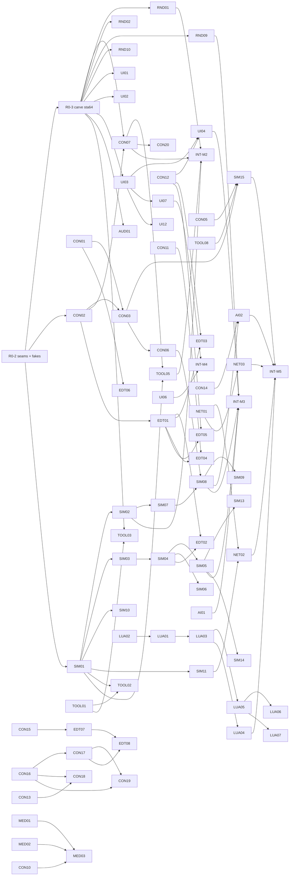

# Work plan: seams and parallel packages

How M2–M5 get built by many agents at once. The plan fixes the contracts
between systems first (the **seams**), gives every lane a fake for each thing
it depends on, and splits the rest into **work packages** that each own their
files and end in a check an agent can run itself.

It builds on [TESTBENCH.md](TESTBENCH.md) (merged; TOOL-01..05 are on main),
whose scenes, scenarios and digest checks are the done criteria for most packages,
and on PR #1 (merged), which brought `a2fmt::Odf::load_layered`.

## How to use this doc

**Assigning work.** Round 0 runs first and alone. After that, any package
whose *needs* are merged, or whose *can start against* fakes exist, is ready.
Open one GitHub issue per package (title `[SIM-06] Weapons`, label
`lane:sim`), assign it, and let the agent work on its branch. How sessions
check, claim and release packages: [AGENTS.md](../AGENTS.md).

**Picking up a package.** Read its row, the seams it names and the files it
owns. Work only in those files. Start against the listed fakes, not against
another package's unmerged branch. Finish when the *done when* check passes on
your branch, and paste the evidence (test names, scenario report lines,
digest) into the PR. If you need a seam to change, stop and open a seam PR
("Integration and merge protocol").

Status lives in the issues, not here. This file changes only when the plan
changes.

## Where main is (2026-11-12, refreshed after #447)

The round-0 carve is done: R0-2 (seams and fakes) and R0-3 (the `sta64` split)
are merged, and the sim, content database, bench, HUD and front end all run
on the seams. Per merged PR titles, the packages on main are:

- **CON:** 01-34, 36, 38, 41 and 43 (CON-35, 37, 39, 40, 42, 44 and 45 are not).
- **SIM:** 01-23 (SIM-24-32 are not; SIM-24 has only its row on main, #358).
- **RND:** 01-11, 13, 14, 16-20, 22, 27 and 28 (RND-12, 15, 21, 23-26, 29 and 30 are not; RND-15 has only its row on main, #175).
- **UI:** 01-10, 12-15, 17, 18 and 27 (UI-11, 16, 19-22, 25, 26 and 28-30 are not; UI-26 has only its row on main, #358; UI-18 stays open for its reference-frame gate).
- **AUD:** 01-05 (AUD-06 is not). **AI:** 01-03. **INT:** M2, M3, M4.
- **TOOL:** 01-05, 07, 08 and 10 (TOOL-06, 09, 11 and 12 are not).
- **LUA:** 01-05 and 09 (LUA-05 stays open until its inventory reports 0 missing calls; LUA-06-08 are not).
- **EDT:** 06-11 (EDT-01, 02, 04, 05 and 12 are not; EDT-03 has only a row amendment on main).
- **MED:** 01, 02. **NET:** 01 (NET-02-06 are not).

The TESTBENCH design, `sta_bench`, the `sta64` bench modes and frames
(`docs/TESTBENCH.md`) are on main. Status per package lives in the issues;
this list is a snapshot of merged PR titles, not a tracker. `sta_bzn` reads
all installed maps; `sta_mission` resolves scripts and runs installed Lua
missions; `docs/data/` inventories every ODF/CFG/AIP key.

## Round 0: the serial part

| ID | Package | Contents | Model |
|---|---|---|---|
| R0-1 | This doc | `docs/WORKPLAN.md`, pointers in ROADMAP/README | Opus |
| R0-2 | Seams as code + fakes | below | Opus |
| R0-3 | Carve `sta64` | below | Sonnet |

**R0-2 contains, and nothing else:**

1. New crate `crates/sta_core` (no deps): `Fixed` and `Vec3` moved from
   `sta_sim` (re-exported there, so no caller changes), `EntityId`,
   `PlayerId`, `TeamId`, `Tick`, `TICK_HZ`, `ContentKey`, `SEAM_REV`.
2. New crate `crates/sta_content`: the types of the content seam
   (`ContentDb`, `UnitDef`, `WeaponDef`, `Profile`, `Features`, `OdfIndex`,
   `MapDef`) with `ContentDb::builder()` working and every loader returning
   `Err(Unsupported)`; `sta_content::fake` (below).
3. In `sta_sim`: modules `command`, `event`, `view`, `setup`, `source`;
   `Sim` implements `WorldSource` with today's movement; `Sim::step` returns
   `TickOutput`; `fake::ScriptedSource`, `fake::ViewLog`. Existing tests keep
   their digests (the digest gains nothing new until SIM-01).
4. In `sta64`: `clock.rs` (`AnimClock`, wall mode working), `sim_link.rs`
   (`SimLinkPlugin`, messages, `SimEntity`, `CommandQueue`, `Selection`),
   `plugins.rs`, `app.rs` (`AppState`, `GameSet`, `LaunchConfig` with every
   planned flag parsed; unimplemented ones log `unsupported: <flag>`).
5. Workspace `Cargo.toml`: members and `[workspace.dependencies]` for every
   crate this plan creates (`sta_core`, `sta_content`, `sta_bench`,
   `sta_net`, `sta_ai`), each an empty `lib.rs` with a crate doc stating its
   owner lane; external deps `serde`, `json5`, `postcard`.
6. `clippy.toml` for `sta_core` and `sta_sim`: `disallowed-types`
   (`HashMap`, `HashSet`) and `disallowed-methods` (`f32::sin` and the other
   platform maths, `Instant::now`, `SystemTime::now`); see Determinism.
7. `docs/ARCHITECTURE.md`: `sta_core`/`sta_content` in the layer diagram.

Done when: `cargo test --workspace` and clippy pass on all four CI targets;
`cargo doc` shows every seam type; the fakes have their own tests.

**R0-3 contains:** `git mv` of the existing `sta64` modules into lane
directories (`render/` ← `model_scene`, `sprites`, `particles`, `textures`,
`planet`, `nebula`, `rock`, `space`, `surfaces`, `strategic`, `*.wgsl`;
`viewer/` ← `viewer`; `map/` ← `map`; `input/` ← selection and order code
from `units.rs`; `render/units.rs` ← placement); `units.rs`'s tick and
interpolation replaced by `sim_link` + `AnimClock`; `map.rs`'s ODF cache
replaced by a `ContentRes(Arc<ContentDb>)` built through a temporary
`sta_content::legacy` shim (CON-03 replaces it). Done when the map view
behaves as on main (TODO.md "Needs your check" items unchanged) and the
existing `units.rs` motion tests, ported to `AnimClock`, pass.

Packages that need nothing from round 0 may start while it runs: CON-01,
CON-08, CON-09, TOOL-01, LUA-02's deterministic `math.*` half.

## Seams

Each seam: owner, sketch, invariants, dependency direction, evolution.
Crate direction, enforced by `Cargo.toml`:

```
formats:   a2fmt, sta_fpq, sta_vfs, sta_odf, sta_bzn, sta_assets, sta_surface  (no sta_core)
sta_core   <- sta_content (+ sta_odf, sta_vfs, sta_bzn, json5)
sta_content <- sta_sim <- sta_mission, sta_ai, sta_net, sta_bench
all of the above <- sta64 (the only Bevy crate)
```

No Bevy-free crate depends on `sta64`; `sta_sim` never depends on
`sta_mission`, `sta_ai` or `sta_net` (they plug in through traits).

### S1. Core types — `sta_core`

```rust
pub use fixed::Fixed;                       // 32.32, moved from sta_sim
pub struct Vec3 { pub x: Fixed, pub y: Fixed, pub z: Fixed }
pub struct EntityId(pub u32);               // never reused; 0 = none
pub struct PlayerId(pub u8);                // 0..=7 players, SCRIPT = 254, BENCH = 255
pub struct TeamId(pub u8);
pub type Tick = u64;
pub const TICK_HZ: u32 = 30;
pub struct ContentKey(pub u32);             // index into ContentDb's name-sorted table
pub const SEAM_REV: u32 = 3;                // versions the postcard command/view surface
```

- Space is the maps': Direct3D left-handed, +Y up, ODF/BZN units. Headings
  are unit vectors in XZ (`(x, z)`), as `sta_sim` has them; the sim uses no
  trigonometry. Durations are ticks; ODF seconds convert once, at content
  load, rounding half up.
- `ContentKey`s are equal on every peer that loaded the same content, because
  they index names sorted bytewise. Never persist a key without the
  `ContentDb::hash()` it came from.
- Evolution: additive only. Moving or renaming a type is a breaking change.

The [starting-personnel prerequisite](STARTING_PERSONNEL.md) introduces revision
3 for optional player crew and recorded setup choices. Replay format 2 rejects
previous formats/revisions before decoding. Snapshot format 12 appends a
mandatory personnel record; narrow readers retain historical 8/9/10 (seam 1)
and 11 (seam 2). Historical records keep crew/officer maxima unknown, and only
the newly introduced rules-hash contribution may be omitted for that save
migration. Current snapshots and network identities require the full hash.
Perceived identity remains independent of real ownership as in
[PERCEIVED_TEAM.md](PERCEIVED_TEAM.md). Desktop and Android share the same state
and rules; the December 2026 desktop alpha remains the priority.

### S2. Commands — `sta_sim::command`

```rust
pub struct Command { pub player: PlayerId, pub seq: u32, pub kind: CommandKind }
#[non_exhaustive] pub enum CommandKind { Order(Order), Edit(Edit) }
#[non_exhaustive] pub enum Order {
    Move { units: Vec<EntityId>, to: Vec3, queue: bool },
    Stop { units: Vec<EntityId> },
    Attack { units: Vec<EntityId>, target: EntityId },
    Build { builder: EntityId, what: ContentKey, at: Option<Vec3> },
    Formation { units: Vec<EntityId>, kind: u8 },
    Special { units: Vec<EntityId>, slot: u8, target: Target },
    Cloak { units: Vec<EntityId>, on: bool },
    Mine { units: Vec<EntityId>, node: EntityId },
}
#[non_exhaustive] pub enum Edit {           // TESTBENCH's Command::Bench
    Spawn { odf: ContentKey, player: PlayerId, pos: Vec3, heading: (Fixed, Fixed) },
    Kill(EntityId), Damage(EntityId, Fixed), Heal(EntityId), Immortal(EntityId, bool),
    SetEnergy(EntityId, Fixed), Tech(PlayerId, ContentKey), Cargo(PlayerId, u8, Fixed), …
    Present(Presentation),                   // missions: shown, not simulated (sta_sim::present)
    Subsystem(EntityId, Subsystem, bool), Alert(EntityId, AlertState),
    MaxSpeed(EntityId, Option<Fixed>), Targetable(EntityId, bool), Decommissionable(EntityId, bool),
}
pub trait CommandRouter {                    // local today, lockstep in sta_net
    fn submit(&mut self, cmd: Command);
    fn take_ready(&mut self, tick: Tick) -> Option<Vec<Command>>; // None = stall
}
pub struct LocalRouter;                      // everything lands on the next tick
```

- Commands are the only input to `Sim::step`. A tick applies its batch
  sorted by `(player, seq)`. Invalid commands (dead unit, wrong owner) are
  ignored deterministically and produce `SimEvent::Rejected`.
- `Edit` is accepted from `PlayerId::BENCH` (bench builds only) and
  `PlayerId::SCRIPT` (missions); lockstep peers reject it from players. Both
  are in the command log and the digest, so edited runs replay (TESTBENCH's
  open question, decided this way; see D4).
- Evolution: new variants and new fields with defaults within a milestone.
  The wire encoding (`postcard`) is versioned by `SEAM_REV`.

### S3. World view — `sta_sim::view`

```rust
pub struct WorldView {
    pub tick: Tick, pub digest: u64,
    pub units: Vec<UnitView>,       // ascending id
    pub players: Vec<PlayerView>,   // resources, officers, eliminated, relation table
}
pub struct UnitView {
    pub id: EntityId, pub def: ContentKey, pub owner: PlayerId,
    pub pos: Vec3, pub heading: (Fixed, Fixed), pub speed: Fixed,
    pub hull: [Fixed; 2], pub shields: [[Fixed; 2]; 4],   // [now, max]; fore/aft/port/stbd
    pub flags: UnitFlags,           // cloaked, dying, building, docked, selectable
    pub progress: Option<Fixed>,    // build/construction 0..1
}
pub struct TickOutput { pub view: Arc<WorldView>, pub events: Vec<SimEvent> }
pub trait WorldSource: Send {
    fn step(&mut self, commands: &[Command]) -> TickOutput;
    fn view(&self) -> Arc<WorldView>;
}
```

- The view is an immutable snapshot built at the end of each tick; readers
  never borrow `Sim`. Render, UI, audio, AI, Lua and the bench read only
  views and events.
- Everything in it is `Fixed`; readers convert with `to_f32` and never feed
  the result back.
- Per-player visibility comes later as `WorldView::visible_to(PlayerId)`
  (SIM-12); until then the view is omniscient.
- Evolution: fields are added, never removed, within a milestone.

### S4. Sim events — `sta_sim::event`

```rust
#[non_exhaustive] pub enum SimEvent {
    Spawned { id: EntityId }, Destroyed { id: EntityId, by: Option<EntityId> },
    Fired { shooter: EntityId, weapon: ContentKey, hardpoint: u8, target: Target },
    Hit { target: EntityId, by: EntityId, weapon: ContentKey, facing: u8,
          shield: Fixed, hull: Fixed, at: Vec3 },
    ShieldsDown { id: EntityId, facing: u8 },
    BuildStarted { builder: EntityId, what: ContentKey },
    Built { builder: EntityId, id: EntityId },
    Delivered { player: PlayerId, resource: u8, amount: Fixed },
    CloakChanged { id: EntityId, on: bool },
    Rejected { player: PlayerId, seq: u32 },
    PlayerEliminated { player: PlayerId },
    Present(Presentation),                   // from Edit::Present, the tick it applies
}
```

- Emitted in deterministic order and identical on every peer, so marks and
  mission triggers can key on them; not hashed separately (they follow from
  state).
- Client-side events that the sim never sees are Bevy messages in
  `sta64::sim_link`: `OrderIssued { units, kind }` (voice acks play on input,
  not on the tick), `SelectionChanged`.
- Evolution: new variants freely (`#[non_exhaustive]`); consumers must
  ignore unknown ones.

### S5. Content database — `sta_content`

```rust
pub struct ContentDb { /* name-sorted defs, profile, features, hash */ }
impl ContentDb {
    pub fn load(vfs: &Vfs, profile: Profile, index: &OdfIndex) -> Result<(ContentDb, Vec<Warning>)>;
    pub fn builder() -> ContentBuilder;             // fakes and JSON5
    pub fn key(&self, odf: &str) -> Option<ContentKey>;
    pub fn unit(&self, k: ContentKey) -> Option<&UnitDef>;
    pub fn weapon(&self, k: ContentKey) -> Option<&WeaponDef>;
    pub fn hash(&self) -> u64;                       // folded into tick 0's digest
    pub fn profile(&self) -> Profile; pub fn features(&self) -> &Features;
}
pub struct UnitDef {
    pub key: ContentKey, pub odf: String, pub class: ClassLabel, pub race: String,
    pub model: String, pub scale: Fixed, pub movement: MoveStats,
    pub hull: Fixed, pub shields: ShieldDef, pub crew: Fixed, pub sensor: Fixed,
    pub hardpoints: Vec<Hardpoint>,                  // weapon key, node name, arc
    pub build: BuildDef,                             // cost, ticks, build list, officers
    pub sounds: SoundRefs, pub fx: FxRefs,           // names only; resolved client-side
    pub raw: Arc<sta_odf::Odf>,                      // unread keys stay reachable
}
pub enum Profile { Native, Fo4, Sta2Classic, Sta1Classic }
pub struct Features { pub directional_shields: bool, pub fire_arcs: bool,
    pub point_defense_cycles: bool, pub pay_on_queue: bool, … }  // one per NATIVE_FEATURES row
pub struct OdfIndex { /* stem -> (path, layer), duplicates */ }
```

- Every number reaches the sim as `Fixed`, converted once here
  (`Fixed::from_f64` of the parsed value, as `sta_sim` already rules). No
  other crate parses ODF numbers for the sim.
- Profile defaults first, then per-ODF keys switch features per unit.
- `ContentDb` is immutable after load and shared as `Arc`.
- Evolution: new defs and fields freely; renaming a field is breaking. Keys
  STA64 reads are marked in `docs/data/odf_keys.csv` by
  `tools/data_inventory.py`.

### S6. Maps — `sta_content::map`

```rust
pub struct MapDef {
    pub name: String, pub label: Option<String>, pub mission: Option<String>,
    pub bounds: (Vec3, Vec3),
    pub starts: Vec<StartPos>,                       // per player slot
    pub objects: Vec<MapObject>,                     // odf, owner slot, pos, heading, label
    pub regions: Vec<Region>,                        // nebula / asteroid field volumes (Fixed)
    pub scenery: Scenery,                            // f32; render only: sky, starfield,
}                                                    //  planets, lights, ambient
impl MapDef {
    pub fn from_bzn(m: &sta_bzn::Map, db: &ContentDb) -> (MapDef, Vec<Warning>);
    // Selected VFS stem relative to bzn/, without .bzn; additive named context.
    pub fn convert_bzn_named_in(m: &sta_bzn::Map, selected_stem: &str,
        db: &ContentDb, vfs: &sta_vfs::Vfs, index: &OdfIndex) -> Conversion;
    pub fn empty() -> MapDef;                        // the bench's built-in empty map
}
```

- `sta_bzn` stays a pure format crate; the conversion lives here because it
  needs ODF classes (`physicsFile`, `dont_load_SOD`, start markers).
- The sim spawns from `objects`, `starts` and `regions` only; `scenery`
  never enters the sim or the digest.
- JSON5 maps (native format) deserialize into the same type.
- Named conversion carries the selected source identity before conversion;
  the A1 MDF adapter and unchanged old APIs follow the
  [selected-map seam contract](SELECTED_MAP_CONVERSION.md).

### S7. Game setup and controllers — `sta_sim::setup`

```rust
pub struct GameSetup { pub seed: u64, pub map: Arc<MapDef>, pub content: Arc<ContentDb>,
    pub players: Vec<PlayerSetup>, pub options: GameOptions }
pub struct PlayerSetup { pub id: PlayerId, pub team: TeamId, pub race: String,
    pub control: Control }                           // Human, Remote, Ai(name), Idle
impl Sim { pub fn from_setup(s: &GameSetup) -> Sim; }
pub trait Controller: Send {                         // AI, missions
    fn think(&mut self, view: &WorldView, events: &[SimEvent], out: &mut Vec<Command>);
}
```

- UI (Instant Action, lobby) produces a `GameSetup`; the sim, net and bench
  consume it. A replay is `GameSetup` + command log + digests.
- Controllers run on one host and send their commands through the
  `CommandRouter` like a player (assumption D3), so AI and Lua need not be
  bit-deterministic and replays never rerun them.

### S8. Client link — `sta64::sim_link`

```rust
#[derive(Resource)] pub struct SimLink { source: Box<dyn WorldSource>, router: Box<dyn CommandRouter>,
                                         prev: Arc<WorldView>, curr: Arc<WorldView> }
#[derive(Component)] pub struct SimEntity(pub EntityId);
#[derive(Resource)] pub struct SimEntities(BTreeMap<EntityId, Entity>);
#[derive(Message)] pub struct SimMsg(pub SimEvent);          // after each tick
#[derive(Message)] pub struct OrderIssued { pub units: Vec<EntityId>, pub kind: OrderKind }
#[derive(Resource)] pub struct CommandQueue(Vec<CommandKind>); // input pushes; link stamps player/seq
#[derive(Resource)] pub struct Selection(pub Vec<EntityId>);
#[derive(Resource)] pub struct ContentRes(pub Arc<ContentDb>);
#[derive(Message)] pub struct PlaySound { pub name: String, pub at: Option<Vec3>, pub bus: Bus }
```

- `SimLinkPlugin` decides how many ticks run this frame from `AnimClock`,
  steps the source, shifts `prev`/`curr`, and sends `SimMsg`s. Nothing else
  calls `step`.
- Interpolation: a thing is drawn at `lerp(prev, curr, AnimClock::alpha())`;
  heading lerps then renormalises. An id only in `curr` appears at `curr`; an
  id only in `prev` is gone (its `Destroyed` event drives the effect).
- Render-side entities link to the sim only by `SimEntity`; nothing keys on
  Bevy `Entity` across frames.
- `PlaySound` is how UI, render and input ask for audio without depending on
  the audio module.

### S9. Animation clock — `sta64::clock`

```rust
#[derive(Resource)] pub struct AnimClock { /* mode, sim_time, alpha, paused, seed */ }
impl AnimClock {
    pub fn now(&self) -> f64;              // sim time at last tick + alpha * tick
    pub fn alpha(&self) -> f32;
    pub fn wall(&self) -> f64;             // only for loops allowed to run while paused (wall mode)
    pub fn seed(&self) -> u64;
    pub fn entity_key(&self, id: EntityId) -> u64;
    pub const SUBSTEP: f64 = 1.0 / 120.0;  // fixed step for anything integrated per frame
}
```

TESTBENCH's rule, verbatim in effect: anything that moves on screen reads
`AnimClock`, never `Time`; cosmetic seeds come from `seed()` and
`entity_key(EntityId)`; integrated effects advance in `SUBSTEP`s. `bench`
mode advances one fixed `Step=` per `App::update`.

### S10. Plugins, sets and app modes — `sta64::{plugins, app}`

```rust
pub enum Mode { Viewer, Map, Game, FrontEnd, Bench { headless: bool, sim_only: bool } }
#[derive(States)] pub enum AppState { Boot, FrontEnd, Loading, InGame, Viewer }
#[derive(SystemSet)] pub enum GameSet { Input, SimLink, Interpolate, Render, Ui, Audio, Bench }
pub fn add_plugins(app: &mut App, cfg: &LaunchConfig) {
    // render — one line per package, append inside your lane's block
    // ui —
    // audio —
}
```

- Each package ships one `pub struct XxxPlugin` in its own module, registers
  systems only in its `GameSet`, gates them on `AppState`, and reads seams,
  not other packages' internals.
- `plugins.rs` adds render/UI/audio plugins only when the mode has a window;
  `--sim-only` adds none.
- Per-package settings: a `#[derive(Resource, Deserialize, Default)]` struct
  under the package's own section of `settings.toml` (`[render.nebula]`),
  loaded by `app.rs`.

### Determinism rules (sim crates: `sta_core`, `sta_content`, `sta_sim`)

1. No `f32`/`f64` in state or in arithmetic that feeds state; floats only at
   load (S5) and out to rendering. No platform maths.
2. `BTreeMap`/sorted `Vec` only; no `HashMap`/`HashSet` (clippy-enforced).
3. One seeded `Rng`; cosmetic randomness never touches it.
4. Commands apply at tick boundaries in `(player, seq)` order; ids are never
   reused; entities iterate by ascending id.
5. No threads, I/O or clocks inside `step`.
6. Golden digests at fixed ticks are committed and checked on all four CI
   targets (TOOL-06).

## Fakes and fixtures

Every fake ships in round 0 (R0-2) unless marked, lives with the seam it
fakes, and contains no game data.

| Fake | Where | Stands in for | Used by |
|---|---|---|---|
| `sta_content::fake::db()`: 6 units (`fx_cruiser`, `fx_frigate`, `fx_station`, `fx_yard`, `fx_miner`, `fx_moon`), 3 weapons (beam, torpedo, point defence), built in Rust | `crates/sta_content/src/fake.rs` | ODF content DB (CON-03) | SIM, AI, LUA, TOOL |
| JSON5 copies of the same units + boxy GLB models | `fixtures/content/`, `fixtures/models/` (CON-04) | real installs in CI | RND, TOOL CI scenes |
| `MapDef::empty()`, `fake::two_bases()` (2 starts, moon, nebula region, asteroid region, sky/planet scenery) | `sta_content::map`, `fake.rs` | BZN → MapDef (CON-07) | SIM-01, RND, UI, TOOL |
| `ScriptedSource`: a `WorldSource` that plays a JSON5 timeline (`at 30: Fired …`, `at 45: Hit …`, units on rails) | `crates/sta_sim/src/fake.rs` | combat/economy sim | RND FX, AUD, UI HUD |
| `ViewLog`: record a real run's `TickOutput`s to `postcard`, replay as a `WorldSource` | same | any sim | render perf, AUD |
| `NullAudio`: records `PlaySound`/positional requests | `sta64/src/audio/null.rs` (AUD-01) | audio backend | UI, tests |
| `LocalRouter`, `LoopbackNet` (two routers over a channel) | `sta_sim::command`; `sta_net` (NET-02) | relay | NET, TOOL |
| `IdleController` | `sta_ai` (AI-01) | skirmish AI | INT-M3 |
| `fixtures/odf/`: hand-written ODFs: includes, FO self-include, A1 `addon/`, `;`/`f` numbers | CON-01/02 | install ODFs | CON |

## Ownership and shared files

Every package owns the paths in its *owns* column. Hotspots and their rules:

| Hotspot | Rule |
|---|---|
| `sta64/src/main.rs`, `app.rs` | R0 and INT packages only, with the narrow TOOL-10 platform-entry exception below. |
| `sta64/src/plugins.rs` | Append-only: one `app.add_plugins(...)` line per package, at the end of its lane's block. Rebase conflicts are resolved by keeping both lines. |
| `sta64/src/sim_link.rs`, `clock.rs`, `sta_core`, the seam modules of `sta_content`/`sta_sim` | Seam files: changed only by seam PRs. |
| Workspace `Cargo.toml` | Members written once in R0-2. A new external dependency is one line appended to `[workspace.dependencies]`, named in the PR description. A new crate needs a seam PR. |
| `sta64/Cargo.toml`, `Cargo.lock` | Append one dependency per line. Never hand-merge `Cargo.lock`: rebase, then `cargo update -w`. |
| `.github/workflows/*` | TOOL lane. Others request a job in their PR description; TOOL-06 adds it. |
| `docs/ROADMAP.md`, `TODO.md` | Ticked only by INT packages and the user. `TODO.md` stays the user's eye-check list; packages add `[?]` lines only under "Needs your check", append-only. |
| `docs/NATIVE_FEATURES.md` | A package may change the Status cell of the rows it implements, nothing else. |
| `docs/data/*` | Generated. Never hand-edited or hand-merged; rerun `tools/data_inventory.py`. |
| `bench/scenes/`, `bench/scenarios/`, `fixtures/` | New files only; a package edits only files it added. Shared fixtures (`fixtures/content/`) are CON-04's; others append new files. |
| Existing `sta64` modules after R0-3 | Owned as listed per package below; one owner each. |

## Lanes and work packages

Android is a planned first-class native platform using the same engine and
gameplay implementation. The December 2026 desktop alpha remains the immediate
priority. TOOL-10 is isolated preparation, not an additional desktop release
gate or permission to simplify gameplay. Its documented entry seam may extract
the existing client launch into `lib.rs`, retain the desktop CLI wrapper, and
route platform storage/lifecycle inputs; it does not authorize a core rewrite.
The Android-only lifecycle condition may also gate the existing viewer/map
update chains and HUD command set, and discard transient input state; it must
not change desktop scheduling or committed commands. The existing theme click
dispatcher may check the same gate because its observers run outside these
sets. Touch, safe-area UI,
device performance and cross-play remain subsequent gates.
See [Android support](ANDROID_SUPPORT.md), [compatibility](ANDROID_COMPATIBILITY.md)
and [roadmap](ANDROID_ROADMAP.md). No Android completion date is assigned.

Columns: **needs** must be merged first; **against** lists the fakes that let
work start earlier; size S ≤ 1 day, M ≤ 1 week, L > 1 week of agent work;
model: Haiku for mechanical work, Sonnet by default, Opus for hard-to-reverse
design. `✓main` marks work already on main that the package moves behind a
seam rather than writes.

**Modding rules are decided:** [MODDING_DECISIONS.md](MODDING_DECISIONS.md) (D1-D13, accepted) binds every package that touches mod loading, the VFS mount, profiles, `RTS_CFG.h`/ODF rules, render recipes or mission Lua. Packages CON-33..36, RND-28 and LUA-09 implement it.

**Armada I is in v1** (D5 as amended 2026-11-12, approved by Tammy), the stock game only; mods of Armada I come later. The
A1 packages (CON-15, CON-25..28, UI-19, LUA-06, MED-04 and the A1 parts of the
shared ones) are v1 work and join the milestones their needs allow: UI-19 in
INT-M7, LUA-06 and MED-04 in INT-M6. CON-38..42 close what the merged A1 map
support lacks. HUD packages stay with the HUD lane.

**Principle: data first.** Missing behaviour is first looked up in the original
games' data (ODF keys, `RTS_CFG.h`/`ART_CFG.h`, tech trees, GUI and sprite cfg,
map files of the A1/A2/FO installs and mods) and implemented driven by that
data. No hard-coded behaviour, and no invented data structure where an existing
format carries it. Package *done when* checks name the file and key a value is
read from and verify it against the installs. When it is unclear how a game or
mod behaves, measure it in the original (data, documentation, static analysis
or decompilation of the executable, a test bench around the original game)
rather than guessing or inventing behaviour; if measuring needs a plan or new
tooling, that is acceptable work (Cedric, 2026-11-12).

**Principle: stock parity and existing mods first, enhancements second.** Every
game starts looking and behaving like its stock self (HUD, nebulae,
hulls, beams, cloak, pathing, cutscenes). Refit-derived effects and the generic
LCARS kit are kept in the repository and stay selectable as options or mods
(UI-17, RND-22); they are not the default and are not deleted. Where a package
below says "Refit" it describes the optional enhancement profile unless it is
a Stock package. Parity is judged against reference frames of the stock games.
Exception: **menus** (front end, in-game options, campaign screens) copy the
stock layout and flow but are our own implementation and art, not the games'
assets; the HUD and in-match effects are the stock-parity part.

### Content and formats (CON)

| ID | Package | Owns | Needs | Against | Unlocks | Done when | Size | Model |
|---|---|---|---|---|---|---|---|---|
| CON-01 | FO self-include rule in `sta_odf::resolve` (adopt `a2fmt::Odf::load_layered` semantics: a file may include its own name from a lower layer) | `crates/sta_odf/` | — | `fixtures/odf/` | CON-02, CON-03 | Fixture test: self-include resolves, true cycle still `IncludeCycle`; install-gated: 0 `IncludeCycle` over all FO4 ODFs | S | Sonnet |
| CON-02 | ODF index: all ODF folders, recursive, A1 `addon/`, duplicate warnings (replaces `map.rs` stem cache) | `sta_content/src/index.rs` | R0-2 | synthetic `Vfs` | CON-03, CON-07 | Unit tests; `--example odf_index` prints counts and duplicates for A1/A2/FO | M | Sonnet |
| CON-03 | Content DB from ODF: `UnitDef`, `WeaponDef`, movement (from `units.rs`), build, sounds, FX refs; replaces R0-3's shim | `sta_content/src/{odf,unit,weapon}.rs` | CON-01, CON-02 | `fake::db()` | SIM-04+, AUD-02 | Every FO4 and A2 craft ODF yields a def or a listed warning (install-gated); `odf_keys.csv` ✓ column regenerated | L | Sonnet |
| CON-04 | JSON5 content + synthetic fixtures (units, weapons, GLB boxes), schema doc | `sta_content/src/json5.rs`, `fixtures/content/`, `fixtures/models/` | R0-2 | — | TOOL-06, CI scenes | `fixtures/content` loads to the same `hash()` as `fake::db()` | M | Sonnet |
| CON-05 | Profiles and feature switches: profile from mod chain, defaults table, per-ODF overrides | `sta_content/src/profile.rs` | R0-2 | — | SIM combat rules | Table test per profile; FO4 / STA2 Classic / STA1 Classic detected on installs | M | Sonnet |
| CON-06 | Tech tree and build lists (`.tt`, FO techtree `.xml`, `docs/data/techtree.md`) | `sta_content/src/techtree.rs` | CON-03 | `fake::db()` | SIM-09, AI-02, UI-04 | All installed `.tt`/`.xml` parse; prerequisites test | M | Sonnet |
| CON-07 | `MapDef::from_bzn`: objects, start positions, regions, scenery, mission; `map.rs` reads `scenery` | `sta_content/src/map.rs` (not the seam types) | R0-3, CON-02 | `two_bases()` | SIM-01, TOOL-05 | All 517 maps convert with counts equal to `sta_bzn`'s; start positions found on every multiplayer map | M | Sonnet |
| CON-08 | M3D 1.93 layout; typed Legacy LOD/light data and explicit native chunk contexts; [pre-code contract](M3D_NODE_SUPPORT.md) | sta_assets m3d/chunks/tests, narrow shared Model variants/constructors and exhaustive client matches; model_info/tests; resolver-backed list_models filter/test in lib.rs; owning docs | — | original synthetic streams and hash-preserved installed M3D corpus | RND-07 | Every valid installed M3D parses by its explicit context; expected native historical refusals reported; LOD/light nodes listed by model_info, finest-LOD/index/malformed-input/legacy checks pass; exact light playback, chunk destruction and dynamic LOD remain explicit RND limits | M | Lead compatibility/integration; bounded inspector/tests |
| CON-09 | Static glTF/GLB → shared Model and viewer; pre-code [M1 contract](M1_ASSET_MODEL_COMPLETION.md) | new sta_assets gltf/tests/PBR annotations; narrow asset dispatch/constructors/dependencies; model_scene/textures native PBR integration and viewer dispatch; owning docs | — | original synthetic models and VFS resources | native content | Static glTF/GLB fixtures preserve geometry/hierarchy/materials and resource errors; VFS-backed offscreen textured draw; explicit unsupported advanced features; legacy regressions, Clippy/workspace checks | M | Lead integration, bounded parser delegation |
| CON-10 | Audio data: sound lookup by bare name (OGG > WAV > MP3 per layer), **WAV, MP3 and OGG (Vorbis) decode** in pure Rust (permissive licences only), `audio.odf`/`events.odf` sound tables; the formats STA64 supports (Immy, 2026-11-09) | `sta_assets/src/audio.rs` | — | — | AUD-01..04, MED-03, LUA-06 | Every sound named by FO4 ODFs and the A1/A2 mission DLLs resolves or is listed; every installed WAV, MP3 and OGG decodes | M | Sonnet |
| CON-11 | Language packs: `Dynamic_Localized_Strings.h`, `label.map` → `StringTable` (shares `sta_mission::Labels`) | `sta_content/src/strings.rs` | R0-2 | — | UI-09 | All installed packs parse; lookup test | S | Haiku |
| CON-12 | GUI cfg (`docs/data/cfg.md`) → typed layouts for HUD/menus | `sta_content/src/gui_cfg.rs` | R0-2 | — | UI-04 | All 43 FO `.cfg` parse; layout snapshot tests | M | Sonnet |
| CON-13 | Mod discovery: list mods (`info.ini`), chain, metadata | `sta_vfs/src/mods.rs` | — | temp dirs | UI-07 | Unit tests; lists installed mods | S | Haiku |
| CON-14 | AIP files (`docs/data/aip.md`) → typed AI params | `sta_content/src/aip.rs` | R0-2 | — | AI-02 | All installed `.aip` parse | S | Haiku |
| CON-15 | Armada I `.zfs` archives: reader, mounted per layer (`.odf` → `odf/`, `.tt` → `techtree/`, rest at root; loose > FPQ > ZFS), `Source::Zfs`, `Vfs::read_from` | `sta_vfs/src/zfs.rs`, ZFS mount in `sta_vfs/src/lib.rs` | — | synthetic archives | A1 content in CON-02/03/06 | Synthetic-archive tests; install-gated: A1 retail `assets.zfs` 516 entries, `objtxt.zfs` 81; `odf_index` resolves every A1 retail ODF | S | Sonnet |
| CON-16 | `.sta` reader and VFS mount ([STA_ARCHIVE.md](STA_ARCHIVE.md)): header, index, binary search by key, stored + Zstandard entries, per-file SHA-256, whiteouts; a mod folder's `*.sta` mounts in its layer below its loose files | `crates/sta_vfs/src/sta.rs`, the `.sta` mount in `sta_vfs/src/lib.rs` | — | hand-built archives | CON-17, CON-18, EDT-08 | Spec examples parse; every refusal in "Reading safely" has a test; a mounted `.sta` serves files and the ODF index finds its ODFs | M | Sonnet |
| CON-17 | `.sta` writer: reproducible packing (key order, fixed Zstandard level, no timestamps), store-when-not-smaller, `content_hash` | `crates/sta_vfs/src/sta_write.rs` | CON-16 | — | EDT-08 | Same folder packs to the same bytes twice; same files packed stored vs compressed give the same `content_hash`; write → read round trip | S | Sonnet |
| CON-18 | Mod manifests and load order: `manifest.toml` parse, `info.ini` `ParentMod` as a dependency, semver checks, cycle refusal, topological order with `[load]` hints; mod identity (`content_hash`) into `ContentDb::hash` | `crates/sta_vfs/src/manifest.rs`, `sta_vfs/src/order.rs` | CON-13, CON-16 | temp dirs | UI-07 (mod select), NET handshake | Table tests for ordering, missing/wrong-version dependencies and cycles; installed Roots mods order as `mod_chain` does today | M | Sonnet |
| CON-19 | `.sta` signatures: Ed25519 sign/verify of header + `content_hash`, trust store, status (trusted / unknown key / unsigned / tampered) | `crates/sta_vfs/src/sta_sign.rs` | CON-16, CON-17 | — | UI-07 | Sign → verify; a flipped byte in any file, the index or the header reports tampered | S | Sonnet |
| CON-20 | Star Trek: Legacy `.sol` maps (BinaryMode SOL v3021): map metadata, bounds, start locations, placed objects (ODF, id, team, instance name, Matrix34) → `MapDef`; the mission script name kept (`.drl`/`.dsl`). Port of A2FOExtensions' `A2FOSOLMaps/sol_format.cpp` (Immy's own) | `crates/sta_bzn/src/sol.rs` | CON-07 for `MapDef` (parser first, against `MapDef::empty`) | hand-built SOL fixtures | maps | Fixture tests; `mpbajor_all.sol` gives 8 start locations and 19 objects, as A2FOSOLMaps validated; a SOL in `bzn/` appears in the map list and loads its objects | M | Sonnet |
| CON-21 | Menu and shell images: **BMP** decode (1/4/8-bit palette, 16/24/32-bit, RLE) beside the existing PNG path, found through the VFS like textures | `sta_assets/src/bmp.rs` | — | — | UI-06, UI-07, UI-08 | Every installed `.bmp` (A1, A2, FO) decodes; palette and RLE fixture tests | S | Sonnet |
| CON-22 | Start loadouts resolve: every race's skirmish start units (outpost, construction ship, freighters, the profile's start fleet) resolve a def and a model through the mod chain; the first playtest's Federation start drew nothing until #191 | `crates/sta_content/tests/loadout_install.rs` | CON-03, CON-13 | — | — | Install test over FO4, FO, DW and A2 (where mountable) lists each race's start units with their model and fails on any without one | S | Haiku |
| CON-23 | Skirmish start loadouts per race checked against the games: CON-22 (#217) found no race's start list holds freighters, and DW lists `fed`, `dom` and `borg` as playable next to `unitedfederation` and `dominion`. Read how A1/A2/FO/DW choose start units and playable races (race/loadout ODFs, `*.cfg`) and fix `Races::loadout` / `skirmish_races` to match | `sta_content/src/race.rs` | CON-22 | — | — | Install test: each install's start units and playable race list match the game's data, with the rule cited | S | Sonnet |

| CON-24 | Resolved legacy is_starbase metadata for exact mission classification: native-backed zero default and inherited ODF overrides, kept separate from actor kind; design in [LEGACY_STATION_FLAG.md](LEGACY_STATION_FLAG.md) | sta_content/src/def.rs UnitDef field/constructor, odf.rs native flag reader, db.rs conditional hash; new station_flag tests | CON-03, CON-05 | Synthetic ODFs, pinned GOG A1/A2/FO class readers and genuine v8 fixture | LUA-05 IsStation query after native class guard is verified | Explicit/inherited zero, verified profile-specific numeric prefixes/Boolean forms, invalid diagnostics, weapon exclusion and effective/no-op hash tests; default Native fixtures remain compatible; shared/consumer/Clippy/workspace checks pass | S | Lead |

| CON-25 | Explicit A1 BZN front-matter inspection and unsupported-import errors instead of successful empty text maps; pre-code contract in [A1_BZN_SUPPORT.md](A1_BZN_SUPPORT.md) | sta_bzn/src/a1.rs, narrow lib.rs module/error/dispatch, dedicated tests; contract docs | CON-07 | Synthetic LF/CRLF/malformed headers and read-only GOG A1 corpus | Validated future typed metadata/object/MDF importer | Lossless description and exact metadata offset, identified A1 inputs never silently become empty maps, A2 outputs unchanged, scoped/consumer/Clippy/workspace/Android library checks | S | Lead |

| CON-26 | A1 binary map body: native-backed metadata, count-checked placements, mission descriptors and retained AOI/AiPath data; pre-code contract [A1_BZN_IMPORT.md](A1_BZN_IMPORT.md) | sta_bzn/src/a1/body.rs; narrow a1/lib Map/error/dispatch; dedicated header/body tests; contract docs | CON-25 | Synthetic grammar/malformed/rescale fixtures, pinned GOG readers/writers, 49 A1 and 72 A2 maps | A1 scenes and subsequent MDF/start/mission integration | 49 nonempty A1 maps with declared counts matched; fields/paths retained, invalid/unsupported inputs explicit, A2 unchanged; scoped/consumer/Clippy/workspace/Android library checks | M | Lead |

| CON-27 | Original flat A1 install roots through the existing shared VFS/client entry point; pre-code contract [INSTALL_ROOTS.md](INSTALL_ROOTS.md) | sta_vfs/src/lib.rs narrow mount/doc/test-module; new flat_install_tests.rs; install/support docs and WORKPLAN row | CON-15 | Synthetic ZFS/Data/mod fixtures and read-only original A1 root | Actual desktop A1 map viewing; shared cross-platform mounting | Data priority/errors and archive order unchanged; root ZFS recognized only with no selected mod; corrupt/unsupported roots explicit; scoped/consumer/Clippy/workspace and real client headless report checks pass | S | Lead |

| CON-28 | Pure A1 MDF count and precise Camera_i start resolver; pre-code contract [A1_START_LOCATIONS.md](A1_START_LOCATIONS.md) | sta_bzn/src/a1/starts.rs, narrow a1.rs exports, dedicated tests and contract/support docs | CON-26 | Synthetic canonical/malformed MDF/path fixtures; pinned GOG new-game placement and read-only 49 A1 maps/28 MDFs | Subsequent selected-file-aware content conversion seam | Explicit checked count subset, exact first-path/first-point XYZ without grid inversion or partial results, original corpus and scoped/consumer/Clippy/workspace/Android library checks; no client/gameplay claim | S | Lead |

| CON-29 | Original loose-file A2 install mounting: `Vfs::mount_install` recognises a root with no Data child and no selected mod holding a case-insensitive `Armada2.exe` file plus `odf/` and `bzn/` directories, through the existing `push_dir` loader; Data keeps priority (including errors and the mod chain), the flat A1 ZFS rule is preserved and a requested mod is never discarded; contract [A2_INSTALL_ROOTS.md](A2_INSTALL_ROOTS.md) (#303, PR #304, merged) | narrow mount-selection lines in `crates/sta_vfs/src/lib.rs`; new `flat_a2_tests.rs`; `docs/A2_INSTALL_ROOTS.md` | CON-27 (merged) | synthetic directory fixtures (the stub executable is never run), read-only original A2 root | Direct `--install-root` on a loose-file A2 install | Complete/mixed-case/incomplete/wrong-type marker tests, selected-mod refusals, Data priority and errors and A1/archive semantics unchanged; the built client goes from NoData/0 maps to enumerating 72 A2 maps; no arbitrary-directory fallback | S | Lead |
| CON-30 | Resolved planet role metadata: typed immutable `PlanetRole` (Background or Producer) on `UnitDef`, resolved once from verified class/profile defaults and explicit `STA64_planetRole` overrides; known `planet_obj` units admitted without `unitName`; effective roles hashed; no numeric colony defaults and no consumers; contract [PLANET_ROLES.md](PLANET_ROLES.md) (#319, PR #320, merged) | new `sta_content/src/planet.rs`; `UnitDef` field/constructor in `def.rs`; export in `lib.rs`; class table and one resolver assignment in `odf.rs`; conditional role hash in `db.rs`; `tests/planet_roles.rs` | CON-03, CON-05 (merged) | synthetic ODF/profile/include fixtures, read-only A1/A2 content | CON-37, SIM-30, SIM-19 background lifecycle | Class/profile table, Native opt-in, none/background/producer overrides, inherited/case/invalid diagnostics, weapon exclusion, `unitName`-free admission and effective/no-op hash tests pass; Native fake hash unchanged | S | Lead |
| CON-31 | Fleet Operations identity on base Data: apply existing authored info.ini Name hint before the Data-layer skip; contract [FO_PROFILE_DETECTION.md](FO_PROFILE_DETECTION.md) | sta_content/src/profile.rs narrow loop/docs; new tests/base_profile.rs; owning doc | CON-02, CON-03, CON-05 (merged) | Synthetic Data/mod/ZFS/explicit-profile/feature fixtures and hash-preserved Roots content | Correct shared defaults for standalone FO bases on every platform | Base FO name auto-selects Fo4; explicit Profile/A1 precedence and existing hints/fallbacks retained; ContentDb defaults and zero overrides tested; shared/Clippy/workspace/Android library/unchanged-lock/full OS checks; no data or profile-default rewrite | S | Lead |
| CON-32 | Map writer: `sta_bzn` writes maps back (A1 binary and A2/FO as each is read) with a lossless round-trip test, plus a native `MapDef` save format for editor-made maps. Merged in #412 for A2/FO maps; the 49 Armada I maps are counted, not written (`WriteError::Armada1`), and CON-38 replaces that part | `crates/sta_bzn/src/write.rs` | CON-07, CON-26 | fixtures | EDT-12 | Read → write → read gives an equal `MapDef` for every installed map; byte-equal where the format is canonical; install-gated | M | Sonnet |
| CON-33 | Mount fix ([MODDING_DECISIONS.md](MODDING_DECISIONS.md) D6): `Vfs::mount_install` honours `info.ini` `standalone` and `ignoreParentMaps`; lineage from manifest `profile`, then `info.ini`, then heuristics (D4 lineage order), with the manifest `engine` version checked at mount; one mount entry point, signature kept so call sites do not change (recount the non-test call sites first: reviewers disagree, 5 vs ~50) | `crates/sta_vfs/src/lib.rs` (install mount), `info.ini` handling in `crates/sta_vfs/src/` | CON-31 (merged) | synthetic install trees | CON-34, CON-35, CON-36 | FO 4.0 mounts over Roots with no base Roots ODFs, tech trees or maps leaking in (synthetic fixture and install-gated); `ignoreParentMaps` test; call-site count recorded in the PR | S | Sonnet |
| CON-34 | Coverage report and `why` ([MODDING_DECISIONS.md](MODDING_DECISIONS.md) D7): `check-pack <root\|mod>` example/CLI printing key coverage weighted by use, changed-but-ignored `RTS_CFG.h`/`ART_CFG.h` keys, unresolved map references, and which layer and line won a file or key | `crates/sta_content/src/coverage.rs`, `crates/sta_content/examples/check_pack.rs`; `crates/sta_odf/src/lib.rs` (per-key provenance in the resolved `Odf` only, which key-level `why` needs) | CON-33, CON-01 | synthetic mod trees | CON-35, CON-36 | Report prints coverage for every installed mod (install-gated); STA2 Classic Enhanced lists its 8 changed cfg lines as ignored until CON-35; `why` names layer and line for a file and a key | M | Sonnet |
| CON-35 | Rules and digest ([MODDING_DECISIONS.md](MODDING_DECISIONS.md) D9, D10; **seam PR**): typed `Rules` struct fed from `RTS_CFG.h` (first the keys Classic Enhanced changes); the 7 raw ODF reads in `sta_sim/src/specials/mod.rs` (not 6) replaced by typed fields; derived digest that includes the tech tree, `ResourceModel` and the derived collision geometry per unit (ellipsoid axes, radius, centre offset, from the profile's SOD with `scaleSOD` and `shieldPad`; SIM-32 supplies the computation), folds in the existing ad-hoc hash markers, includes definition keys and excludes display strings, and is keyed so a mismatch names the differing unit and key or geometry value (D10, amended 2026-11-12 and approved by Tammy); replay and snapshot headers gain lineage and pack names (one format bump, shared with SIM-32, which changes every content digest) | `crates/sta_content/src/rules.rs`, `ContentDb::hash`, `sta_sim/src/specials/mod.rs` reads | CON-33, NET-01 | `fake::db()` | NET-02, CON-36 | Two in-process peers on Classic vs Classic Enhanced refuse to start and name the differing key; peers differing only by a texture, recipe folder or render-only model, or whose model geometry derives identically, are accepted; a unit whose derived geometry differs refuses the match and names the unit and the value; replay names its packs; digest covers tech tree, resource model and collision geometry; determinism rules respected (`Fixed`, no `HashMap`) | M | Opus |
| CON-36 | Self-include inheritance for `.h` cfg files and `.tt` tech trees ([MODDING_DECISIONS.md](MODDING_DECISIONS.md) D11): a file in an upper layer may include its own name from the layer below, as ODFs do (CON-01), with provenance | `crates/sta_content/src/` cfg and tech-tree loaders | CON-33, CON-01, CON-34 | synthetic mod trees | — | STA2 Classic Enhanced `RTS_CFG.h` and tech trees resolve over their parent by inheritance; provenance visible in CON-34 `why`; a true cycle is still an error | M | Sonnet |
| CON-37 | Typed planet numerics: `crewModifier`, `isColonizable`, `civilianPopulationModifier` and `maxCrewGain` become typed `UnitDef` fields with the observed native fallbacks and zero rules of [PLANET_ROLES.md](PLANET_ROLES.md) / [PLANET_OWNERSHIP.md](PLANET_OWNERSHIP.md) (A1 `crewModifier` 1.2, A2/FO `isColonizable` true, `civilianPopulationModifier` 1, `maxCrewGain` 10000; explicit or inherited zero stays zero, per profile, never shared across profiles); effective values in the content hash | `sta_content/src/planet.rs` (numerics beside CON-30's role); `UnitDef` fields in `def.rs`; the matching reads in `odf.rs` and `db.rs` | CON-30 (merged), CON-05 | synthetic ODFs, read-only A1/A2/FO planet ODFs | SIM-30, SIM-19 colony crew contribution | Table test per profile, inherited and explicit zero, invalid values diagnosed; values read from the planet ODF keys and checked against every installed A1, A2 and FO planet ODF; effective changes alter the hash, defaults leave the Native fake hash unchanged; raw keys stay reachable | S | Sonnet |
| CON-38 | Armada I map body writer: `sta_bzn` writes the A1 binary body (`Map::a1`: metadata, placements, mission descriptors, retained AOI/AiPath data) in the layout CON-26 reads, replacing `WriteError::Armada1`; native-class payload and light colours follow CON-40 and CON-41 | `crates/sta_bzn/src/write.rs` (A1 part), `crates/sta_bzn/src/a1/` | CON-32, CON-26 | synthetic A1 fixtures | EDT-12 for A1 maps | Fixture tests (header variants, every record type, malformed input rejected); every map of the stock A1 install reads, writes and reads back an equal `Map` (all 49, install-gated); A2/FO output unchanged | M | Sonnet |
| CON-39 | Armada I text BZN bodies: `sta_bzn::parse` reads `binarySave=false` A1 files into the shared `Map` instead of `UnsupportedArmada1Import` (lib.rs reports it as not implemented); the grammar is measured from the installs and the native reader, not copied from A2 ([A1_BZN_SUPPORT.md](A1_BZN_SUPPORT.md)) | `crates/sta_bzn/src/a1/text.rs` (new); narrow dispatch lines in `crates/sta_bzn/src/lib.rs` | CON-26 | synthetic text bodies | CON-38 (writes them back), A1 mod maps | Every BZN of the stock A1 install whose header says `binarySave=false` (A1 mods excluded; the count reported, none claimed if the install holds none) reads with its declared counts matched and no empty successes; fixture tests; binary and A2 results unchanged | M | Sonnet |
| CON-40 | Armada I saved-game state: the native class payload between placements and per-object saved state (health, orders, cargo, team) of `missionSave` BZNs, read into typed `Map` fields with explicit unsupported errors for what stays unknown; [A1_BZN_IMPORT.md](A1_BZN_IMPORT.md) lists what is skipped today | `crates/sta_bzn/src/a1/state.rs` (new); `Map` fields by narrow edit in `a1/body.rs` | CON-26 | synthetic saved-state fixtures, pinned native reader references | CON-38 (writes it), A1 saved-game load in the sim | Every `missionSave` map of the stock A1 install and every saved game it holds reads with declared counts matched and each retained field cited to the native layout; round-trip through CON-38; nothing guessed, unknown fields reported | L | Opus |
| CON-41 | Armada I per-object light colours: the binary map body's per-object light colours read into the map's lights ([A1_BZN_SUPPORT.md](A1_BZN_SUPPORT.md): they need further work), and kept by the writer, which drops binary light colours today | `crates/sta_bzn/src/a1/body.rs` (light records), colour field in `sta_bzn` `Map` by narrow edit; `write.rs` light part | CON-26 | synthetic light records | RND map lights for A1, CON-38 | Colours of all stock-install A1 lights read from the file bytes and checked against the native reader; writer round-trip keeps them; a frame or data check of one A1 map's lights uses them | S | Sonnet |
| CON-42 | Armada I MDF parity: malformed-MDF and default-eight start handling, and the configuration-backed missing-path fallback, as the native game does them, measured on the original ([A1_START_LOCATIONS.md](A1_START_LOCATIONS.md); today missing or invalid companions give no starts) | `crates/sta_bzn/src/a1/starts.rs`; narrow reads in `crates/sta_content/src/map.rs` | CON-28 | synthetic MDF fixtures | A1 skirmish starts on every map | Each stock A1 install map's start list equals the original game's (28 MDF companions, 113 starts, and the maps without one by the measured rule), with the rule cited; malformed fixtures behave as the original does, no partial starts | M | Sonnet |
| CON-43 | **Unblocked: the [FO_PROFILE_DETECTION.md](FO_PROFILE_DETECTION.md) amendment was approved by Tammy on 2026-11-12 (#443); claimed in #446.** Detect the Roots lineage by `AssetVersion`: in `Profile::detect`, after an explicit `Profile=` and before the existing heuristics, read `AssetVersion` from the `[mod]` section of the mod's own `info.ini` (`>= 50000` is the Roots lineage), then the host install's base `Data/info.ini` for identity only (not mounted), then `[FleetOps] Version=` in `Data/packages.ini`; an optional load warning when a mod's `AssetVersion` is older than its lineage. Evidence notes are kept outside the repository; the `Fo4` rename question is Tammy's | `crates/sta_content/src/profile.rs` detection, plus the `info.ini`/`packages.ini` reads it needs; new tests | CON-31, CON-33 (merged) | synthetic mod trees with and without `AssetVersion`; the Roots, stock A2 and A1 installs | STA2 Classic and Classic Enhanced getting the Roots rules (point defence), SIM packages that switch per lineage | With the Roots install: base Roots, Fleet Ops 4.0, STA2 Classic Mod and STA2 Classic Mod Enhanced Gameplay all detect as the Roots lineage; stock Armada II detects as `Sta2Classic`, Armada I as `Sta1Classic`; a synthetic mod with `AssetVersion=30205` does not detect as Roots; explicit `Profile=` and the A1 ZFS rule still win; existing `tests/base_profile.rs` cases unchanged | S | Sonnet |
| CON-46 | Typed `RTS_CFG.h` autonomy defaults (D9): `CRAFT_DEFAULT_MOVEMENT_AUTONOMY` and `CRAFT_DEFAULT_SPECIALWEAPON_AUTONOMY` into the typed `Rules` and its digest (absent: 1 and 0, the engine's defaults, decompiled; Roots and FO 4.0 set 1 and 2, Classic Enhanced 1 and 1, plain Classic neither, read from the installs). The sim stops reading the header for them. | `sta_content/src/rules.rs` (autonomy defaults) | CON-35 | install headers | SIM-36 | Install test reads the values per mod as above; absent gives 1 and 0; the rules digest includes them | S | Sonnet |
| CON-47 | Armada II map paths: `sta_bzn` reads the `AiPaths` list of Armada II / Fleet Operations maps, binary and text (`Map::paths`: label, points, path type, belt speed, nebula type; the section Armada I maps already hold as `AiPath`), and writes it back; the mission host fills `A2.paths` from it, so converted missions' `Goto`, `BuildObject`, `GetDistance` and path-point calls find their named paths. Record layout established from the installs' maps (notes kept outside the repository) | `crates/sta_bzn/src/paths.rs` (new), narrow `lib.rs`/`write.rs`; narrow `crates/sta_mission/src/campaign.rs` and `api/mod.rs` (host fills `A2.paths`) | CON-26 (merged), LUA-05 (merged) | own-authored binary and text fixtures | LUA-11, SIM-56, SIM-57 | Every installed A2/FO map parses its path list (counts and bounds sane, labels unique per map case-insensitively or the duplicate reported); every path name a stock A2 mission references is found or listed as absent in the map; write then parse is the same `Map`; converted a2_fed03 resolves `path_6` | M | Sonnet |

### Simulation (SIM)

| ID | Package | Owns | Needs | Against | Unlocks | Done when | Size | Model |
|---|---|---|---|---|---|---|---|---|
| SIM-01 | Entity model: kinds (craft, station, resource, projectile), id-ordered storage, `Sim::from_setup` spawning from `MapDef` | `sta_sim/src/world.rs`, `spawn.rs` | R0-2 | `fake::db()`, `two_bases()` | all SIM | `two_bases` spawns N entities; golden digest at tick 300 | M | Opus |
| SIM-02 | Movement on top of SIM-01 (✓main kinematics), queued waypoints, formations, stop | `sta_sim/src/movement.rs` | SIM-01 | `fake::db()` | UI-02, AI-02 | Bench `goto` scenario arrives within N ticks; digest golden | M | Sonnet |
| SIM-03 | Spatial grid, separation, collision with planets/regions | `sta_sim/src/spatial.rs` | SIM-01 | — | SIM-04, SIM-08 | Property tests; digest stable with 500 units | M | Sonnet |
| SIM-04 | Weapons: targeting, hardpoints, fire arcs, refire/bursts, beams vs projectiles; `Fired`/`Hit` | `sta_sim/src/combat/weapons.rs` | SIM-03 | `fake::db()` (CON-03 for FO) | SIM-05, RND-09, AUD-02 | Bench `firing`: `fire.start`/`fire.end` marks at expected ticks | L | Sonnet |
| SIM-05 | Damage, directional shields, systems damage, destruction | `sta_sim/src/combat/damage.rs` | SIM-04 | — | RND-10, SIM-13 | Bench `shields`, `explosion`: hull/shield curves match expected values | M | Sonnet |
| SIM-06 | Point-defence cycles | `sta_sim/src/combat/pd.rs` | SIM-04 | — | — | Bench torpedo-vs-PD scenario | S | Sonnet |
| SIM-07 | Resources and mining (dilithium, latinum, metal, biomatter; freighters) | `sta_sim/src/economy/` | SIM-02 | `fake::db()` | AI-02, UI-04 | Bench `mining`, `freighters`: income per minute | M | Sonnet |
| SIM-08 | Construction: rig deploy → weld → reveal, yards, build queues, multi-yard, officers, pay-on-queue | `sta_sim/src/production/` | SIM-07, CON-06 | `fake::db()` | AI-02, UI-04 | Bench `construction`: station appears at expected tick; queue tests | L | Sonnet |
| SIM-09 | Tech availability from tech tree | `sta_sim/src/tech.rs` | CON-06, SIM-08 | — | UI-04 | Build rejected until prerequisite exists | S | Sonnet |
| SIM-10 | Snapshot save/load (`postcard`, versioned) | `sta_sim/src/snapshot.rs` | SIM-01 | — | `Start=snapshot:`, saves | Reloaded digest equals continued run at tick N+300 | M | Sonnet |
| SIM-11 | Replay file (`GameSetup` + command log + digests) | `sta_sim/src/replay.rs` | SIM-01 | — | NET-02, TOOL `Start=replay:` | Record → replay → equal digests | S | Sonnet |
| SIM-12 | Sensors and per-player visibility (`visible_to`) | `sta_sim/src/sensors.rs` | SIM-03 | — | RND-13, AI | Bench visibility scenario | M | Sonnet |
| SIM-13 | Victory/elimination | `sta_sim/src/victory.rs` | SIM-05 | — | INT-M3 | Last-unit-killed scenario emits `PlayerEliminated` | S | Haiku |
| SIM-14 | Cloak and specials framework | `sta_sim/src/specials/` | SIM-05 | — | RND-11 | Bench `cloak` marks | M | Sonnet |
| SIM-15 | Movement parity, one model per profile: `Unit::step` moves out of `lib.rs` into a movement model picked by `Profile` (STA2 Classic and FO4; STA1 Classic can follow), each model measuring which of acceleration, turning, braking and waypoint handling differ, physics keys each model reads (new `MoveStats` fields with defaults), waypoint chains without a stop at each leg where the game does so; constants fitted to the matching install, not guessed | `sta_sim/src/kinematics.rs`, `sta_sim/src/movement.rs`; `MoveStats` fields in `sta_content/src/def.rs` | SIM-02 (✓), CON-03, CON-05, TOOL-08 | `fake::db()` under each profile | INT-M5 | Bench `move-*` scenarios (start/stop, turn in place, 90° and 180° turns, waypoint chain) per unit class under STA2 Classic and FO4: TOOL-08 diff against stock A2 and against FO within a stated tolerance; goldens re-recorded once, in this PR | M | Opus |
| SIM-16 | Launch points: a finished unit leaves its builder from the builder model's launch hardpoint (SOD hardpoint names or ODF keys, as A1, A2 and FO define them), facing out and clear of the builder, instead of appearing at its centre | `sta_sim/src/production/launch.rs` | SIM-08, CON-03 | `fake::db()` with a launch hardpoint | SIM-17 | Bench `launch`: a yard's new ship appears at the hardpoint and is clear of the yard within N ticks under STA2 Classic and FO4; install test: every builder in FO4, FO, DW and A2 resolves a launch point or a stated fallback | S | Sonnet |
| SIM-17 | Rally points: `Order::Rally { builders, at }` (a point or a unit), kept per builder and in snapshots; new units head there after launch | `sta_sim/src/production/rally.rs`, the `Rally` variant in `sta_sim/src/command.rs` | SIM-08 | `fake::db()` | UI-13, UI-14 | Bench `rally`: each ship a yard builds goes to its rally point; snapshot round-trip keeps it | S | Sonnet |
| SIM-18 | Resources stay neutral: in the first FO4 playtest (`boobytrap`) the `trigger_tritanium` moon belonged to the local seat, so it could be selected as a craft and played that race's voices. Find where it gets an owner (map conversion, `from_setup`, the race loadout) and keep every resource neutral whatever the map or loadout says, by the def's resource kind | `sta_sim/src/spawn.rs` | SIM-01, SIM-07 | `fake::db()` `fx_moon`, `two_bases()` | RND-16, UI-14 | Test: a resource placed with a team spawns neutral; install test over FO4, FO, DW and A2 maps: no resource has an owner at tick 0 | S | Sonnet |


| SIM-19 | Deterministic ownership transfer: native-backed cleanup and cargo/production accounting for the existing Edit::Team; shared across platforms, missions and bench. Design and unresolved native gates in [OWNERSHIP_TRANSFER.md](OWNERSHIP_TRANSFER.md) | sta_sim/src/ownership.rs, spawn.rs, lib.rs, event.rs; narrow economy/production/movement/snapshot helpers and ownership tests; sta_content/src/odf.rs native queueInstantDeduct mapping and planet/def/db producer crew-contribution rules; world/victory and narrow client mining/producer eligibility checks, with scoped payment/planet tests; no Lua adapter until merged | SIM-01, SIM-02, SIM-07, SIM-08, SIM-10, SIM-11, SIM-12, SIM-13, SIM-14, SIM-17 | fake content, loaded-miner/build fixtures and the existing installed Team rejections | LUA-05 ownership calls | Explicit native-backed transfer policy; privileged edits update identity/control/visibility/tech consistently, preserve physical cargo/state, resolve production and victory handling, and pass snapshot/replay/wire/regression tests; no guessed defaults or owner-field shortcut | L | Lead |

| SIM-20 | Profile-aware station queue capacity: pinned A1 five and stock A2/FO ten total jobs, with a STA64-owned producer ODF override and explicit inherited zero; Native retains five. Design in [QUEUE_LIMITS.md](QUEUE_LIMITS.md) | sta_content/src/def.rs, profile.rs, odf.rs, db.rs; production/mod.rs admission guard and dedicated queue-limit tests; docs/QUEUE_LIMITS.md | SIM-08, CON-03 | Synthetic ODF/production fixtures; pinned original A1/A2/FO static references | Mod-authored queue capacity on every platform | Active head counts toward the cap; per-builder/profile/zero/inheritance/invalid-value tests; rejected orders never charge; effective rule changes alter content hash; genuine v8 fixture, snapshot/replay and shared consumer checks pass | M | Lead |
| SIM-21 | Unit separation and obstacle avoidance: unit radii from the model bounds (`UnitDef.radius`), craft-vs-craft separation and planet/station/field/`avoidMe` solids in the tick, steering round solids instead of stalling, rigs parking beside their build site | sta_sim/src/spatial.rs, avoid.rs (new); one call site in the tick in sta_sim/src/lib.rs; production deploy stand-off | SIM-03, SIM-15, #260 | `fake::db()`, `two_bases()` | Ships no longer pass through each other, planets or fields | Bench scenarios: two groups crossing do not overlap beyond a stated tolerance; a ship ordered through a planet / asteroid field reaches its goal around it; digests stable for scenes without contacts; install test on an FO4 map with fields | M | Sonnet |

| SIM-22 | Map confinement and off-map mission control: shared ForceOntoMap state/geometry with native-backed A1/A2/FO policy, authored defaults, target/position enforcement and versioned persistence; staged contracts in [MAP_CONFINEMENT.md](MAP_CONFINEMENT.md) and [integration proposal](MAP_CONFINEMENT_INTEGRATION.md), with the final [core contract](MAP_CONFINEMENT_CORE.md) | docs/MAP_CONFINEMENT*.md; sta_sim boundary/contact/state modules and tests, narrow lib/command/spawn/production/movement/kinematics/avoid/regions/snapshot integration; sta_content confinement module and narrow lib/def/unit/db rule parsing, cache and hash; dedicated own-authored fixtures/tests and append-only manual check; no BZN/content map/replay-body/network/client/Lua source change, and no Lua adapter until integrated seam merged | SIM-01, SIM-02, SIM-10, SIM-11, SIM-15, SIM-21, CON-03, CON-05, CON-07 | Synthetic bounds/units, genuine v8 Native fixture, private pinned A1/A2/FO references | LUA-05 ForceOntoMap, scripted off-map movement on shared desktop/Android engine | Pure checked geometry prerequisite tested independently; initialization, serialized-map handling, rearm/background/numeric policies resolved before entity integration; real enabled/disabled/entry/edge/target/movement behavior, authored overrides and zero, atomic rejection, deterministic hashes and versioned snapshot/replay checks; shared/Clippy/workspace/full OS checks; no no-op setter | L | Lead |
| SIM-23 | Pathfinding: orders route **around** obstacles and hazards instead of through them: planets, stations, fields, map barriers and borders, and hazard regions such as damaging or disabling nebulae (which regions count as hazards read from the nebula/ODF data, with the games' own exceptions, e.g. ships that ignore them). Deterministic search (integer or fixed-point, stable tie-breaks) on a navigation grid built from SIM-21's solids and map hazards; path following with SIM-21 steering for local avoidance; replan when blocked; applies to player, AI and Lua mission orders | `sta_sim/src/nav/` (new); one call site where an order sets a goal | SIM-21, SIM-22 | `fake::db()`, `two_bases()` | AI-02 | Bench scenarios: a ship ordered across a hazard nebula, a map barrier and a planet reaches the goal without entering the hazard or a solid; if the goal is unreachable it stops at the nearest reachable point; digests identical across targets and with no obstacles | L | Opus |
| SIM-24 | Passive resource income (FO / Roots Supply, and any mod): `resourceweapon` hardpoints that add resources over time (`addDilithium`, `addMetal`, `addLatinum`, `addBiomatter`, `addCrew`, per second; shot delay, `onetimemode`, `alwaysactiveplayer` / `alwaysactiveai` gate who gets it), applied to the owner's stock on the sim tick, and the `replaceweapon` swaps (`replacement<N>class<M>`, resource costs, `required*`) that put the carrying unit or structure in play where stock does. Reported from a playtest: Supply (the biomatter slot) never rises on its own in FO / Roots; stock rises steadily. Tammy's note: Supply is biomatter, done through `replaceweapon` and `resourceweapon`. SIM-07 lists passive producers as "Not yet" and no row covers them. **How stock does it:** `f_generate_supply.odf` is a `resourceweapon` with `addbiomatter = 0.2`, `alwaysactiveplayer 1`, `alwaysactiveai 1` (the Roots `generate_resources.odf` is the AI-only variant). **First step:** find which units carry it (and whether a `replaceweapon` puts it there) and the time base of `add*` (per second or per shot delay) by checking the stock rate of Supply in play; record both in the issue | `sta_sim/src/economy/passive.rs` (new); one call site in the tick; `sta_content/src/weapon.rs` (the `add*` and `onetimemode` keys); `sta_sim/src/specials/` only if the weapon is routed as a special | SIM-07, SIM-14 | `fake::db()` with a `fx_supply` unit carrying a resource weapon; installed FO / Roots data | RND-16, UI-04 | Test: a unit with `addbiomatter 0.2` (as `f_generate_supply`) raises its owner's biomatter at that rate (from the ODF value, not a constant; fractional amounts accumulate without drift) and nothing else's; the `alwaysactive*` gates hold for human and AI seats; digest identical across targets. Install test on FO / Roots: Supply rises over a minute of play as in stock, and the figure matches the stock game's | M | Sonnet |
| SIM-25 | Crew regeneration and casualties ([STARTING_PERSONNEL.md](STARTING_PERSONNEL.md), [UNIT_STATUS_VIEW.md](UNIT_STATUS_VIEW.md)): the player crew stock and the per-unit crew pool already exist as state and in `UnitView`; make them change. Crew lost by a unit when it is damaged or boarded, recovery over time and the player stock's regeneration, with every rate, threshold and the Normal/Lots/Unlimited semantics read from the units' ODF keys and `RTS_CFG.h`; the keys are found first in the installs and recorded in the issue | `sta_sim/src/crew.rs` (new); one call site in the tick; narrow reads in `combat/damage.rs` and `economy/personnel.rs`; crew keys in `sta_content/src/unit.rs` | SIM-05, SIM-08 | `fake::db()` crew units; Classic and FO4 installs | SIM-26, UI-28 | Tests: a damaged unit loses crew and a regenerating one recovers at rates read from the ODF/cfg keys (cited in the PR) and verified against the installs; no hard-coded rate; crew stays within 0..max; snapshot round trip and replay digest stable; no float in state | M | Sonnet |
| SIM-26 | Officer reservation and admission ([STARTING_PERSONNEL.md](STARTING_PERSONNEL.md)): `officer_census` in `sta_sim/src/lib.rs` counts live actors only ("queued reservations/admission are not implemented") and `production/mod.rs` lists officers as "Not yet". Reserve a queued item's officer cost when it is queued, admit or refuse at the start of its build against the player's officer limit, release on cancel, and count reservations in the census, as the stock games do. Officer cost per item comes from the unit ODF's build keys and the limit from `RTS_CFG.h` (already typed); pay-on-queue timing follows `Features::pay_on_queue` | `sta_sim/src/production/officers.rs` (new); `officer_census` in `sta_sim/src/lib.rs`; queue admission in `production/mod.rs` | SIM-08, SIM-20 | `fake::db()` with officer-cost units | UI-26 officer display, AI-02 build gating | Tests: items that would exceed the limit are refused or deferred as the data says (rule cited and checked on Classic and FO4), cancel releases the reservation, the census equals live plus reserved; digest, snapshot and replay stable; no hard-coded costs or limits | M | Sonnet |
| SIM-27 | Instant Action replay with start locations: `Sim::from_setup_with_starts` places each seat's race start (`sta_sim/src/start.rs`), but the `Recorder` starts a bare map through `Sim::from_setup`, so a recorded Instant Action match replays without its starting forces ([STARTING_PERSONNEL.md](STARTING_PERSONNEL.md), [REPLAY_FRAMING.md](REPLAY_FRAMING.md)). Record what is needed to rebuild the starting forces (race loadout, stock and personnel choices) so a replay reproduces the match from the setup alone; any format change follows REPLAY_FRAMING (explicit version, no ignored suffixes) | `sta_sim/src/replay.rs`, `sta_sim/src/start.rs` (the shared entry point), narrow `setup.rs` option fields; replay fixtures in `sta_sim/tests/` | SIM-11, SIM-10, CON-22 | `fake::db()`, `two_bases()`; installed maps and races | NET-02 with real matches, TOOL `Start=replay:` | A match started through `from_setup_with_starts` is recorded and replayed to equal digests at every checkpoint (test on `two_bases` and an install-gated FO4 map); an old-format replay is rejected explicitly; loadouts come from the race ODFs, not from a copy of rules in the replay | M | Sonnet |
| SIM-28 | FO4 start-effect and faction-object lifecycle: `Races::loadout` places each race's `standardUnits` (outpost, faction object, effect), and `from_setup_with_starts` only warns when an entry cannot be spawned ([UNIT_INFO_STARTS.md](UNIT_INFO_STARTS.md)). Read how FO4's faction objects and start effects behave from the race and effect ODFs (what they do at tick 0, what they spawn, when they end), implement that lifecycle in the sim, and drop the warning for the entries it now supports | `sta_sim/src/start.rs` (lifecycle), `sta_sim/src/start_effects.rs` (new); effect and faction-object reads in `sta_content/src/race.rs` | SIM-27, CON-23 | `fake::db()` with a faction-object unit and effect; read-only FO4 install | RND-11 start-up effects, INT-M3 | Install test over FO4: every `standardUnits` faction-object and effect entry either runs its lifecycle (behaviour read from the ODF keys, cited in the PR) or is listed as unsupported with its key; no unresolved-entry warning remains for supported ones; digest and replay stable | M | Sonnet |
| SIM-29 | Ownership-transfer remainder ([OWNERSHIP_TRANSFER.md](OWNERSHIP_TRANSFER.md); SIM-19 left these as explicit unsupported capabilities): weapon `activateOnTeamChange` re-activation after a swap (opt-in key, default zero, included zero overrides valid), capture of an unfinished child (weld records, rig deploys) and the research attachments a research station propagates on a swap. Each follows the stock reference for A1, A2 and FO separately; unproven profiles stay rejected | `sta_sim/src/ownership.rs` additions (or `ownership/` submodules), narrow `production/` and `economy/` helpers; ownership tests | SIM-19, TOOL-15 | fake content, loaded-miner/build fixtures | LUA-05 ownership calls | For each of the three: tests of the data-driven behaviour (key read from the ODF, cited) per profile, atomic rejection where unsupported, snapshot/replay stable; the "unsupported" lines in OWNERSHIP_TRANSFER.md updated; no guessed defaults | M | Lead |
| SIM-30 | Colonization, population, planetary shields and orbital links ([PLANET_OWNERSHIP.md](PLANET_OWNERSHIP.md) steps 3 and 4): deterministic colony state (colony-ship reference, civilian population, shield and atmosphere state, which the native save carries), team crew capacity and producer ownership cleanup, orbital relationships, and complete resource-interface quantities; colony initiation stays separate from privileged Team. Transitions and values come from the planet/producer ODF keys and CON-37's typed numerics; persistence by explicit tags, not enum layout | `sta_sim/src/colony/` (new); narrow `ownership.rs`, `economy/`, `snapshot/` integration; `view.rs` fields by seam PR | CON-37, SIM-29, SIM-07, SIM-10 | `fake::db()` with a producer planet | RND-12 city lights, LUA-05 colony calls | Tests per profile: a colony ship colonises an `isColonizable` planet and not a zero one, population and capacity follow the ODF values, shields and orbital links persist through snapshot and replay, capture accounts crew correctly; values cited to ODF keys and checked on the A2/FO installs; versioned snapshot admission | L | Opus |
| SIM-31 | Section digests ([NET_DECISIONS.md](NET_DECISIONS.md) N6; **seam addition**): `Sim` exposes one digest per section of its state (movement, combat, production and economy, RNG; this package fixes the list) beside `Sim::digest`, whose value does not change | `sta_sim/src/digest.rs` (new), the `digest` code in `sta_sim/src/lib.rs` | SIM-01 | `fake::db()` | NET-06 | `digest_is_pinned` passes unchanged; changing one unit's position changes the movement section and no other; section digests equal on all four OSes (`full-ci`) | S | Sonnet |
| SIM-32 | Original size rule ([MODDING_DECISIONS.md](MODDING_DECISIONS.md) D10; evidence: read from the executable (static), notes kept outside the repository; **changes every content digest**, one format bump with CON-35): a unit's collision geometry comes from the profile's SOD as the originals compute it, never from a render-only replacement: bounds over the whole node hierarchy (all LOD and damage meshes) times `scaleSOD`, enclosing ellipsoid, largest semi-axis plus `shieldPad` as the bounding radius, sim position at the box centre. The ¾ factor goes. Collision prevention, obstacle avoidance, weapon hits, selection, build footprint and formation spacing use that shape as the originals do. The ellipsoid semi-axes are the box half-extents times the square root of 3, rescaled together so the ellipsoid encloses every vertex; sprite and emitter points count in the bounds. Contact is tested on spheres first (centre distance under 1.5 x (r1 + r2)), then on the ellipsoids; weapon hits and selection use the ellipsoid; the build footprint is a square whose half-size is the radius; formation scale is the largest radius in the group with a floor of 28. `collisionRadius` is honoured only for the Armada I lineage (inert in A2, an AI-fleet flag in Roots). A unit with no readable SOD gets a defined fallback and a load warning, never radius 0 (also fixes the glTF-first lookup leaving radius 0) | `crates/sta_content/src/launch.rs` (`attach_radii`, bounds code); the radius consumers in `crates/sta_sim/src/` (`kinematics.rs`, `production/mod.rs`, `avoid.rs`, `spatial.rs`, `nav/mod.rs`, `sensors.rs`, `boundary/contact.rs`); the geometry fields on `UnitDef` | CON-35 (seam, digest format), SIM-21, TOOL-15 (the original-side measurements run through the harness), bench measurements confirming the rule read from the executable (sphere readout, `shieldPad`, SOD swap, `collisionRadius` in A2) | `fake::db()`, synthetic SODs, read-only installs | NET-02 geometry check, RND selection and footprint visuals | Computed geometry matches the original's memory readout for a sample of units per install within a stated tolerance (fixed in the PR from the measured noise); `collisionRadius` live for A1 only, with a test; no-SOD fallback warns and is never zero; existing goldens regenerated with the change recorded in the PR; digests identical on all four OS targets (`full-ci`) | L | Opus |
| SIM-33 | Build payment at item start, per lineage (engine measurement M3; notes kept outside the repository, measured on stock A2 1.1, Roots + Classic and Roots + FO 4.0): every original lineage charges a queued item's full cost when it becomes the head and starts building, never at enqueue. **Today** `sta_sim::production` already does this when `Features::pay_on_queue` is off, which is the default for every profile except Native; FO producers can turn it on per producer with `queueInstantDeduct` (none of the measured yards does), and `[Features] pay_on_queue` overrides it. This package pins the measured behaviour with tests and a parity scenario rather than rewriting it. Behaviour is selected by profile data (the existing `Sta2Classic` and `Fo4` profiles, Roots + Classic detecting as `Fo4` since CON-43, plus `RTS_CFG.h` and ODF keys), never by game or mod name; any new `Features` bit is a **seam addition** (S5, `features.rs`). Randomness draws from the sim's deterministic RNG. Implements D5, D9. Parity scene (M3): a Federation destroyer queueing three builds at a yard (on FO 4.0 the scene runs in Instant Action). | `sta_sim/src/production/` tests (`charge_tests`), `bench/scenes/` M3 scene | SIM-08, TOOL-16 | `fake::db()` yard; read-only installs | AI-02 build planning, UI-04 cost display | Tests under the Sta2Classic and Fo4 profiles: three items queued at once are charged one by one at their start ticks (cost from the ODF keys), none at enqueue; a producer with `queueInstantDeduct = 1` and the Native profile still charge at enqueue; TOOL-16 parity of the M3 scene against the stored Refit marks within one tick; digest stable | S | Sonnet |
| SIM-34 | Point-defence energy and rate per lineage (engine measurement M1; notes kept outside the repository). All lineages (measured): PD drains `specialEnergyCost` per sim second while toggled on, also with nothing to shoot, and switches itself off at 0. **Stock A2**: no rate limit (ignores `shotDelay`, measured). **Roots** (Classic and key-absent default): one per-weapon timer that falls by dt while active, is never clamped at 0, gains `shotDelay`×(1+U[0,0.05]) per shot, fires while ≤ 0 and is not reset by toggling (measured and decompiled); activation needs energy ≥ cost (decompiled only). **FO `ordnancedefenseweapon`**: timer reset to raw `shotDelay` per shot and a list of already-engaged ordnance cleared on switch-off (decompiled only, not measured; mark it so in code). Today `combat/pd.rs` is a per-hardpoint `refire` cooldown with no energy, and **stock has no PD at all** (`point_defense_cycles` off for `Sta2Classic`): turning it on for Sta2Classic changes that profile's defaults (CON-owned `profile.rs` default and its test, via a CON/seam PR) and content hashes. Behaviour is selected by profile data (the existing `Sta2Classic` and `Fo4` profiles, Roots + Classic detecting as `Fo4` since CON-43, plus `RTS_CFG.h` and ODF keys), never by game or mod name; any new `Features` bit is a **seam addition** (S5, `features.rs`). Randomness draws from the sim's deterministic RNG. Implements D5, D9. Parity scene (M1): a PD ship against two turrets at 600 units; an ordnance counts as intercepted when its `ord.gone` is more than 60 units from the target. On Roots `gameSpeed` 5 makes sim time differ from wall time, so marks use sim seconds. | `sta_sim/src/combat/pd.rs`, `pd_tests.rs`; narrow `snapshot/` integration for the new PD record | SIM-06, SIM-14, TOOL-16, a CON/seam PR for the Sta2Classic default | `fake::db()` PD unit; Classic install for the parity scene | RND PD effects, AI special use | Tests per profile: energy curve −cost/s with recharge running, auto-off at 0, Roots activation refused below cost; stock profile intercepts eligible ordnance with no rate limit; Roots profile reproduces the debt bursts after an idle active stretch; FO class behind its own class label; TOOL-16 parity of the M1 scene (intercept counts and energy slope within stated tolerances); versioned snapshot keeps the timer; goldens regenerated with the change recorded in the PR (`full-ci`) | M | Opus |
| SIM-35 | Weapon initial reload, `initialShotDelayModifier` and shot jitter (engine measurement M2; notes kept outside the repository; measured on a special launcher, the creation rule decompiled from the generic weapon constructor, so regular weapons are decompiled only): at weapon creation reload = U[0,1)×`shotDelay` (stock, and Roots with the key absent: default −1; stock has no such key); with the key m: m=0 → 0, m>0 → `shotDelay`×m, m<0 → U[0,−m)×`shotDelay` (Classic ships 0.0, so 0.0 is **not** stock); every shot reloads `shotDelay`×(1+U[0,0.05]) (team modifier and crew penalty as the engine does; FO `ignoreShotDelayEffects` disables jitter and team modifier); a special fire order arriving while the weapon reloads is refused, not queued. This package owns the two new weapon keys in `sta_content/src/weapon.rs`. Behaviour is selected by profile data (the existing `Sta2Classic` and `Fo4` profiles, Roots + Classic detecting as `Fo4` since CON-43, plus `RTS_CFG.h` and ODF keys), never by game or mod name; any new `Features` bit is a **seam addition** (S5, `features.rs`). Randomness draws from the sim's deterministic RNG. Implements D5, D9. Parity scene (M2): a Klingon battleship with the special launcher at 500 units, fresh ships. | `sta_sim/src/combat/weapons.rs` (reload init and per-shot reload), `sta_sim/src/specials/` (order refusal); `initialShotDelayModifier` and `ignoreShotDelayEffects` in `sta_content/src/weapon.rs` (agreed with CON-03's owner) | SIM-04, SIM-14, TOOL-16 | `fake::db()` launcher special; Classic and FO 4.0 ODFs | AI special use, UI-04 special button state | Tests: initial reload distribution per key value (seeded, deterministic), jitter bounds, refused order when reloading; install test reads the key on Classic (0.0) and FO 4.0; TOOL-16 parity of the M2 fresh-ship scene (first shot inside the reload window); goldens regenerated with the change recorded in the PR; digests identical on all four OS targets (`full-ci`) | M | Sonnet |
| SIM-36 | Attack approach, targets of opportunity, assist by autonomy, construction fire (measured on stock A2 and Roots + STA2 Classic, rules read from both executables; notes kept outside the repository). **Approach:** close until `D > W - buffer - R_target` turns false (surface distance; buffer `min(0.2W+5, 50)` stock, `0.2W+5` capped to 80 from 100 on the Roots engine), then brake and face the target; warp while `D >= cfg_MIN_MOVE_WARP_DISTANCE` (`RTS_CFG.h`: stock and Classic 1100, Roots and FO 999999, absent 1500), a `combatSpeed` cap for a slower target inside it (stock at once, which ends the warp; Roots only in weapon range, so it stays in warp to the lead point and closes at `impulseSpeed`). **Targets:** one target per craft, highest `attackPower / current shields` (absent `attackPower` 0.5); a moving craft fires and keeps its course; an attack-ordered craft fires only at its target on stock, at the best other enemy while it cannot reach it on Roots. **Assist:** an idle craft attacks whoever hit itself or an ally in its sensor range in the last second (stock: also joins an ally that fired; any movement autonomy); Roots: high movement autonomy only. **Construction:** stock construction ships hold fire while going to the site and building; Roots fire. Default autonomies from `RTS_CFG.h` `CRAFT_DEFAULT_*_AUTONOMY` written as rows at spawn. Profile switches `attack_buffer_roots`, `attack_combat_speed`, `attack_opportunity_fire`, `builder_hold_fire`, `target_score`, `idle_assist`, `assist_high_autonomy_only`, `assist_on_ally_fire`; never by game or mod name. Not modelled: alert status, the idle 300-unit leash, AI fleets, planet dewarp zones, the engine's grid-order tie-break. Implements D5, D9. Parity pair `bench/pairs/attack-approach.ini`. | `sta_sim/src/movement.rs` (attack approach), `sta_sim/src/combat/targeting.rs` (new: opportunity fire, assist), autonomy on the unit and in `snapshot/`, narrow hook in `production/` for construction fire; `warpSpeed` in `MoveStats` (`sta_content/src/def.rs`); the `Autonomy` order, the `UnitView` field and `warpSpeed` come from SIM-38 | SIM-02, SIM-04, SIM-15, TOOL-16, SIM-38 (autonomy seam), CON-46 (typed `RTS_CFG.h` autonomy defaults, D9) | `fake::db()`, `two_bases()` | AI-02, UI autonomy buttons | Tests per profile for each of the four behaviours; TOOL-16 parity of the M4a/M4b scenes: speed profiles within stated tolerances, fire/no-fire en route, assist per autonomy, construction fire gap; the open stock low-autonomy point re-checked through the HUD before stock's assist rule is final; goldens regenerated, versioned snapshot (`full-ci`) | L | Opus |
| SIM-37 | Point-defence profile defaults. After SIM-34 PD is a toggled special whose sim order is `Order::Special` on its slot (`pd_energy`, `pd_debt_timer`; both off in every profile because nothing could toggle PD yet). This package switches the defaults on: `Fo4`: `pd_energy` and `pd_debt_timer`; `Sta2Classic`: `pd_energy` (CON-owned `profile.rs` defaults and tests, seam PR). **Evidence for the AI side:** the AIPs and `strategic_AI_config.txt` of Roots, FO 4.0 and Classic contain no point-defence or special-weapon instruction (read from data); whether the engine's own special-weapon autonomy (`CRAFT_DEFAULT_SPECIALWEAPON_AUTONOMY`, 2 on Roots and FO 4.0) switches PD on by itself is **not measured and not decompiled**, so AI-04's policy is STA64's own. The HUD button is **UI-31, Tammy's HUD lane**; land this package only with or after UI-31 and AI-04, or players get PD that never switches on. Behaviour is selected by profile data, never by game or mod name; D5, D9. | `sta_content/src/profile.rs` defaults and test (seam PR) | SIM-34, AI-04, UI-31 | `fake::db()` | RND PD effects | Profile default tests; a `Fo4` and a `Sta2Classic` sim scene in which the AI's PD intercepts ordnance; goldens re-pinned and listed in the PR (`full-ci`) | S | Sonnet |
| SIM-38 | Autonomy seam for SIM-36 (seam PR, S2/S3): `Order::Autonomy { units, movement, special }` appended to `command.rs` with a new wire tag (check open PRs for tag clashes and say which tag was taken), a `UnitView` autonomy field, autonomy state on the unit and in `snapshot/` (levels 0 low, 1 medium, 2 high as the engine reads them; spawn default from CON-46, until then 1 and 0), and `warp_speed` in `MoveStats` (`sta_content/src/def.rs`, from the ODF `warpSpeed`). No behaviour change by itself. D5, D9. | `sta_sim/src/command.rs`, `view.rs`, autonomy in `snapshot/`; `MoveStats` in `sta_content/src/def.rs` | SIM-02 | `fake::db()` | SIM-36, UI autonomy buttons | Postcard round trip of the new order keeps every old tag; snapshot keeps autonomy; view carries it; digest stable for sims that never issue it | S | Sonnet |
| SIM-39 | Per-unit crew casualties (the part of SIM-25 it left open; SIM-25 delivered team crew regeneration only). Crew lost by a unit when it is hit, from the ordnance's `hullCrewModifier` / `shieldCrewModifier` (and the damage threshold), the unit's `saneCrewLossMethod`, `crewhitpercent` / `*crewloss` subsystem keys, and `has_crew`; recovery by repair ships and yards from `recrewRate`. **Evidence so far (measured on stock Armada II, notes kept outside the repository):** a unit does not regain crew by itself; shield hits cost a constant amount per hit that scales with damage above the threshold; whether it is a percent of maximum or absolute points differs with `saneCrewLossMethod`; hull hits and one steady drain at low hull are not explained. FO / Roots set the modifiers to 0 on almost all ordnance (read from data), so this matters for Armada II and Classic. **Measure first:** the hit law per ordnance and per `saneCrewLossMethod` value, the hull-hit law, the low-hull drain, boarding losses, and `recrewRate` repair; mark each measured / read / not measured | `sta_sim/src/combat/damage.rs` (narrow read of the hit), `sta_sim/src/economy/crew.rs`, crew keys in `sta_content/src/weapon.rs` and `unit.rs` | SIM-25, SIM-05 | `fake::db()` crew units; stock A2 and Classic installs | SIM-26, UI-28 | A damaged unit loses crew at the measured rate per ordnance, never below 0; `saneCrewLossMethod` honoured as measured; no hard-coded rate; snapshot round trip and replay digest stable; evidence grade per rule cited in the PR | M | Opus |
| SIM-40 | Yard repair, stock rules and Roots deltas: a damaged ship ordered to a shipyard (crew recovery at yards is SIM-39's) (or sent by the priority-repair command) enters the yard's repair queue and is repaired there; today `sta_sim` has no repair at all (`odf_keys.csv`: none of the repair keys is read). Rule to follow: per-system repair times (`enginesRepairTime`, `weaponsRepairTime`, `shieldGeneratorRepairTime`, `lifeSupportRepairTime`, `sensorsRepairTime`), the yard's `repairHardpoint` / `repairSide` / `repairFacility`, hull and shield restore, `canShipyardRepair = 0` on the unit (Roots/FO: the ship is refused), special energy refilled when repair ends, entry distance to the queue larger by 50 on Roots, a second priority-repair order does not cancel the first, only Stop does. Evidence: key names read from data (A1/A2/FO ODFs; stock A2 sets the repair-time keys on only 4 ODFs, so its default for a missing key is **not measured**); the Roots deltas, including `canShipyardRepair = 0` refusing a ship (key name only), are in the engine changelog or inferred and **not measured**. **First step:** read how stock A2 times a repair (rate, order of systems) from its data, then measure one ship repaired at a yard with a paired scene (`sta-bench pair`) on stock A2 and on Roots; record the figures in the issue. New `Order` variant for priority repair is a **seam PR** (S2). Implements D5, D9 | `sta_sim/src/repair/` (new, SIM-40 creates the module); one call site in the tick; repair keys in `sta_content/src/unit.rs`; `Order::Repair` in `sta_sim/src/command.rs` (seam PR); narrow `snapshot/` record (coordinate format bump and wire tag with open PRs, as SIM-38 does) | SIM-05, SIM-08, SIM-14, TOOL-15 (parity scene; the data reads can start) | `fake::db()` yard with a damaged ship; installed A2 and Roots data | SIM-41, UI-04 repair button, AI-02 | Tests: a ship with damaged engines and 60 % hull leaves the yard whole after the measured time (from the ODF keys where set, else the measured default); `canShipyardRepair = 0` ship is refused with `Rejected`; special energy refilled on completion; second priority-repair order keeps the first; snapshot round trip mid-repair; digest identical across targets. Paired scene (one damaged ship at a yard): repair duration within the stated tolerance of the original on stock A2 and on Roots | M | Sonnet |
| SIM-41 | Repair ships and allied repair: a `repairship` repairs a station or ship in range with its repair beam (`repairRate`, `repairsShields`; recrew is SIM-39's); on Roots a repair ship on **medium** movement autonomy repairs targets already in beam range but does not move to them (high autonomy does); the yard's `alliedRepairUpgrade` names a research pod (with `canRepairShipRepair`); that it lets allies repair at the yard is inferred from the names and **not measured**; special weapons of class `fedrepairteam` / `esconverter` do not auto-fire at ships whose shields are down and `fedrepairteam` not at ships without a shield generator. Evidence: keys read from data; autonomy and auto-fire rules from the Roots changelog, **not measured**. **First step:** measure the repair beam rate and range on stock A2 (paired scene), then a repair ship at medium autonomy on Roots. Implements D5, D9 | `sta_sim/src/repair/ship.rs` (module created by SIM-40); `repairRate` / `repairsShields` in `sta_content/src/unit.rs`; `sta_sim/src/specials/` only for the auto-fire gates | SIM-40, SIM-38 (autonomy seam), TOOL-15 | `fake::db()` repair ship and damaged ally | AI-02, RND-26 | Tests: beam repair raises hull at the ODF rate and stops at the end of range; medium autonomy repairs in range and does not move, high autonomy approaches (Roots profile); allied repair refused until the pod is held, then allowed; `fedrepairteam` gates; digest identical. Paired scene: repair-ship rate within tolerance of the original | M | Sonnet |
| SIM-42 | Experience and ranks (FO/Roots; stock A2 has no XP): a unit's `worthXP` is added to the killer's XP when it is destroyed (artillery kills included), a unit with `nextRankXP` and `nextRankClass` is replaced in place by its next rank at that XP (`XPLevel` marks its rank), a large XP gain may skip ranks, `rankUpBiomatter` (and any other `rankUp*` cost key the Roots data sets; only the biomatter one is in the FO inventory) read as the cost of the promotion as the data states, and the promoted unit keeps orders, rally point and recrew (formation is SIM-50's). Evidence: keys read from data (about 2100 FO ODFs); skip and keep rules from the Roots changelog, **not measured**. **First step:** read the key semantics from the Classic and FO 4.0 data, then watch one promotion (XP total, which class, what is kept) on Roots with a paired scene. Uses the in-place class swap of SIM-43. Implements D5, D9 | `sta_sim/src/rank.rs` (new); one call site in the tick; `worthXP`, `nextRank*`, `rankUp*` in `sta_content/src/unit.rs` (counts for `worthXP` and `nextRankXP` from the FO inventory; Roots-only keys from the Roots ODF archive, not in `odf_keys.csv`); `view.rs` rank field by seam PR; narrow `snapshot/` record | SIM-05, SIM-43, TOOL-15 | `fake::db()` with a two-rank chain | UI-04 rank display, AI-02 | Tests: kills add the victim's `worthXP` to the killer; reaching `nextRankXP` swaps the class and keeps orders and rally; a big boost skips a rank; keys absent means no XP (stock profile); snapshot round trip keeps XP; digest identical. Paired scene: XP and promotion tick equal to the original within tolerance | M | Sonnet |
| SIM-43 | `replaceweapon` lifecycle beyond SIM-24: the swap of a unit by another class and what survives it, from the keys `replacementMode`, `replacementKeepOwner`, `replacementKeepName`, `replacementMaintainOrders`, `replacementRegisterAsNew`, `replacementCreationType`, `replacementInstantPlayer` / `AI` / `Derelict` / `Delay` / `Cycle`, `replacementResetSpecialEnergy`, `replacementResetCrew`, `replacementIgnoreFleetCap`, `replacementEvent`, `transferStats`, `preserveStatus`, `overrideSubsystem`, `ignoreTechTree`. SIM-24 covers class lists, costs and `required*`; SIM-28 saw modes 0 and 2 on start helpers, but its notes list the modes as not measured. Replacement always deducts its special energy cost on Roots. Evidence: keys read from data (about 300 FO ODFs); no mode is **measured**. The Roots self-delete rule (`warpInSpeed = 0.0` with no special energy and no children) is in scope. **First step:** list which key combinations the installed FO 4.0 and Classic data actually use and measure one swap of each distinct combination on Roots (paired scene or the SIM-28 object-list method); record in the issue | `sta_sim/src/replace.rs` (new; shared in-place swap used by SIM-42); keys in `sta_content/src/weapon.rs` (agreed with CON-03's owner); narrow `snapshot/` record | SIM-24, SIM-14, TOOL-15 | `fake::db()` unit with a replace weapon | SIM-42 | Tests per key combination found in the data: owner, name, orders, stats, status and crew after the swap as measured; fleet cap ignored only with its key; deterministic; snapshot round trip; digest identical | M | Opus |
| SIM-44 | Fleet caps (FO/Roots): a producer or pod names a cap file (`fleetCapFile`) whose `fleetCapClass#` / `fleetCapClass#CapValue` / `maxCap` limit how many units of a class a player may own; build and replace respect it unless `replacementIgnoreFleetCap`; `captooltip` text. The FO XML tech-tree caps (`capacitylist`, `maxCapValue`) are already parsed in `sta_content/src/techtree.rs` and evaluated by the tech-availability code: **first decide whether `fleetCapFile` caps are the same mechanism and reuse that evaluator, not a second counter**. Today nothing in `sta_sim` counts units against a `fleetCapFile` cap (the A2 `unitcap_*` pods of start helpers only exist as objects). Evidence: keys read from data (about 840 FO ODFs); counting rules **not measured**. **First step:** read the cap ODFs of FO 4.0 and Classic (which classes, how veteran and research caps raise a value) and measure a build refused at the cap on Roots. Part of the rules goes through D9's typed `Rules` | `sta_sim/src/production/cap.rs` (new, or an extension of the tech evaluator); cap keys in `sta_content/src/unit.rs`; build admission call in `production/mod.rs`; narrow `snapshot/` record | SIM-08, SIM-43, CON-35 (typed `Rules`), TOOL-15 | `fake::db()` yard with a cap of 2 | UI-04 cap tooltip, AI-02 | Tests: the third unit of a capped class is refused with `Rejected` and not charged; a cap raised by the named pod admits it; a replace with `replacementIgnoreFleetCap` ignores it; snapshot round trip; digest identical. Paired scene: build refused at the cap on the original | M | Sonnet |
| SIM-45 | Recycling and decommissioning: stock `recycler`, `recycleExchangeRate`, `recycleMetalFraction` / `recycleDilithiumFraction`, `recyclesInPlace`, `recycledLabel` (A2) and the FO/Roots `recycleDilithium` / `recycleLatinum` / `recycleBiomatter` / `recycleTime` (about 2100 FO ODFs) give what a decommissioned or recycled unit returns and how long it takes; `destroyedBiomatterCost` (226 FO ODFs) and `eventDecommission`; `decommissionFacility`. Roots rule: no decommission while the unit is being boarded (SIM-46). Decommission needs `Edit::Decommissionable` accepted (rejected today "until decommissioning exists"); the order variant for recycle and decommission and that edit are a **seam PR** (S2). Not here: the Roots miner and freighter economy keys (`spriteDuration = 0`, `explosionUnitsPerLatinum`) belong to SIM-07's follow-up and `BASE_CREW_PER_SEC` to SIM-25. Evidence: keys read from data; refund fractions, times and the meaning of `destroyed*Cost` **not measured**. **First step:** read the keys in the A2 and FO data, then measure one recycle and one decommission refund on stock A2 and Roots (paired scene) | `sta_sim/src/economy/recycle.rs` (new); `Order::Recycle` / `Order::Decommission` in `command.rs` (seam PR); recycle keys in `sta_content/src/unit.rs`; narrow `snapshot/` record | SIM-07, SIM-08, CON-35, TOOL-15 | `fake::db()` unit with recycle values | UI-04 decommission button, LUA-05 (`SetCanBeDecommissioned`) | Tests: recycling returns the data's fractions after the data's time; `Edit::Decommissionable` is accepted; snapshot round trip; digest identical. Paired scene: refund and duration equal to the original within tolerance | M | Sonnet |
| SIM-46 | Transporter, boarding and transport attack: units with `transporter` and a boarding weapon (`boardingPartyStrength`, `boardingStrength`, `boardingSize` / `Delay` / `Interval`; torpedo `boardingPercent` / `Rate` / `Time`) take over or crew-drain a target when shields are down, (`transportToEnemyOnHard` / `transportToFriendsOnNotEasy` are AI policy, left to AI-02;) crew drain from boarding is SIM-25 / SIM-39's, this row only moves ownership; on Roots a ship or station with `weldingAnimSpeed = 0.0` may be ordered to **transport attack** a target that still has shields (normal transport on a friend or on a target without shields), never by special-weapon autonomy and never by the AI, and `disableShieldsOnTransport` drops the carrier's own shields; assault ships' marines capture faster. Capture hands over through SIM-19's ownership transfer. Evidence: keys read from data; the Roots command from its changelog, **not measured**; stock boarding rates **not measured**. **First step:** measure a boarding on stock A2 and a transport attack on Roots with a paired scene | `sta_sim/src/combat/boarding.rs` (new); `Order::Transport` by seam PR (new wire tag); keys in `sta_content/src/weapon.rs`; narrow `snapshot/` record | SIM-05, SIM-14, SIM-19, SIM-38 (autonomy), TOOL-15 | `fake::db()` transporter ship and target | UI-04 transport button, AI-02 | Tests: boarding with shields down changes owner after the data's time and strength; refused against shields (stock); `weldingAnimSpeed = 0` ship transport-attacks a shielded target (Roots profile) and is refused by autonomy and AI; digest identical. Paired scene: capture time within tolerance of the original | M | Sonnet |
| SIM-47 | Ordnance hit rules (Roots keys): `hitChanceMod` 0-3 (stations are not auto-hit; ranged affectors ignored; value 3 on ranged affectors adds an auto-shutdown, and on `temporal` ordnance the value is an event id, not a chance), `lodShift` (damage multiplier against ships with shields down or shield hit points below the weapon's base damage; on Borg bore / holding beams a crew gate), `hitCloaked`, `hitMode` / `damageMode` / `affectedSystems` (99 = all systems at once), `areamissile` `hitCondition` 3 / 4 / 5 (target selection of allied craft: weakened shield, shield and hull, hull), `forceInvalidateTarget` for multi-target cannons. `hitCondition` and `forceInvalidateTarget` are also stock keys, so the stock profile keeps its own values for them. Evidence: keys read from data (`hitCloaked` 65 and `hitMode` 136 FO ODFs; `hitChanceMod` and `lodShift` counts are from the Roots ODF archive, not in `odf_keys.csv`); rules from the engine changelog, **not measured**. **First step:** read how each key is used in the Classic, FO 4.0 and Roots data, then measure hit counts for `hitChanceMod` 0 to 3 against a station and a ship with a paired scene on Roots | `sta_sim/src/combat/hit.rs` (new; called from `combat/weapons.rs`); narrow edit in `combat/damage.rs` (SIM-05) for the multiplier and `affectedSystems`; keys in `sta_content/src/weapon.rs` | SIM-04, SIM-05, TOOL-15 | `fake::db()` weapons per key value | AI-02 | Tests: per key value the hit chance, the damage multiplier and the affected systems as measured or read; stock profile ignores the Roots-only keys; seeded RNG; digest identical. Paired scene: `hitChanceMod` hit ratio within tolerance of the original | M | Sonnet |
| SIM-48 | Multi-target cannons and fire-cycle keys (Roots): `cannonimp` firing at more than one target (`maxExtraTargets`, `targetLoop`, `useprimarytarget`, `baseTargets`, `validTargets`), burst cycle control (`shotCycleResetTime`, `saveFireCyclePoint`, `hardpointShift`, `turnToFire` (a unit key), `autoTargetClosest`, `alwaysFireSpecialWeapons`), and **artillery ships prefer stations as targets**. Auto-targeting of terrain objects when the ordnance has `specialEnergyCost = -1`. Evidence: keys read from data (`shotCycleResetTime` 867 FO ODFs, `baseTargets` 205); the preference rule (stations meaning `is_starbase = 1`) from the Roots engine changelog and the Classic readmes, **not measured**. **First step:** measure target choice of an artillery ship offered a station and a ship at equal range on Roots, and one `cannonimp` with `maxExtraTargets` > 0, paired scenes | `sta_sim/src/combat/artillery.rs` (new: artillery preference and multi-target selection, called from SIM-36's `targeting.rs`), `combat/weapons.rs` cycle state; keys in `sta_content/src/weapon.rs` / `unit.rs` (agreed with CON-03's owner); narrow `snapshot/` record. Lands after SIM-36, which creates `targeting.rs` | SIM-36, SIM-04, TOOL-15 | `fake::db()` artillery ship, station and ship | AI-02 | Tests: the artillery ship fires first at the station when both are in range (Roots profile, not stock); a multi-target cannon splits its shots over the allowed targets; cycle reset after the data's time; snapshot keeps the cycle state; digest identical. Paired scene: first target and shot count equal to the original | M | Opus |
| SIM-49 | Build-queue keys (Roots): infinite build (activating a `reflectweapon` on a yard whose `reflectionRatio = 0` and `reflectMissile = 1` repeats its queue), `pushBuildItem#` (items pushed on the queue by the yard's own data), `allowBuildQueuePop`, `preloadUnits#` (`builditem#availability` is already read by the tech-tree code; `beneficialBuild` / `beneficialBuildRadius` are a placement footprint rule left to SIM-52's follow-up), `isResearchedByYard`, `showOnlyIfHasTech`. Evidence: keys read from data (`pushBuildItem#` 347 FO ODFs, `allowBuildQueuePop` 28, `beneficialBuild` 16); infinite build from the changelog and Enhanced Gameplay, **not measured**. **First step:** read each key's use in the FO 4.0 and Classic Enhanced data and measure an infinite-build yard for three cycles on Roots (paired scene) | `sta_sim/src/production/` (queue keys; narrow edits); keys in `sta_content/src/unit.rs` | SIM-08, SIM-14 (the reflect special), SIM-20, TOOL-15 | `fake::db()` yard with each key | AI-02, UI-26 | Tests (and a paired scene of three cycles on Roots, within tolerance): a yard with the infinite-build reflect repeats its job and charges each cycle; pushed items appear first; `allowBuildQueuePop` as read; stock profile ignores them; snapshot round trip; digest identical | M | Sonnet |
| SIM-50 | Formation when the leader leaves (Roots): the followers continue to the formation's destination when the leader is destroyed, replaced, ranked up or sent to repair, mine, build, colonize, scout or search, and a replaced or promoted ship keeps its formation (this row owns the formation part for SIM-42 and SIM-43). Today `movement.rs` has formations as a fixed kind per unit with no leader hand-over. Evidence: from the Roots changelog and the Classic readmes, **not measured**. **First step:** measure a three-ship formation losing its leader (destroyed; sent to repair) on stock A2 and on Roots with a paired scene; the rule STA64 follows is the measured one per profile | `sta_sim/src/movement.rs` (formation leader state); snapshot record | SIM-02, SIM-15, SIM-36 (both edit `movement.rs`; SIM-36 lands first), TOOL-15 (the repair and promotion cases follow SIM-40 and SIM-42) | `fake::db()` three-ship formation | AI-02 | Tests per profile as measured: after the leader dies the followers still arrive at the original destination (Roots) or as stock does; a promoted leader keeps the formation; snapshot round trip; digest identical. Paired scene: follower arrival equal to the original within tolerance | M | Sonnet |
| SIM-51 | Wormhole transit: ships ordered into a wormhole leave at its exit; Roots lets human mining and cargo ships take wormholes on their own, fighters follow their mother ship in, and a tractor beam may pull a target through (it then disengages). Today `sta_sim` treats wormholes as background objects (`world.rs`) and has no transit. Evidence: `wormhole_obj` keys read from data (`openscale`, `closedscale`, `disableTimer`; `wormholeID` belongs to the `wormholegen` weapon, not to the map link); the Roots behaviours from the changelog, **not measured**. **First step:** find where the exit pairing comes from (BZN or map data; map links change the S6 map seam, so a **seam PR**), then measure a transit on stock A2 (exit position, delay, orders kept) and the Roots automatic mining and fighter-follow cases with paired scenes | `sta_sim/src/wormhole.rs` (new); existing move order; links from `sta_content` map data (seam PR); narrow `snapshot/` record | SIM-02, SIM-07, SIM-14 (tractor), SIM-23 (routing), TOOL-15 | `fake::db()` two linked wormholes | LUA-05 wormhole calls, AI-02 | Tests: a ship moved to a wormhole appears at the exit after the measured delay with its queue intact; a miner reaches its resource through the wormhole on Roots (not stock); a fighter follows its carrier; snapshot round trip; digest identical | M | Sonnet |
| SIM-52 | Station rotation: a station may be placed rotated 90, 180 or 270 degrees (Roots with the `station_rotation` feature; `footprintAligned` and `freighterSize = 0` centre a 2x2 or 4x4 footprint on a tile cross; counts for these Roots-only keys are from the Roots ODF archive). `Features::station_rotation` exists but nothing reads it and `Order::Build` carries no rotation. **First step:** read how Roots rotates the footprint and the build-ghost (from `footprintAligned`, `freighterSize` and the SOD) and place one rotated station in a paired scene. **Seam PR** (S2): a rotation field on `Order::Build` with a new wire tag; replay and snapshot format bump | `sta_sim/src/command.rs` (seam PR), `production/site.rs` placement and footprint, narrow edit to `production/launch.rs` (SIM-16) for rotated launch points; wire tag and `SEAM_REV` coordinated with open PRs; `footprintAligned` and `freighterSize` in `sta_content/src/unit.rs` | SIM-08, SIM-21, TOOL-15 | `fake::db()` station with a non-square footprint | UI-32 (hotkey and ghost) | Tests: a station built at 90 degrees has its footprint and launch points rotated; the rotated placement blocks the same tiles as the original's; rotation refused when the feature is off; replay and snapshot round trip; digest identical (`full-ci`) | M | Sonnet |
| SIM-53 | Attack-order first-shot latency and burst grouping (stock A2; found by the paired harness, TOOL-15, run `firing-a2`): the original fires its first shot about 1.2 s after the Attack order, STA64 on tick 0; the original merges photon shots into bursts (a fire gap of about 1 s) where STA64 starts a new burst every 1.4 s. Distinct from SIM-35 (initial reload at creation). Evidence: measured once (first-shot latency and burst count on stock A2), cause **not measured**. **First step:** re-measure after SIM-36 lands (the latency may be its attack approach and turn to face), then find the cause on the original with paired scenes: target acquisition, turn to face, the weapon cycle at order time and fresh versus long-lived ships, across a phaser and a photon ship and on Roots; the rule STA64 follows is what that measurement shows per profile | `sta_sim/src/combat/weapons.rs`, `combat/targeting.rs` (created by SIM-36; order-to-fire path) | SIM-35, SIM-36, TOOL-15 | `fake::db()` shooter and target at 300 units | AI-02 | Paired scenes `firing-*` (phaser and photon, stock A2 and Roots): first-shot time and burst count equal to the original within a stated tolerance; a test pins the measured latency per profile; goldens regenerated with the change recorded in the PR (`full-ci`) | M | Opus |
| SIM-54 | Mission-set player and unit attributes (seam PR, S2): scripted `Player.maxOfficers` (counted-unsupported in **29 of 30** Roots base missions; the officer limit SIM-26 reads from data), `Player.color` (5 Roots missions), `Player.race` / `Entity.race` / A2 `SetRace` (Roots 6, A2 2 missions) and crew set by script (A2 `SetCrew` 9 missions, Roots `resources.crew` 5, `Entity.crew` 1). Each becomes a typed `Edit` the sim applies with the data's clamps (`maxCrew`, officer cap) instead of a counted rejection. Evidence: call shapes and counts measured on the installs by LUA-05; the engine rule is read from the executable, static; clamp and re-race side effects **not measured**. **First step:** read what `SetRace` and `SetCrew` touch (tech tree, crew limits) in the executable, then one paired scene each | `sta_sim` edit variants in `command.rs` (seam PR; `Player.color` is a presentation request for the client, not sim state, so it stays out of the digest and the snapshot), narrow `ownership.rs` / `economy/` helpers; `snapshot/` record only if state is kept | SIM-26, SIM-25, SIM-19, CON-35 | `fake::db()` with two races | LUA-05 (`Player.maxOfficers`, `Player.color`, `SetRace`, `SetCrew`), campaign readiness column (d) | Each edit is accepted, clamped by the data's keys, replays and snapshots identically; the LUA-05 counted line for each call disappears; New wire tag(s) appended to `Edit`/`Order`, `SEAM_REV` coordinated with open PRs; replay and snapshot format bump (`FORMAT_VERSION` is 14 on main) where state is added; digest identical (`full-ci`). `tools/campaign_readiness.py` (d) rises for the Roots base | M | Sonnet |
| SIM-55 | Mission-set shields and subsystem state (seam PR, S2): `Entity.shields` (**18 of 30** Roots missions), A2 `SetShieldPercent` (6 missions) and `SetMaxShields` (1), `DisableShieldGenerator` (4, edit rejected today), and the subsystem calls `DamageEngines` / `DamageSensors` / `DamageLifeSupport` / `DamageShieldGenerator` / `DamageWeapons` (1 to 3 missions each) with `DisableSensors` / `DisableLifeSupport`. Rule read from the executable, static: current shield = max x fraction; `SetMaxShields` sets max and current to the value; subsystem damage lowers per-subsystem points. Data keys: `maxShields`, `shieldRechargeRate` and the subsystem health keys (names to be read from the ODFs). Subsystem point values and what a disabled subsystem does **not measured**. **First step:** list which subsystem keys the A2 and FO ODFs carry; measure one shield set and one disabled sensor on stock A2 | narrow extension of `sta_sim/src/combat/damage.rs` (shield pools, directional facings and `recharge` exist) applying the existing `Edit::Subsystem(EntityId, Subsystem, bool)` (Shields, Sensors and LifeSupport are rejected today), plus appended edits for shield percent / max and per-subsystem damage in `command.rs` (seam PR); a shield percentage sets every facing pool of a directional unit to that fraction of `shields.max` (rule **not measured** for directional units); new state is per-subsystem damage only (shield pools and max are already persisted) | SIM-04, SIM-34 | `fake::db()` unit with shields | LUA-05 shield and subsystem calls | Edits applied and clamped; shields persist through snapshot and replay; recharge resumes per data; digest identical; the LUA-05 counted lines for these calls disappear. New wire tag(s) appended to `Edit`/`Order`, `SEAM_REV` coordinated with open PRs; replay and snapshot format bump (`FORMAT_VERSION` is 14 on main) where state is added; digest identical (`full-ci`). | M | Sonnet |
| SIM-56 | Scripted order variants (seam PR, S2): looping patrol on a path (A2 `Patrol`, **17 missions**), search and destroy (9), scout (7), attack without a target and attack-move to a point (A2 `AI_Attack` forms, 7; A1 attack-move per LUA-06), warp-speed move (A2 `Goto` with the warp flag, 6 call sites; A1 per LUA-06) and the colonize order for a script (5; the colonization state itself is SIM-30). The command numbers and the path-type behaviour are read from the executable, static; what an order does once issued (patrol re-targeting, scout range) **not measured**. **First step:** read the AiCommand handlers for PATROL, SEARCH_AND_DESTROY, SCOUT and GO_WARP, then measure one patrol and one scout on stock A2 | `Order::Patrol` / `SearchAndDestroy` / `Scout` / `AttackMove` / warp flag in `command.rs` (seam PR); `sta_sim/src/orders/` (new) handlers; SIM-36's targeting reused | SIM-02, SIM-23, SIM-30, SIM-36, SIM-38 | `fake::db()` two units and a path | LUA-05 `Patrol`, `SearchAndDestroy`, `Scout`, `AI_Attack`, `Goto` warp; LUA-06 attack-move and warp; AI-02 | Each order moves or attacks as measured; replay and snapshot stable; the counted LUA-05 lines for these calls disappear. New wire tag(s) appended to `Edit`/`Order`, `SEAM_REV` coordinated with open PRs; replay and snapshot format bump (`FORMAT_VERSION` is 14 on main) where state is added; digest identical (`full-ci`). | M | Sonnet |
| SIM-57 | Mission placement and facing edits (seam PR, S2): teleport an object to a path point (A2 `SetPosition`, **10 missions**, 4 more with an index; A1 per LUA-06), instant turn toward a target or path (A2 `PointAt`, 11; Roots `Entity.forward`, 3), angular velocity (A2 `SetAngularVelocity` 5; Roots `Entity.omega` 1). Rule read from the executable, static: teleport sets position and clears the movement queue; `PointAt` sets heading at once. Rotation convention for offsets (which also gates `BuildObject` with a non-zero offset) and whether a teleport clears queued orders **not measured**. **First step:** measure a stock teleport and a `PointAt` on a paired scene | `Edit::Position` / `Edit::Heading` / `Edit::AngularVelocity` in `command.rs` (seam PR); `sta_sim/src/kinematics` narrow helper; `snapshot/` unchanged if state already carried | SIM-02, SIM-10, SIM-22 | `fake::db()` unit | LUA-05 `SetPosition`, `PointAt`, `SetAngularVelocity`, `BuildObject` offsets | Position and heading land at the stated tick; teleport respects SIM-22 map confinement; replay stable; snapshot round trip (position, heading and `omega` are already persisted and in the digest, so no format bump for state; the wire tags still bump `SEAM_REV`); digest identical; counted lines disappear. New wire tag(s) appended to `Edit`, `SEAM_REV` coordinated with open PRs (`full-ci`) | S | Sonnet |
| SIM-58 | Per-team targeting and per-craft switches (seam PR, S2): `AllowAsTarget(object, team, bool)` (10 missions; a per-team 'cannot be targeted by' mask, today `Edit::Targetable` has no team), `CraftCanRepair` (5), `ButItCanBeDerelicted` (5, needs derelict state in the view), `CraftCanRecrew` (3), `HideObject` (1), `SetName` (1; Roots `Entity.name` 1) and the `SetSpecialForcesFlag` flag in the view (the consumer that skips reserved crafts in AI bids and team assignment lives in `sta_ai` and is AI-02's, not this row's). `AllowAsTarget(team)` is a **new appended edit** beside the existing `Edit::Targetable(EntityId, bool)`, which stays as is. Rules read from the executable, static (each writes one flag, mask bit or name); semantics of hidden and derelict **not measured**. **First step:** read what the AI and the sensors do with each flag in the executable | typed edits in `command.rs` (seam PR); per-unit flag state in `sta_sim/src/`; view fields by seam PR | SIM-10, SIM-36 | `fake::db()` two teams | LUA-05 the listed calls; AI-02 (flag consumer in `sta_ai`, AI lane) | A unit with the mask set is not chosen as target by that team's units; each switch changes the named behaviour; replay and snapshot stable. New wire tag(s) appended to `Edit`/`Order`, `SEAM_REV` coordinated with open PRs; replay and snapshot format bump (`FORMAT_VERSION` is 14 on main) where state is added; digest identical (`full-ci`). | M | Sonnet |
| SIM-59 | Mission-condition state (seam PR, S2): what the rule DLL conditions and the Roots Lua need and the world view lacks. `IsCompromised(object, n)` (**27 of 36** A2 missions, 176 sites; bound by LUA-12 on the view as it is, meaning in the LUA-12 row; this row adds the state the binding approximates: the engine's derelict latch, which is set once when crew falls below one and cleared when it returns to one except on a craft that `CraftCannotDie` shields unless `ButItCanBeDerelicted`, and the original owner of a unit under a temporary takeover, which `IsCompromised` and `GetRealTeam` read instead of the current owner; today's binding uses crew under one for the first and the current owner for the second), cargo and freighter state `IsCargoShipReadyToLoad` / `IsCargoShipFullAndReadyToSend` (2 missions, 9 sites each) with `LoadCargoShip` (1), team trade totals `GetLatinumTraded` (1), a capital-ship class in the content data for `CountCapitalShips` (5 missions, 9 sites), and the per-ship off-map state `IsShipAliveAndOffMap` (1 mission, 39 sites; state from SIM-22). Evidence: call sites measured on the A2 installs (LUA-07, LUA-10); every meaning **not measured**. **First step:** the `IsCompromised` rule is settled (LUA-12); design the derelict and true-owner view fields with SIM-58's `ButItCanBeDerelicted` | `sta_sim/src/view.rs` fields (seam PR) and the counters behind them; capital class key in `sta_content` if the ODFs have one | SIM-22, SIM-07, SIM-14, CON-35 | `fake::db()` freighter and a capital ship | LUA-10 raising conditions, LUA-05 `LoadCargoShip` | Each condition returns the measured value instead of raising; the LUA-10 'raising' count drops by the names covered; replay stable; where state (not only view fields) is added: new wire tag appended, `SEAM_REV` coordinated, snapshot format bump, digest identical (`full-ci`); view-only fields need none of that | M | Opus |
| SIM-60 | Unit command record and targeted special orders (seam PR, S2): the unit's current AI command, parameter and target that `SetCommandWhatWhoVO` / `ParamVO` / `WhereVO` write (5 missions, 25 call sites; only attack, go, mine and build map to orders today), and `Special_Attack(unit, [target,] weapon)` (5 missions: quantum effect, assimilator, tractor beam; the sim models only cloak and point defence and ignores the target), plus `SetCommandMoveAutonomyLow` (1; SIM-38 owns the autonomy order). Evidence: AiCommand numbering and handlers read from the executable, static; special-weapon effects **not measured**. **First step:** list the special weapons the A2 stock missions name and check which exist in SIM-14 | `sta_sim` command record on units (seam PR); `Order::SpecialAttack` with a target; `snapshot/` record | SIM-14, SIM-38, SIM-56 | `fake::db()` unit with a special weapon | LUA-05 `SetCommandWhat*VO`, `Special_Attack` | The record round-trips through snapshot; a targeted special applies its data effect to the target; the counted lines disappear. New wire tag(s) appended to `Edit`/`Order`, `SEAM_REV` coordinated with open PRs; replay and snapshot format bump (`FORMAT_VERSION` is 14 on main) where state is added; digest identical (`full-ci`). | M | Sonnet |
| SIM-61 | Presentation-done command (seam PR, S2): a command kind that carries what the client tells a running mission into the command stream: *movie done*, *audio message done* (id), *message dismissed* (id), *cineractive skipped*, and the *any key* answer of `WaitForKey` (UI-30's `ScriptReply`). Today the host that runs the mission (INT-M6, `game/mission_host.rs`) calls the script's `A1.` / `A2.MovieDone()`, `AudioMessageDone(id)` and the cineractive flag itself, in one function, so those answers reach the script outside the command stream and a replay of the game does not carry them. Also outside the command stream today: a mission's AIP load (AI-06) reaches the seat's AI controller through a shared port, not as a command, and the loaded plan is not in the snapshot; the commands the AI then issues are recorded as usual, so a replay is right, but a save made after a load restores the seat without its plan. A `LoadAip { seat, file }` command kind would close it. Evidence: the gap is read from `sta_sim::present` (`WaitForKey` names a presentation-done command that was never added) and the UI-30 report; the original's own timing of a movie's end **not measured** | `sta_sim` `CommandKind::PresentationDone { what, id }` (seam PR); `sta_mission` applies it where the host calls the script now; `game/mission_host.rs` writes the command and drops the host-side calls | SIM-10, LUA-05, UI-30, INT-M6 | `fake::db()` with a scripted `WaitForKey` | INT-M6 replay-safe mission replies | A mission that waits on a movie, an audio message or a cineractive replays to the same digest from its replay file alone; the host-side reply function is gone. New wire tag appended to `CommandKind`, `SEAM_REV` coordinated with open PRs, replay format bump (`full-ci`) | S | Sonnet |

Later SIM backlog (rows in NATIVE_FEATURES "Simulation"): energy systems,
turrets, squadrons, breeders/infestation, collective XP, wreckage, upgrades.
Each becomes a package of the same shape when M3 closes.

### Render (RND) — all under `sta64/src/render/`

| ID | Package | Owns | Needs | Against | Unlocks | Done when | Size | Model |
|---|---|---|---|---|---|---|---|---|
| RND-01 | `AnimClock` everywhere: `model_scene`, `sprites`, `particles` (fixed sub-steps, per-emitter seed), map spin, `planet`, `nebula`, viewer light | those files | R0-3 | — | TOOL-04 frames | Grep: no `Res<Time>` in `render/`; two `--headless --clock bench` frames identical | M | Sonnet |
| RND-02 | Units from views: spawn/despawn on view diff, team colour per player, damage nodes by hull share | `render/units.rs` | R0-3 | `ScriptedSource` | RND-09..12 | Scripted spawn/destroy test; no orphan entities after 1,000 ticks | M | Sonnet |
| RND-03 | Strategic view: fleet icon stacking, grid and height bars (TODO.md) | `render/strategic.rs` | R0-3 | `ViewLog` | — | Icon count test; `[?]` check line | M | Sonnet |
| RND-04 | Custom SOD materials (~30 names; `blend_survey`) | `render/materials.rs` | R0-3 | — | — | Every listed material mapped; viewer check line | M | Sonnet |
| RND-05 | Map scenery extras: nebula lightning/ring/swirl, ship shadows, moon ravine parallax, glow shell, billboard fade | `render/{nebula,rock}.rs` | R0-3 | `two_bases()` | — | Recipe tests in `sta_surface`; check lines | L | Sonnet |
| RND-06 | Hull lighting from Refit `render3d/mods/hulls/shaders/hulls.hlsl` → WGSL | `render/hulls.rs`, `hulls.wgsl` | R0-3 | — | — | Viewer A/B toggle; frame diff vs previous within tolerance | M | Sonnet |
| RND-07 | Cull 2800, fade from 0.9×, far 20000 / near 20, LOD switch; render marks (culled, LOD) | `render/cull.rs` | CON-08 for LOD nodes | `ViewLog` | TOOL parity | Marks match Refit `planet` scene parity | S | Sonnet |
| RND-08 | Selection overlays: rings, health/shield bars, waypoint lines (`render3d/mods/overlays`) | `render/overlays.rs` | R0-3 | `ScriptedSource` | UI-04 | Frame test; overlay count marks | M | Sonnet |
| RND-09 | Weapon FX: beams, ordnance, muzzle flashes (`render3d/mods/ordnance`) from `Fired` | `render/fx/weapons.rs` | R0-3 | `ScriptedSource` | INT-M3 | Scripted `firing` timeline frames identical across runs | L | Sonnet |
| RND-10 | Impacts, shield hits, explosions, damage smoke (`mods/effects/effects_{shields,explosions}.hlsl`) | `render/fx/impacts.rs` | R0-3 | `ScriptedSource` | INT-M3 | as RND-09 | L | Sonnet |
| RND-11 | Construction, repair, warp, cloak effects (`effects_construction`, `effects_repair`, `mods/specials`) | `render/fx/specials.rs` | R0-3 | `ScriptedSource` | INT-M3 | as RND-09 | M | Sonnet |
| RND-12 | Planet city lights (blocked on colony population in the sim view, which SIM-30 provides with CON-37's numerics) | `render/planet.rs` | SIM-07, SIM-30 | `ScriptedSource` | — | Check line | S | Sonnet |
| RND-13 | Fog-of-war rendering | `render/fog.rs` | SIM-12 | `ScriptedSource` | — | Frame test | M | Sonnet |
| RND-14 | Opt-in post FX (Refit `postfx`) | `render/post.rs` | — | — | — | Setting toggles; frame test | S | Sonnet |
| RND-15 | Nebula ship shadows: key-light shadow map sampled in the nebula march, plus a hull shadow pass consistent with RND-06 | `render/shadows.rs` | RND-05, RND-06 | `two_bases()` | — | GPU test: ship inside a nebula darkens the gas behind it; frame diff within tolerance | M | Sonnet |
| RND-16 | Resource moons in game: drawn with their game models (`map_dilithium_moon1.SOD`, `map_biomatter_moon.SOD`, …) the way the game picks them, not the editor's `trigger_*` letter markers (those SODs hold only `trigger_basic_bump`/`trigger_border` nodes); the rule read from the ODF/cfg data; moons stay neutral and are not shown as craft | `render/moons.rs` | CON-03, SIM-07 | `fake::db()` `fx_moon` | — | Every moon on FO4, FO, DW and A2 maps draws a moon model and no letter; install test prints moon ODF → model | S | Sonnet |
| RND-17 | Team colour on the right parts: only the hull parts the game colours take the player colour; the FO4 Federation construction ship came out blue all over while Dominion looked right. Find the rule A1, A2 and FO use to mark team-coloured parts (SOD material or texture naming, alpha) and apply only that | `render/hulls.rs`, `render/units.rs` (team groups) | RND-02 | `fake::db()` | — | Install test: per race, the share of team-coloured faces of each start unit, none fully tinted unless the data says so; frame check of the Federation construction ship (grey hull, coloured markings) | S | Sonnet |
| RND-18 | Model animations by event: SOD animation tracks play when their event happens (bay doors on launch/dock, build arms while building) and only ambient ones loop; seen as drone bays opening and closing nonstop on the FO4 Federation construction ship and a Dominion ship. Which track is which read from SOD node names / ODF keys | `render/anim.rs` | RND-02, SIM-08 | `ScriptedSource` | RND-11 | Test: an idle ship's bay track stays shut and a launch event plays it once; install test lists each model's tracks as ambient or event | M | Sonnet |
| RND-19 | Effects touching despawned entities: combat effects queue commands on entities despawned the same frame, logging pairs of `Entity despawned … is invalid` warnings about every 1.5 s in a skirmish. Find the systems (beam, impact, shield hit) and stop them touching expired effects | `render/fx/`, `render/particles.rs` | RND-09, RND-10 | `ScriptedSource` | — | A scripted 5-minute battle logs no `Entity despawned` warning | S | Sonnet |
| RND-20 | Team colour palette and blend as the games apply it: found by RND-17, the `team*` group rule is right (Federation `fconst` is 80% team by its SOD) but STA64's colours are a built-in fallback (blue 0/0.4/1, saturated) because the installs carry no `teamcolor.odf`, and the hull shader straight-multiplies the texture by it. Read the per-player colours the games use (the exe's team table, `Team+8`, as Refit reads it in `render3d/src/mods/hulls/game.rs::team_colour`; Refit's hull draw passes it as `k_tint` and multiplies `t.rgb * k_tint.rgb` on lit texels, self-illuminated texels untinted) and check whether the original modulates or blends rather than multiplying; `teamcolor.odf` overrides where present, data-driven for A1, A2, FO and mods | `render/hulls.rs` (palette), `render/hulls.wesl` (tint), `viewer::TeamColours` | RND-17 | `fake::db()` | — | Per player colour, the FO4 Federation construction ship (frame check, or data check where no GPU) matches the original's look: grey hull, team tint as in game | S | Sonnet |
| RND-21 | Per-track animation triggers: RND-18 (#238) classifies SOD tracks as ambient (cycle) or event (go-and-stop) from key geometry and plays event tracks on BuildStarted/Built; give the other event tracks their triggers: docking (needs a docking `SimEvent`), weapon fire (FO4 Romulan turrets), workers at work (`dom_worker_ship`), deploy (`bor_dodeca_relayt`, `wtranwrp`); give map-view/model-viewer ships (no `SimEntity` root) a default | `render/anim.rs` (`anim::triggers`) | RND-18 | `ScriptedSource` | — | Scripted test per trigger kind; install test lists every event track with its trigger or a stated none | S | Sonnet |
| RND-22 | **Render profiles**: `RenderProfile` = Stock (default) or Refit. Every Refit-derived effect (RND-04..06, 09..11, 14, 15 and the nebula, hull, beam, cloak, shield and post shaders) is registered under Refit and **stays in the repository**; a setting or mod selects it. Stock effects (RND-23..26) register under Stock. Refit work is not deleted or re-owned | `render/profile.rs` | RND-01 | `two_bases()` | RND-23..26 | Toggle switches a running scene between profiles with no restart; grep: Refit shader files unchanged and still built; default per game is Stock | S | Sonnet |
| RND-23 | Stock nebulae, skies and planets: draw them as the original games do (not the volumetric march): the games' own nebula sprites/clouds, skybox, starfield, planet and ring look, read from the install's data; the volumetric nebula stays as the Refit profile | `render/stock/{nebula,sky,planet}.rs` | RND-22, RND-05, TOOL-15 | `two_bases()` | INT-M7 | Reference frames of stock A2 and FO maps with nebulae match within tolerance; same map renders both ways via the profile | L | Sonnet |
| RND-24 | Stock hulls and materials: lighting, texture and team-colour treatment of the original engine's ships and stations (RND-17/20 findings feed in); Refit's `hulls.hlsl` port (RND-06) becomes the Refit profile | `render/stock/hulls.rs` | RND-22, RND-06, RND-20, TOOL-15 | `fake::db()` | INT-M7 | Reference frames of stock ships per race match within tolerance; A/B against the Refit profile | M | Sonnet |
| RND-25 | Stock weapon and impact effects: beams, ordnance, muzzle, shield hits, explosions, damage smoke as the stock games draw them (from their sprites, particle and effect data); RND-09/10 shaders stay as Refit profile | `render/stock/fx.rs` | RND-22, RND-09, RND-10, TOOL-15 | `ScriptedSource` | INT-M7 | Scripted `firing` timeline frames match stock reference clips within tolerance and are identical across runs | L | Sonnet |
| RND-26 | Stock cloak, warp, construction and repair effects as the stock games show them; RND-11 effects stay as Refit profile | `render/stock/specials.rs` | RND-22, RND-11, TOOL-15 | `ScriptedSource` | INT-M7 | Scripted cloak/decloak, warp-in and build scenes match stock reference clips within tolerance | M | Sonnet |
| RND-27 | Exclusive symbol/model switch: on the strategic map an object is **either** its 2D symbol **or** its model, never both. One switch distance per object class from projected size, shared by the icon, model, selection overlay and health bar paths, with hysteresis so it does not flicker; RND-07's fade-in from 0.9× must not overlap the icon fade-out. Cause of today's overlap found first and written to the issue | `render/lod_switch.rs` (hooks into `render/strategic.rs`, `render/cull.rs`, reported) | RND-03, RND-07 | `ViewLog` | — | Test sweeps camera distance for every unit class and asserts exactly one of icon/model visible at each step (zero both-visible frames); a frame test at the old overlap distance | S | Sonnet |
| RND-28 | Recipe overrides ([MODDING_DECISIONS.md](MODDING_DECISIONS.md) D12): ordnance recipes VFS-first like nebula and surface recipes; developer-only option letting a VFS file shadow an embedded `.wesl` by path, labelled unstable, no contract | `sta64/src/render/` ordnance recipe loading, dev shadow option | — | — | — | A recipe ini dropped in a mod folder changes a headless frame; a shadowing `.wesl` replaces the embedded shader in the bench; stock output unchanged without them | S | Sonnet |
| RND-29 | Mining ships animate while mining (issue #345): a miner orbits the resource it mines while firing its mining beam at it, and docks at the drop-off at the position the game files give (typically in or on top of the station). Orbit, beam and dock points are read from the game files (ODF keys, SOD hardpoint nodes), not chosen; the sim may need a small view or event addition so the renderer sees the mining phase (`ToNode`/`Mining`/`ToDock`/`Unloading` exist in `economy/mod.rs`) | `render/mining.rs` (new); `sta_sim/src/view.rs` (seam PR: mining phase, additive) with an `economy/` accessor only | RND-02, SIM-07, RND-09 | `ScriptedSource` with a miner cycle | — | Scripted miner-cycle frames: orbiting at the data-given radius with the beam on during `Mining`, parked at the dock point during `Unloading`; install test lists each miner model's dock point and its source key, or a stated fallback; digests unchanged | M | Sonnet |
| RND-30 | M3D light-shader and destruction/variant playback ([M3D_NODE_SUPPORT.md](M3D_NODE_SUPPORT.md)): CON-08 parses type-2 lights (subtype, RGB, falloff) and chunk geometry with variant counts, but exact light playback and chunk destruction/variants stay explicit limits. Play lights as the files' shader strings and falloffs describe, and switch a destroyed unit's chunk variants as the file's variant data says; dynamic LOD stays RND-07 | `render/m3d_lights.rs`, `render/m3d_variants.rs` (new); narrow hooks in `render/units.rs` | CON-08, RND-02, RND-10 | original synthetic M3D streams, hash-preserved installed M3D | — | Test: a model with a light node draws it with the authored colour and falloff in a headless frame; a destroyed unit shows its destruction variant per the file's data; the "not implemented" lines of M3D_NODE_SUPPORT.md updated; the installed corpus reports each light and variant with its source | M | Sonnet |

| RND-32 | A2FOExtensions persistent shield visibility: optional object ODF `alwaysShowShields` (default off), one independent outline while a visible craft has positive shields, removed at zero and restored on recharge; [contract](PERSISTENT_SHIELDS.md). Evidence: A2FOAlwaysShowShields source/documentation (static); exact original effect appearance not measured | new `render/fx/persistent_shields.rs`, dedicated tests/shader; append-only module/plugin and `render/shader_shadow.rs` registrations | CON-03, SIM-05, RND-01, RND-10 (merged) | resolved synthetic ODFs, scripted views, headless Apps and synthetic offscreen frames | A2FOExtensions presentation compatibility | Inheritance/explicit-zero, ship/station, depleted/recharged shields, cloak/perception, root/match cleanup and hit coexistence tests; one outline with bounded asset counts; no sim/digest changes; scoped tests and workspace all-target check; visual acceptance separate | M | Lead integration; bounded engineer implementation |

### UI and input (UI)

| ID | Package | Owns | Needs | Against | Unlocks | Done when | Size | Model |
|---|---|---|---|---|---|---|---|---|
| UI-01 | Selection QoL: control groups, double-click class, Refit `qol/README.md` rules, rebindable keys | `sta64/src/input/select.rs`, `keys.rs` | R0-3 | `ViewLog` | UI-02 | Input-injection tests (TESTBENCH M4 mechanism) | M | Sonnet |
| UI-02 | Orders from input: move, attack, stop, queue (Shift), formation; `OrderIssued` | `sta64/src/input/orders.rs` | R0-3 | `LocalRouter` | AUD-03 | Injected right-click yields the expected `Command` | M | Sonnet |
| UI-03 | LCARS theme and widget kit (Refit `ui/STYLE.md`), SDF fonts/icons via a port of `ui/fontbake` | `sta64/src/ui/theme/`, `crates/sta64/assets/ui/` (generated, ours) | R0-3 | — | UI-04..08 | Widget gallery screen; frame baselines (local) | L | Sonnet |
| UI-04 | HUD: cfg-driven layout, three info-panel heights, command grid (Refit `grid`), build buttons, resources bar (`ui/HUD.md`) | `sta64/src/ui/hud/` | UI-03, CON-12 | `ScriptedSource`, `fake::db()` | INT-M3 | Bench `ui-hud-layout` passes | L | Sonnet |
| UI-05 | Minimap / radar | `sta64/src/ui/radar.rs` | UI-03 | `ViewLog` | INT-M3 | Frame test | M | Sonnet |
| UI-06 | Front-end menu scene: live map, named views, decloak/warp moments (Refit `render3d/content/menu/map.ini`) | `sta64/src/frontend/scene.rs`, `assets/menu/` | CON-07, RND-02 | `two_bases()` | UI-07 | Scene loads headless; view-switch marks | L | Sonnet |
| UI-07 | Screens: main, single player, game setup/Instant Action, settings, mod select (`ui/MENUS.md`) → `GameSetup` | `sta64/src/frontend/screens/` | UI-03, CON-13 | fake scene | INT-M4 | Each screen reached by state; setup round-trip test | L | Sonnet |
| UI-08 | Loading screen over the map's sky (`ui/LOADING.md`) | `sta64/src/frontend/loading.rs` | UI-03 | `two_bases()` | INT-M4 | Progress marks; frame test | M | Sonnet |
| UI-09 | All UI text through `StringTable`; language switch | `sta64/src/ui/i18n.rs` | CON-11 | — | INT-M4 | No literal UI strings (lint test) | S | Haiku |
| UI-10 | Tooltips, notices, chat log | `sta64/src/ui/notices.rs` | UI-03 | `ScriptedSource` | — | Notice on `Destroyed` test | S | Sonnet |
| UI-11 | Lobby | `sta64/src/frontend/lobby.rs` | UI-07, NET-03 | `LoopbackNet` | INT-M5 | Two clients join a room in-process | M | Sonnet |
| UI-12 | **Sprite fonts**: UI text drawn with the games' own SPR fonts (`FontSmall.spr` and the rest, resolved through the mod chain; each mod's byte → glyph table, including custom single-byte glyphs such as resource symbols, as Tooltip Lab reads them). The games' fonts are sprite based; UI-03's baked TTF fonts stay for STA64's own screens | `sta64/src/ui/sprite_font.rs` | UI-03 | — | UI-04, UI-07, UI-10, EDT-04 | HUD and menu text renders in the mod's font; glyph tables differ per mod and are read, not assumed | M | Sonnet |
| UI-13 | Command grid from capabilities: the buttons a selection gets follow from what its units can do in the data (no engines: no move, stop or formations; builders: build and rally; freighters: mine; specials from the ODF), checked against A1, A2 and FO's own grids | `sta64/src/ui/hud/commands.rs` (hooked from `hud/model.rs`) | UI-04, SIM-17 | `fake::db()` | — | HUD tests: a station shows no move or formation buttons, a yard shows rally, a freighter shows mine, a mixed selection gets the shared set | M | Sonnet |
| UI-14 | Context orders on right-click: freighter on a resource → `Mine` (the sim's order exists); builder on the map → rally; ship on an enemy → attack; the cursor shows the order. Matched to what each game does on a right-click | `sta64/src/input/context.rs` | UI-02, SIM-07, SIM-17 | `LocalRouter` | — | An injected right-click on a moon with a freighter selected yields `Order::Mine`; with a yard selected, `Order::Rally` | S | Sonnet |
| UI-15 | In-match text fixes: notices ("Enemy … destroyed") draw over the map info text at the top left; place them where A2/FO show event messages. The info panel's map line says the map's default race (`race federation`) rather than the race being played | `sta64/src/ui/notices.rs`, the `hud` text in `sta64/src/map/mod.rs` | UI-10 | `ScriptedSource` | — | Frame or layout test: notices don't overlap the info text; the info panel names the played race | S | Haiku |
| UI-16 | Sprite fonts everywhere: UI-12 (#237) drew HUD `panels::text()` with the mod's SPR fonts; extend to menus/front end, notices, tooltips and the theme kit's labels/buttons; width-aware layout for centred and wrapped text; font picked per widget by the game's named font (FontSmall/Medium/Large from gui cfg) instead of nearest height; untinted coloured glyphs (resource symbols); the glyph → word mapping Refit's `[Glyphs]` does | `sta64/src/ui/sprite_font.rs` | UI-12 | — | — | Menu, HUD, notice and tooltip text render in the mod's font where it has one (layout tests); centred/wrapped text matches TTF layout bounds within a tolerance | M | Sonnet |
| UI-17 | **UI profiles**: `UiProfile` = the active game's own look (A1, A2, FO as detected from the install or mod) or the generic LCARS kit (UI-03). **Stock is the default for every game**; LCARS is a setting; a mod can register a profile. Switching changes HUD, menus and widgets together | `sta64/src/ui/profile.rs` | UI-03, CON-12 | `fake::db()` | UI-18..UI-22 | Setting and mod switch between stock and LCARS on a running HUD and menu; default per game is stock (test per install) | S | Sonnet |
| UI-18 | Stock HUD, Armada II and Fleet Ops: layout and art from the games' own `gui_*.cfg`/SPR (CON-12, UI-12): info panel, minimap, resource bar and the **command icons in a bar** as the stock game orders them (supersedes UI-04's Refit grid as default). The command grid becomes a setting (or a mod), not the default; relates #344 | `sta64/src/ui/hud/stock/` | UI-17, UI-13, UI-04, UI-12 | `ScriptedSource`, `fake::db()` | UI-20, INT-M7 | Bench `ui-hud-layout` per game against stock reference frames of the FO Roots and A2 HUDs; icon order matches the stock bar for a selection of each unit class; grid setting restores the Refit layout | L | Sonnet |
| UI-19 | Stock HUD, Armada I: its 640×480-based layout with the command icons in **several bars**, its panels and resource display, scaled to the window as the game scales; same data-driven rules as UI-18 | `sta64/src/ui/hud/stock_a1.rs` | UI-17, UI-13, UI-12, TOOL-15 | `ScriptedSource`, `fake::db()` | UI-20, INT-M7 | Bench `ui-hud-layout` on an A1 install against stock reference frames; bar membership per unit class read from data | L | Sonnet |
| UI-20 | In-game options menu and the top-right icon row: every function the stock games reach through the icons in the HUD's top-right corner (game/options menu, objectives, diplomacy, save/load, help, pause and whatever each install's `gui` cfg lists; the set is read from each game, not assumed), plus an options screen with audio, video, gameplay and key bindings, built from UI-21 widgets (our own look). Opens over the running match and pauses where the game pauses | `sta64/src/ui/hud/menu_icons.rs`, `sta64/src/ui/ingame_menu.rs` | UI-18, UI-19, UI-21, SIM-10 | — | INT-M6, INT-M7 | Each icon of each stock HUD opens its screen in a scenario; changing an option takes effect and persists; Save/Load round-trips a match | L | Sonnet |
| UI-21 | Menu widget kit, our own implementation (not the stock games' assets): **dropdown selects** (player faction, colour, team, map size), scrolling lists, check boxes, sliders, text fields, tabs, buttons, styled by the active UI profile (LCARS or a neutral stock-inspired skin). Used by the menus, the options screen and EDT-12 | `sta64/src/ui/theme/stock/` | UI-17, UI-12, UI-03 | — | UI-22, UI-20, EDT-12 | Widget gallery in both profiles; dropdown opens, selects, closes on outside click; keyboard and mouse tests | L | Sonnet |
| UI-22 | Front-end screens with the stock games' **layout and flow** but our own look and assets (no 1:1 reproduction): main, single player, Instant Action and settings; Instant Action arranged as the games arrange it (player rows with faction **dropdowns**, map list and preview, options column), each producing `GameSetup`. Replaces UI-07's layouts | `sta64/src/frontend/screens/stock/` | UI-21, UI-07, CON-12 | fake scene | INT-M4, INT-M6, INT-M7 | Layout test per screen: the same controls in the same regions as the stock screen (reference frames used for arrangement only, no pixel match); faction dropdown lists the playable factions; setup round-trip test | L | Sonnet |
| UI-25 | Campaign screens: campaign select, mission list/briefing, debrief, between-mission screens and load/save of campaign progress, built from UI-21 widgets with the stock flow | `sta64/src/frontend/campaign.rs` | UI-22, LUA-08 | fake scene | INT-M6 | Screens reachable from single player; briefing text and objectives shown from mission data; progress write/read test | M | Sonnet |
| UI-26 | Build progress and queue in the HUD: a selected yard, station or construction ship shows what it is building with a progress bar for the active job and the queued jobs behind it (icon, name, position, the cancel-one and cancel-all the game offers), updating as the sim ticks. Today the info panel only shows a "Built" bar for a station still being welded, and the builder text "Select Build in the grid to queue ships"; nothing exposes a yard's jobs to the HUD (`UnitView` has only `progress`). Includes the **seam PR**: a per-unit production view (jobs: item, progress 0..1, paid or deferred) fed from `production`'s existing `queue()`; layout and art follow UI-18 / UI-19 per game, data-driven | `sta_sim/src/view.rs` (seam PR, one field); `sta_sim/src/production/` (view accessor only); `sta64/src/ui/hud/` (panels, model, layout); `fake` `ScriptedSource` jobs | UI-04, SIM-08, SIM-20 | `ScriptedSource` with a yard holding three jobs | UI-18, UI-19 | Test: a yard with an active job at 40 % and two queued shows the bar at 40 % and two queue entries in order; the bar advances with ticks; cancelling a queued job removes it; a construction ship shows its station build. Live: select a shipyard in FO / A2 / A1 while building and see progress and queue | M | Sonnet |
| UI-27 | Native GUI SPR command/build artwork: local race `interfaceSprites`, selected table then `gui_global.spr` fallback, lazy atlas crops and widget-state feedback; [contract](GUI_BUTTON_SPRITES.md), existing command grid semantics preserved | `sta64/src/ui/gui_sprites.rs`; narrow hud model/panels/plugin, game local-race plumbing and `sta_content/src/race.rs`; docs and append-only TODO | UI-12, UI-13, CON-12 (merged) | synthetic SPR/texture fixtures, read-only Classic/FO4 installs | UI-18 artwork foundation | Specific-table priority, global/text fallback, crop scaling, resolved-basename build icons and unchanged command checks pass; optimized candidate staged for manual acceptance | M | Lead |
| UI-28 | Per-system damage state for the stock HUD ([STOCK_HUD_CFG.md](STOCK_HUD_CFG.md), [UNIT_STATUS_VIEW.md](UNIT_STATUS_VIEW.md)): expose each unit's per-system damage state in `UnitView`, and colour the wireframe layers by it as the stock selection panel does, replacing today's "unavailable" state. Unit crew and energy are already in `UnitView` on main; only the per-system state is missing. **The HUD side belongs with UI-18's owner; only the sim/view half (a `UnitView` field by seam PR) is separable.** Follows UI-18 (mouseover bar, #382). System names and colours are read from the CFG (`systemIcon*Color`, wireframe layers) and the unit's ODF | `sta_sim/src/view.rs` (seam PR, one field); `sta_sim/src/combat/` (accessor only); `sta64/src/ui/hud/stock/` (wireframe colouring, UI-18's owner) | UI-18, SIM-05 | `ScriptedSource` with damaged systems | UI-18 acceptance | Test: a unit with one system destroyed shows that system's wireframe layer in the CFG's destroyed colour and the others healthy; thresholds and colours read from the CFG and checked against the A2/FO installs; hull health is not used as a substitute; the view field is additive and digests are unchanged | M | Sonnet |
| UI-29 | UI preference and key-binding persistence: `UiPreference` is built from the command line in `plugins.rs`, `KeyBindings::load`/`save`/`rebind` in `input/keys.rs` are unused ("wired by the settings package"), and `MaxSelection` and `CameraFocus` in `input/select.rs` have no settings source. One settings file at the platform path (`platform` module), loaded at startup and written on change: UI profile, key bindings, selection cap (17..120). The options screen of UI-20 edits these. Menus are in scope; the HUD is not changed | `sta64/src/ui/settings.rs` (new); the load/save calls for `input/keys.rs`; the `UiPreference` and `MaxSelection` init lines in `plugins.rs` (append-only) | UI-01, UI-17 | temp dirs | UI-20 persistence | Test: change a binding, the cap and the profile, restart in-process and read them back; a missing or corrupt file falls back to defaults with a warning; the file uses the existing `KeyBindings::to_text` format and Refit's `MaxSelection` range rather than new ones; command-line flags override the file | S | Sonnet |
| UI-30 | Client consumer for mission presentation requests: `sta_mission/src/api/a2/{native_camera,titles,media}.rs` queue camera, title/subtitle and media requests as `Edit::Present` events that no `sta64` code consumes ([LUA05_CAMERA_REQUESTS.md](LUA05_CAMERA_REQUESTS.md)). Consume `SimEvent::Present` in the client: `CenterCamera`/`SetCameraZoom`, the cineractive shots and offsets, and title/subtitle text; media requests are handed to MED-03 where it exists. Argument meaning (path points versus floats, flags) is read from the stock mission and camera data, not guessed; unhandled calls are logged once | `sta64/src/ui/presentation.rs` (new, text and dispatch); `sta64/src/input/camera_cinematic.rs` (new, camera); plugin lines append-only | LUA-05 camera and title bridges (merged), UI-10 | `ScriptedSource` replaying recorded `Present` events | LUA-05 converted-mission acceptance, MED-03 mission movies | Test: each queued camera, title and subtitle call changes the camera pose or shows its text at the tick it applies, identically across replays of one log; a converted A2 mission's opening camera and titles appear in a headless frame; calls without a consumer are listed | M | Sonnet |
| UI-31 | HUD point-defence toggle: a command-bar button and hotkey for a selected unit's toggleable special weapon (`Order::Special` on the PD slot, state shown from the unit's PD switch and special energy). **HUD lane (Tammy's); not claimed by Cedric's session.** Needs the view to expose the PD switch (a `UnitView` field, seam PR with SIM-37 or SIM-38). | `sta64/src/ui/hud/` (command bar) | SIM-34 | `fake::db()` | SIM-37 | Button toggles PD in the fake scene; state follows energy auto-off | S | Sonnet |
| UI-32 | Roots input rules, outside the HUD: station rotation hotkeys (`rotate_station`, `rotate_station_left` in `Input.map`) with the build ghost rotating (SIM-52), `select_next_ship` selecting every damaged combat ship on screen (hull damage, shields under 60 %, or a gravity mine on it), Alt plus number selecting stations in numbered groups, several shipyards selectable together when they have a `buildHardpoint`, `preferredSelect` as the data sets it, the priority-repair hotkey (SIM-40), a promotion keeping selection (SIM-42). (`showInMultiselect` and `selectMode` control weapon buttons in the command bar: UI-33.) Keys are read from the mod's `Input.map` and ODFs, never hard-coded. Evidence: keys and hotkey names read from data; behaviours from the Roots changelog, **not measured**. **First step:** read `Input.map` of Roots and each mod and list which hotkeys exist in which lineage; check the selection rules in a Roots game | `sta64/src/input/` (selection and keys); not `ui/hud/` | UI-01, UI-29, SIM-52, SIM-40, SIM-42 | `ScriptedSource` with damaged ships and stations | INT-M7 | Tests: the rotate hotkeys rotate the ghost and send the rotation in `Order::Build`; `select_next_ship` picks exactly the damaged ships on screen from a scripted view; Alt+number groups; multi-yard selection only for yards with `buildHardpoint`; keys follow the mod's `Input.map` | S | Sonnet |
| UI-33 | **HUD, Tammy's lane** (`sta64/src/ui/hud/`; not claimed by Cedric's session): how the original scales the command palette offset (`popupPaletteX*`, `popupPaletteY*`) with resolution and aspect ratio, which `gui_*.cfg` layout file it picks, and the HUD details Roots changed: tooltips on other teams' objects, the build-time tooltip (`cfgBUILDTIME_TOOLTIP` 0, 1 or 2), the sensor hover circle at full range, the shield bar tooltip showing strength, and `showInMultiselect` / `selectMode` for weapon buttons in a multi-selection. `cfgBUILDTIME_TOOLTIP` is read from `RTS_CFG.h` through D9's typed `Rules` (CON-35). STA64 reads the palette keys (`sta_content/src/gui_cfg.rs`) but how the original moves the palette with window size is **not measured**. **First step:** measure the palette's screen position on the original at 4 to 5 resolutions and 2 aspect ratios (needs the bench to change resolution; TOOL-15 states 1280x720 only, so adding that is the first sub-step) and record the rule; then follow it. Evidence: keys read from data; the scaling rule and the tooltip rules **not measured** | `sta64/src/ui/hud/stock/layout.rs` and the tooltip code under `ui/hud/stock/` | UI-18, CON-35, TOOL-15 | installed `gui_*.cfg` per aspect | INT-M7 | Test: palette origin equal to the measured one at each tested resolution (within 1 pixel); `cfgBUILDTIME_TOOLTIP` values show the build time as in the original; the hover circle matches the sensor range; install-gated (the 3440x1440 live check is a `[?]` line in TODO.md) | S | Sonnet |

### Audio (AUD) — new; not yet on the roadmap

| ID | Package | Owns | Needs | Against | Unlocks | Done when | Size | Model |
|---|---|---|---|---|---|---|---|---|
| AUD-01 | Backend and mixer: buses (master, music, sfx, voice, ui), volumes from settings, `PlaySound`, `NullAudio` | `sta64/src/audio/{mod,mixer,null}.rs` | R0-3 | — | AUD-02..05 | `NullAudio` records the expected calls; tone plays in a manual check | M | Sonnet |
| AUD-02 | Positional SFX from `SimMsg` (fire, hit, explode, built), attenuation from camera, voice limits | `audio/sfx.rs` | AUD-01, CON-10 | `ScriptedSource` | INT-M3 | Scripted `firing` → expected `NullAudio` log | M | Sonnet |
| AUD-03 | Unit voices: select/move/attack acks, under-attack alerts | `audio/voices.rs` | AUD-01, CON-10 | `OrderIssued` injection | INT-M3 | Ack chosen per ODF; rate limit test | M | Sonnet |
| AUD-04 | Music: playlists, calm/battle switching from events, menu music | `audio/music.rs` | AUD-01 | `ScriptedSource` | INT-M4 | State-machine tests | M | Sonnet |
| AUD-05 | UI sounds | `audio/ui.rs` | AUD-01 | — | INT-M4 | Theme click names resolve | S | Haiku |
| AUD-06 | No-install audio is silent or explicit: without an install `plugins.rs` leaves the `StubResolver`, and generated tones named `audio-test:<hz>` are the only audible output (`sta64/src/audio/mod.rs`). Make the fallback silent with one clear log line, keeping the generated tones for the manual `--audio-test` check only | `sta64/src/audio/mod.rs`, `audio/null.rs` | AUD-01 | — | — | Test: with no install every `PlaySound` resolves to nothing, logs one line and plays no tone; `--audio-test` still plays its tones; with an install, resolution from the game's sound data is unchanged | S | Haiku |

### Tooling, bench, CI and release (TOOL)

| ID | Package | Owns | Needs | Against | Unlocks | Done when | Size | Model |
|---|---|---|---|---|---|---|---|---|
| TOOL-01 | `sta_bench` parsers: `SceneFile`, `BenchCommand`, `Scenario`; Refit `firing.ini`/`planet.ini` as fixtures | `crates/sta_bench/src/parse/`, `bench/` | PR #2 merged | — | TOOL-02..04 | Parser tests on Refit fixtures | M | Sonnet |
| TOOL-02 | Tier-1 runner: scene → `GameSetup` → `Sim`; answers, `objects.jsonl`, digest steps, report dir | `sta_bench/src/run/` | TOOL-01, SIM-01 | `fake::db()` | every SIM package's scenarios | `planet` and `firing` scenes pass in-process | M | Sonnet |
| TOOL-03 | `sta64 --scene --headless --sim-only --clock bench --ticks --control`; command channel | `sta64/src/bench/` | R0-3, TOOL-01 | — | TOOL-04 | `sta64 --sim-only --scene bench/scenes/synthetic.ini --ticks 300` exits 0 with digest | M | Sonnet |
| TOOL-04 | `sta-bench` binary: run/check/list/session/drive/diff, frames | `sta_bench/src/bin/` | TOOL-03, RND-01 | — | tier-2 checks | Same frame twice for `planet` | M | Sonnet |
| TOOL-05 | Map corpus test (from `maps_report`): every map loads, ticks 300, same digest twice | `sta_bench/tests/corpus.rs` | CON-07, SIM-01 | — | CI confidence | Passes on stock and FO 4.0 (install-gated) | S | Sonnet |
| TOOL-06 | CI: golden digests on four targets, bench jobs, `--sim-only` smoke, artefact upload | `.github/workflows/` | TOOL-02, CON-04 | — | — | CI green with a deliberately broken digest failing | S | Haiku |
| TOOL-07 | Marks from `SimMsg` and render marks | `sta_bench/src/marks.rs`, `sta64/src/bench/marks.rs` | TOOL-03 | `ScriptedSource` | parity | Marks file matches Refit names | S | Sonnet |
| TOOL-08 | Parity diff vs Refit's bench (objects by name, marks in sim seconds) | `sta_bench/src/parity.rs` | TOOL-07 | Refit sample output | M3 parity report | Diff of two identical runs is empty | M | Sonnet |
| TOOL-09 | Packaging and release: tagged builds for four targets, `packaging/linux` desktop entry, Windows zip, macOS bundle | `packaging/`, `.github/workflows/release.yml` | TOOL-06 | — | release | Tag on a fork produces four artefacts | M | Sonnet |
| TOOL-10 | Android ARM64 preparation as a first-class platform: source audit and compatibility matrix, a shared client library with desktop/Android entrypoints, app-private storage/lifecycle boundary, opt-in NDK/Gradle build and debug APK attempt, Android docs and subsequent touch/UI plan | `docs/ANDROID_*.md`, `tools/android/`, `packaging/android/`, `.github/workflows/android.yml`; narrow launch seam in `sta64/{Cargo.toml,src/main.rs,src/lib.rs,src/platform.rs,src/platform/tests.rs,src/app.rs}`, surface-cache path integration and lifecycle conditions on the existing viewer/map chains and theme click dispatcher | Existing shared client/core and TOOL-06 CI | shared fake content and desktop regression tests; Android SDK/NDK | future Android runtime validation | Accurate audit/docs; ARM64 build infrastructure and actual build attempt/APK where tooling permits; desktop checks pass; no gameplay fork, dependency upgrade or new mandatory Android CI gate | M | Lead |
| TOOL-11 | Test bench gaps listed as "Not yet" in [TESTBENCH.md](TESTBENCH.md): isolated install clones per session (sessions never write to the user's install), `--jobs` for parallel scenarios, the `index.html` report, frames from a session and the `Take a screenshot` / `Expect shots` steps. File and report formats are those TESTBENCH.md already specifies | `crates/sta_bench/src/bin/`, `sta_bench/src/session.rs` and report code; `sta64/src/bench/frames.rs` session hook | TOOL-04 | synthetic installs | tier-2 checks, agent playtests | Test: two sessions on clones of one install do not see each other's writes and the source install is byte-identical before and after; `--jobs 2` yields the same reports as `--jobs 1`; a session frame equals the same `--frames` frame; the "Not yet" lines removed | M | Sonnet |
| TOOL-13 | Agent build tooling: lock wrapper and shared compile cache. A checked-in `tools/agent-cargo` script wraps the machine-wide build policy (low priority, `flock` on heavy/light/check locks, `--jobs 2`, `CARGO_INCREMENTAL=0`, `CARGO_PROFILE_DEV_DEBUG=0`, lock wait 540 s so a tool call does not time out), with `--dry-run`; an optional sccache (and opt-in mold) hookup used when present and silently skipped when not; the "Builds" section of AGENTS.md points at it. CI does not use it | `tools/agent-cargo`, `tools/agent-cargo-selftest.sh`, AGENTS.md "Builds" | — | — | every agent session | The wrapper has a no-build self-test; if sccache is present, a fresh worktree's `sta64` check with a warm cache is measured against a cold one and the numbers are in the PR; CI unaffected | S | Sonnet |
| TOOL-14 | Playtest capture. An in-game hotkey writes a capture folder: the replay so far, a sim snapshot, the selected entities' ids and unit definitions, the active profile/mod set and content digest, the build commit, and an in-app frame if the app already has an in-app frame dump (never a screen grab). A bench/replay entry point loads a capture so a fix agent can reproduce it and turn it into a regression test | `sta64/src/capture.rs` (new), a capture entry in `sta64/src/bench/`, `sta_bench/src/capture.rs` | TOOL-03, SIM-10 | headless skirmish | fix agents; bug reports from playtests | A capture taken in a headless skirmish replays to the same sim digest at the capture tick, in a test | M | Sonnet |
| TOOL-15 | Paired-scene comparison harness (original vs STA64). One scene description (map, units, orders, camera, ticks, in the [TESTBENCH.md](TESTBENCH.md) scene format) runs on the original-game bench (Refit's `./a2test` with `SCENE_INI`, `Clock: bench`, read from `armada2-refit` `testbench/`) and in STA64 headless (`sta-bench run`), producing frames and event/measurement traces side by side with a diff report. It builds on TOOL-04 (frames, `diff`) and TOOL-08 (marks and objects parity) and adds the one-description driver, the frame pairing and the report. Supported where the bench supports it: stock Armada II and Fleet Ops: Roots (`games/armada2.toml`, `games/fo-roots.toml`, Scene.asi runs on both); **Armada I is not supported** (Refit's bench has no A1 profile yet, PLAN-ARMADA1), so A1 rows keep install-reading checks. Measurement scenes reuse `bench/scenarios/`. Refit's bench runs on the user's GPU: at most two bench games at once, 1280x720 unless detail is judged | `crates/sta_bench/src/pair.rs`, `sta_bench/src/bin/` (a `pair` subcommand), `bench/pairs/`, `tools/pair/` (Refit-side driver) | TOOL-04, TOOL-08 | Refit bench; stock A2 and Roots installs | RND-23, RND-24, RND-25, RND-26, UI-19, SIM-29, SIM-32, INT-M7 | At least one visual scene and one behaviour measurement run on both sides from the same description and produce a report (frames side by side, trace diff, tolerances stated); the report is reproducible and no game data enters the repository | L | Opus |
| TOOL-16 | Parity marks for engine measurements M1-M4 (notes kept outside the repository): `sta_bench`'s scene parser takes the `[Marks]` keys `SimTime`, `Ordnance`, `OrdnanceSkip` and `State`; the marks writers (TOOL-07's code, both paths) emit, and the parity diff (TOOL-08's code) compares, the mark kinds `state` (`pos hull sh sp q ma swa`), `ord.new` (`id obj weapon target at`), `ord.gone` (`at life tgt_at d`) and `bank` (resources by name), with `t=` in sim seconds; the name table (`--names`) gains them. The Refit-side harness changes are a local Refit branch to be proposed upstream separately | `sta_bench/src/parse/` (marks keys), `sta_bench/src/run/marks.rs`, `sta64/src/bench/marks.rs`, `sta_bench/src/parity.rs` (name table and tolerances) | TOOL-07, TOOL-08 | Synthetic marks fixtures (Refit sample marks from the M1–M4 runs stay outside the repo) | SIM-33..36 parity checks | A synthetic marks pair with each new kind diffs empty against itself and reports a moved position, a changed energy slope and a missing `ord.gone` within the stated tolerances; unknown kinds are reported, not dropped | S | Sonnet |
| TOOL-17 | **Not in WORKPLAN before 2026-11-13.** Visual pairs on the install's content (the gaps TOOL-15 left for every look-matching package): `sta-bench pair` renders STA64's frames from the same install's content, not stand-in shapes: the pair's map (`Map=`, or the map named in `Launch=`) with its sky, starfield, nebulae, planets and lights, the real hulls and textures of the units the scene names, weapon and impact effects when the scene fires, the camera of the original's `Camera=`/`orbit`, at the original's frame times in sim seconds; fully headless (`sta64 --headless --install-content`: offscreen target, no window, no audio device, no screen capture). The report gains per-frame metrics robust to a small misalignment (mean and max difference, the share of differing pixels, mean colour and luminance per region and per channel, a blurred difference at two radii, the best-shift difference within a few pixels) in `report.json` and `report.md`, and an opt-in tolerance per metric (`Tol=lowfreq=..`, `lum=..`) so a matched look becomes a regression. Reads: the install through the normal content path (`sta_vfs`, `ContentDb`, the map view's `rebuild`), no second loader; D1-D4 mount rules unchanged | `crates/sta_bench/src/pair.rs`, `sta_bench/src/pair_metrics.rs`, `sta_bench/src/cli/pair.rs`, `crates/sta64/src/bench/pair_view.rs`, `bench/pairs/`, `tools/pair/`; narrow edits: `sta64/src/app.rs` (the `--install-content` flag), `sta64/src/bench/mod.rs`, `bench/frames.rs` (camera placement shared) | TOOL-15 (merged), RND-23..26 consume it | stock A2 and Roots + STA2 Classic installs (install-gated); `RunConfig::fake()` for the metric tests | RND-23, RND-24, RND-25, RND-26, UI-19, INT-M7 | One visual pair on stock A2 and one on Roots + STA2 Classic produce STA64 frames showing the map's own background and the real hulls (reported in the PR as metric values and a description, frames stay local); `report.json` carries the metrics and a pair with a `Tol=` metric fails when it is exceeded; metric functions are unit-tested on synthetic images (a one-pixel shift changes the blurred difference far less than the plain one); no game data enters the repository | L | Opus |

### Lua missions (LUA)

| ID | Package | Owns | Needs | Against | Unlocks | Done when | Size | Model |
|---|---|---|---|---|---|---|---|---|
| LUA-01 | Mission runtime as a `Controller`: `sta_mission::script` from dry run to live; error isolation | `sta_mission/src/runtime.rs` | R0-2, LUA-02 | `ScriptedSource` | LUA-03 | A script's `MMM.register` callback runs per tick | M | Sonnet |
| LUA-02 | Deterministic `math.*` and `math.random` (MISSIONS.md "Determinism") | `sta_mission/src/math.rs` | — | — | LUA-01 | Bit-exact golden values on four targets | S | Sonnet |
| LUA-03 | MMM API, most used first (MMM_API.md: `Entity`, `EntityFinder`, `Monitor`, `Player` relations, objectives, `giveOrder`) | `sta_mission/src/api/` | LUA-01, SIM-01 | `fake::db()` | LUA-04 | Per-function tests; share of installed scripts that run 300 ticks without stub hits | L | Sonnet |
| LUA-04 | Every installed mission runs headless on its own map | `sta_mission/tests/missions.rs` | LUA-03, TOOL-05 | — | INT-M5 | Report: scripts run / stubbed / failed (install-gated) | S | Sonnet |
| LUA-05 | **Armada II mission calls** in Lua: the stock mission `ScriptInterface` signatures tracked by the generated [MISSION_DLL_API.md](MISSION_DLL_API.md), separating exact bindings, MMM-equivalent operations and genuinely absent systems as an `A2` table with the DLLs' names and arguments, handles mapped to entities, labels and paths. Orders, objects, teams and resources go through sim commands; cineractives, titles, audio, movies and fades raise presentation events that RND, AUD and MED consume (logged until they exist) | `sta_mission/src/api/a2/`; narrow Entity/EntityAction/spawn and api/mod/runtime reported-edit integration, exact inventory/tests and generated report; [completion audit](LUA05_COMPLETION.md) | LUA-03, merged SIM-19/SIM-22 for shared control adapters | `fake::db()`, `ScriptedSource` | converted A2 campaigns | `mission_dll_inventory.py` reports 0 missing A2 calls; per-area tests; a converted A2 mission runs headless to its first objective | L | Sonnet |
| LUA-06 | **Armada I mission calls** in Lua, bridge scenes included: the 168 engine functions A1 missions import that STA64 lacks (142 new, 26 that MMM has) as an `A1` table: `PreLoadBridgeScene`, `SetBridgeSceneRace`, `ShowBridgeScene`, `ShowBridgeOnScreen`, `PlayBridgeMovie`, `StopMovie`, `IsMoviePlaying`, the `CineractiveShot` family and the rest | `sta_mission/src/api/a1/` | LUA-03, LUA-05 (shared plumbing) | as LUA-05 | A1 campaign conversions | Inventory reports 0 missing A1 calls; bridge-scene events drive MED-03 and the bridge display | L | Sonnet |
| LUA-07 | `.drl` rule decoding → Lua scaffolds: read each A2 `R.drl`'s rules (conditions over `.dsl` variables → `.dsl` actions) and emit a Lua mission skeleton calling LUA-05's `A2` API, as the earlier STA2 Classic conversion scaffolds did | `tools/drl_to_lua.py`, `sta_mission/tests/drl.rs` | LUA-05 | — | A2 conversions | Every installed `R.drl` decodes; the generated scaffold for `a2_fed01` loads and registers its rules | M | Opus |
| LUA-08 | Campaign definition and progression: each installed campaign's mission order, briefings, unlock/win/lose transitions and carried state, read from the install data or converted tables; a campaign runner that starts a mission as a `GameSetup` plus Lua controller and moves to the next; save/restore of progress | `sta_mission/src/campaign.rs` | LUA-01, LUA-05, LUA-06, SIM-10 | `fake::db()` | UI-25, MED-04, INT-M6 | Headless test: runner plays mission 1 of a campaign per game to its win event and selects mission 2; progress round-trips; report of campaign missions that cannot yet run | L | Opus |
| LUA-09 | Lua restriction ([MODDING_DECISIONS.md](MODDING_DECISIONS.md) D13): `sta_mission` builds Lua states (`Lua::new()` today) with an explicit std-lib set and memory and instruction limits; check overlap with LUA-05 (#149) before claiming | `crates/sta_mission/src/` Lua state construction | — | — | — | `io`, `os`, `require`, `load` unavailable to mission scripts (tests); a runaway script is stopped by the limits; all existing mission tests and the installed-map probe unchanged | S | Sonnet |
| LUA-10 | Rule-DLL condition calls: A2 `R.drl` conditions call 27 distinct `ScriptInterface` methods, 21 of them not yet bound on `A2`. `tools/mission_dll_inventory.py` misses them because it follows only DLLs that export `g_pSI` (`.drl` files import it), so the generated inventory wrongly says rule DLLs make no calls. Extend the inventory to follow `.drl` imports, then bind the unbound methods on `A2` (shared with LUA-05's exact-binding rules). Evidence: measured on the A2 installs by LUA-07 (detail kept outside the repo) | `tools/mission_dll_inventory.py`, `tools/test_mission_dll_inventory.py`, `sta_mission/src/api/a2/` additions | LUA-05, LUA-07 | `fake::db()`, `ScriptedSource` | A2 conversions from `.drl` scaffolds | Inventory counts `.drl` condition calls and reports them per method; every counted method is bound on `A2` or listed as absent; `docs/MISSION_DLL_API.md` no longer says rule DLLs make no calls | M | Sonnet |
| LUA-11 | Legacy mission conversion: decode the mission DLL (`<name>S.dsl`) as well as the rule DLL, so a stock A2 mission converts mechanically into a runnable Lua script on the user's machine from the user's install (`--out` outside the repo and every install; nothing converted is committed). The `.dsl` holds the start values, the object handles resolved by label, and the action bodies (each action queues a named engine script whose steps call `ScriptInterface`); decode them with LUA-07's symbolic approach and emit them as Lua beside the decoded rules, with the engine's rule and script scheduling as read from the executable. Output resolves as `missions/<map>.lua` so a converted folder mounts as an overlay layer. A1 (release-built DLLs importing engine functions by name): feasibility and shortest path, converted if feasible. Evidence: read from the executables, static | `tools/dsl_to_lua.py` (new), `tools/test_dsl_to_lua.py` (new), narrow shared-helper changes in `tools/drl_to_lua.py`, `crates/sta_mission/tests/converted_legacy.rs` (new, install-gated) | LUA-07, LUA-08, LUA-10 | own-authored synthetic instruction lists | LUA-05/LUA-06 converted-mission acceptance, INT-M6 | Every stock A2 `.dsl` decodes, with the share of action bodies decoded completely and the constructs that stop the rest reported; the converted `a2_fed01` loads in the campaign runner and runs on its map, reporting the last rule fired and the calls that are unbound or unsupported; A1 converted or its blocker stated with the shortest path | L | Opus |
| LUA-13 | Mission end on Armada II and undecidable ends: A2 `SucceedMission(seconds, text)` / `FailMission(seconds, text)` (the only end calls the 36 stock missions use; every site passes the current mission time and a null text; 38 and 34 sites) were unbound, so no converted mission could end. **Rule (read from the executable, static; not measured):** a call stores *done*, an end time (the `seconds` argument, mission time) and a failed flag in the mission object, overwriting an earlier call (the last call before the end wins); the text is not read; the script keeps running; each update, once mission time is **greater** than the end time, the mission ends once with the won flag (`SucceedMission` = won) and updates stop; while done is set, audio messages and music are not started. The campaign records that won flag. **Undecidable ends (STA64's own rule, not read from the game):** a call to `A2` that raises or is counted unsupported is a *gap call*; the handles it names (argument 1; later arguments above 8; no small integer of a team-first call; only an id the view has shown or a pending `BuildObject` token) are *tainted*, and a gap call that should have produced a handle (`BuildObject`, `GetHandle`, `GetNearest*`) or that changes who fights with no object (`SetRelation`, `DisableAllAITeams`, `EnableAllAITeams`, `ResetStrategyCycle`, `SetPerceivedTeam`) is noted too (calls with no `A2` binding report themselves through the converted guard's `A2.NoteGap`). A condition read (`IsAlive`, `Exists`, `DoesNotExist`, `IsCompromised`, `CountUnits`, `CountUnitsNearObject`, `CountVisibleUnits`, `CountStations`) is *tainted* when the read is itself a gap call (it gave no answer; `Is...`, `Count...`, `Get...`, `Does...`), or when it names a tainted handle, a handle that never existed after a handle-producing gap, or a team count over a team with a tainted object, or at all after a world-effect gap. `SucceedMission` / `FailMission` after a tainted read is **blocked with its reason**: neither win nor loss, the mission keeps running, `MissionRuntime::mission_end` returns `Blocked(reason)`. With no tainted read the end stands whatever else is unsupported. Limits: reads are not tied to the rule that made the call, so an unrelated tainted read blocks a real end (over-blocking, never a false win or loss on a read it saw), and a tainted read never clears, an ended mission stays ended with its outcome; reads are not all instrumented (`IsExploding`, `UnderAttack`, `GetCurrentHealth`, `GetDistance`, resource getters), spawns and edits the sim rejects later do not taint, a taint on a pending token is lost once it resolves, a repeated `FailMission(GetTime())` every tick never ends; a gap that reaches no argument and is not a world-effect call taints nothing. A mission is a *playable candidate* when it ends, is not blocked and has no unsupported call counted by then; `tools/campaign_readiness.py --converted` reports win / loss / blocked-by per mission. Implements D3. | `sta_mission/src/api/a2/mission_end.rs` (new), `sta_mission/src/api/taint.rs` (new), `tools/dsl_to_lua.py` (guard reports unbound calls), `sta_mission/src/campaign.rs` (`scan_outcome`), `sta_mission/src/runtime.rs`, `tools/campaign_readiness.py`, `crates/sta_mission/examples/converted_progress.rs` | LUA-11, LUA-08, LUA-12 | `fake::db()`, `ScriptedSource` | INT-M6 mission outcomes, LUA-08 | Tests: a script ending itself wins/loses at the stated time after the delay, the last call wins, a blocked end is no outcome and says why, an end with no gap on its path stands, an unrelated unsupported call does not block, a tainted handle / team count does, the hook no longer records an A2 call at once; readiness before and after | S | Sonnet |
| LUA-12 | `IsCompromised(object, team)` (**27 of 36** A2 missions, 176 sites; A1 has it too) means *the object has been lost to `team`*: true when the object is gone or dying, is not a craft or station, is a derelict, or its permanent owner is not `team`. Missions pass the team the object should belong to and treat true as a lost unit (player's flagship or base: lose; enemy target: objective done; ambient patrols: replace). Captured by boarding or assimilated counts like destroyed; crew below a threshold other than zero, cloak detection, infiltration and hull fraction do not. Read from the executable, static, A2 and A1 (the A1 test is the same, inlined); not measured, no manual or label mentions it. Bound on `A2` and `A1` from the world view (existence, dying flag, owner, crew); the derelict latch and the true owner under a temporary takeover are approximated and listed on SIM-59 | `sta_mission/src/api/a2/` and `api/a1/` binding; `docs/WORKPLAN.md` row text | LUA-10, SIM-39, SIM-54 | `fake::db()` | LUA-05 conditions (27 missions) | The rule is written with its grade; either the call returns the measured value in a view-based test or SIM-59 names the missing state; `tools/campaign_readiness.py --converted` before and after | S | Opus |
| LUA-14 | Armada I legacy mission conversion: LUA-11's lifter gets an Armada I front end for the release-built mission and rule DLLs (engine functions and objects imported by decorated name; calling convention and argument types from the decoration; `esp`-relative stack modelled per block, `cdecl` arguments kept until the caller's `add esp`; rules from the rule DLL's `DllMain` registration, start values and handles from the mission DLL's), emitting the A2 path's Lua shape with calls to `A1`, so runtime, scheduler and stand-in host are shared. Converted on the user's machine into `--out` (outside the repo and every install, nothing converted committed); a call whose argument cannot be read is an explicit `UD(name)` and a function that cannot be followed a stub listing its calls, both counted at run time. Bind A1 calls only where an existing sim seam serves them. Evidence: read from the DLLs and Armada.exe, static; scheduling shared with A2, not measured on A1 | `tools/a1_to_lua.py` (new), `tools/test_a1_to_lua.py` (new), `--converted a1` in `tools/campaign_readiness.py`, `crates/sta_mission/tests/converted_a1.rs` (new, install-gated), `api/a1/` bindings, `standin.rs` A1 reports | LUA-11, LUA-06, LUA-08 | own-authored synthetic instruction lists | A1 campaign in the runner, INT-M6 | Per mission: rules found, conditions, actions and steps decoded completely / partially / not, leftover constructs; the converted A1 campaign runs headless in `campaign_readiness.py --converted a1` with stage, last rule, first objective and first unsupported or undecoded call; install-gated tests hold the coverage | L | Opus |
| LUA-15 | Rust port of the legacy mission converter (decision of Cedric, 2026-11-13, see the note under this table): the game converts a stock mission DLL (`<name>S.dsl` / `<name>R.drl`, A2 and A1) to Lua itself on first use, on the player's machine from their own install, with no Python; results cached per install in the user data directory and keyed by the DLL hash and the converter version, mounted as an overlay layer (`missions/<map>.lua`), nothing converted ever committed or shipped. Port `tools/dsl_to_lua.py`, `drl_to_lua.py` and the A1 front end (LUA-14) with the same decoding and the same emitted shape, so the runtime, scheduler and stand-in host are untouched. **Scheduled after the Python converter has stopped changing** (the A1 front end still changes shared code): claim only when LUA-11 and LUA-14 are merged and no open package edits those tools. Implements D13 (a converted script runs in the restricted Lua state like any mission) | `crates/sta_mission/src/convert/` (new, decoder and emitter), `crates/sta_mission/tests/convert_parity.rs` (new, install-gated), cache and mount hook in the user data directory code; the Python converters stay as the reference until the parity test is green | LUA-11, LUA-14 | own-authored synthetic instruction lists, LUA-11's fixtures | INT-M6 on a machine without Python, release of the campaign menu | The Rust converter produces scripts equivalent to the Python converter's for every stock A2 mission and the 20 A1 campaign missions (same decoded and undecoded counts, same emitted calls and rules; install-gated comparison reading the install at run time); the campaign menu starts a stock mission on a machine without Python; the cache entry is reused on a second start and invalidated when the DLL hash or the converter version changes; a mission that fails to convert reports why and the rest of the campaign stays playable | L | Opus |

**How legacy mission scripts reach the player (Cedric, 2026-11-13; Tammy not yet told, open to objection).** Compiled mission scripts (A2 mission DLLs, A1's equivalent) are **converted to Lua on the player's machine from their own install**; converted scripts derive from game files and are never committed or shipped. *Interim (playtest):* a separate convert step with the Python tools (`tools/dsl_to_lua.py`, the A1 front end of LUA-14) writing into the user data directory, mounted when present and shown as experimental. *Release target:* LUA-15, the converter in Rust run by the game on first use, cached per install by DLL hash and converter version. *Rejected:* executing the mission DLLs directly (needs an x86 interpreter plus the engine call interface on every platform, little gain over conversion) and shipping hand-written scripts made from decompiled logic. Converted scripts run under D13; no accepted decision is changed.

### Media (MED) — video

Movies are **Bink 1 (`.bik`)** and **MP4**; other formats only when asked for
(Immy, 2026-11-09). The installs hold Bink revisions `BIKi` (92 files) and
`BIKf` (69). Decoders are pure Rust with permissive licences: `mercs2_bink`
(MIT) decodes `BIKi`; GPL decoders are out. MP4 is a port of A2FOExtensions'
`rust/a2fo_media` (Immy's own; `oxideav` H.264/AAC, MIT, no FFmpeg). A new
`sta_media` crate needs a seam PR first (workspace members).

| ID | Package | Owns | Needs | Against | Unlocks | Done when | Size | Model |
|---|---|---|---|---|---|---|---|---|
| MED-01 | Bink 1 decoder, revisions `f` and `i`: video frames (YUV → RGBA) and audio. The `sta_media` crate is created in the MED-01/MED-02 PR, as recorded in their issues | `crates/sta_media/src/bink/` | seam PR for `sta_media` | — | MED-03 | Every installed `.bik` (A1, A2, FO) decodes to its stated frame count and audio length; frame-hash golden tests on short fixtures | L | Opus |
| MED-02 | MP4 (H.264 video, AAC audio) from `a2fo_media`'s demux/decode core: keyframe seek, AAC priming, frame/PCM queues. Crate seam handled with MED-01 as recorded in the issues | `crates/sta_media/src/mp4.rs` | seam PR for `sta_media` | — | MED-03 | Synthetic H.264/AAC fixtures decode; seek and end-of-stream tests. No STA2 HD movie set exists to verify against, so synthetic fixtures are the only check for now; AV1 is out of scope for now (Armada II `animations/Intro.mp4` is AV1 and is reported unsupported) | M | Sonnet |
| MED-03 | Movie playback in `sta64`: full-screen and in-panel (bridge viewscreen) movies, skip, audio through the mixer, same-stem `.mp4` preferred over `.bik` (as A2FOVideo) | `sta64/src/media/` | MED-01 or MED-02, AUD-01, CON-10 | — | LUA-05, LUA-06 | Intro and campaign movies play from the front end; a mission's `PlayCinematicMovie` / `PlayBridgeMovie` event plays and reports when done | M | Sonnet |
| MED-04 | Armada I mission intros and campaign cutscenes: play the stock mission-intro and bridge movies where A1 plays them (before a mission, on bridge-scene events, at campaign end), full screen and on the bridge viewscreen, skippable | `sta64/src/media/campaign.rs` | MED-03, LUA-06 | — | INT-M6 | Movies play on the mission script's story events through its bridge/cinematic movie calls (`PlayBridgeMovie`, `PlayCinematicMovie`), never unconditionally at mission start (read from the executable, static); each campaign mission's script movies are listed and checked against the install; those events play and report done; ending a mission stops its movies; skip reaches the briefing | M | Sonnet |
| MED-05 | Game intro cutscenes: logo and title movies each game plays at start, in the stock order, skippable by key; `--nointro` flag and a settings toggle skip them. Order and files read from the install, not hard-coded | `sta64/src/media/intro.rs`; one-line `--nointro` arg in `main.rs` (reported) | MED-03 | — | INT-M6 | Startup plays the install's intro movies in order; `--nointro` and the setting go straight to the front end; Esc skips one movie | S | Sonnet |

### AI (AI)

| ID | Package | Owns | Needs | Against | Unlocks | Done when | Size | Model |
|---|---|---|---|---|---|---|---|---|
| AI-01 | `sta_ai` crate: `IdleController`, controller registry by name | `crates/sta_ai/src/{lib,idle}.rs` | R0-2 | — | INT-M3 | Idle player issues no commands over 10 min | S | Haiku |
| AI-02 | Skirmish AI: economy, build order from tech tree and AIP, defence, attack waves | `sta_ai/src/skirmish/` | SIM-08, CON-06, CON-14 | `fake::db()` | AI-03, INT-M5 | Beats `IdleController` on `two_bases` within 30 sim minutes | L | Sonnet |
| AI-03 | AI-vs-AI soak | `sta_ai/tests/soak.rs` | AI-02, TOOL-02 | — | — | 10 seeded games end without panic; digests stable | S | Sonnet |
| AI-04 | AI switches point defence on: the skirmish AI sends `Order::Special` for the PD slot of an armed unit while hostile ordnance homes on it, and off again when the energy would run out with nothing incoming (STA64's own policy; the originals' AI data has no such instruction, and the engine's behaviour is not measured). Under the profile's PD rules (`pd_energy`, `pd_debt_timer`). | `sta_ai/src/skirmish/` (PD policy) | SIM-34, AI-02 | `fake::db()` PD unit | SIM-37 | A seeded scene: the AI's PD station intercepts incoming ordnance with PD toggled by the AI only; energy never reaches 0 while idle; digests stable | S | Sonnet |
| AI-05 | AI profile timing and attack patterns from data: the skirmish AI switches from its opening AIP to the aggressive one after a time that differs per lineage (Roots changelog: Hard at 1800 s, Normal at 1800 s, an easy AIP of its own; 2400 s for Hard before Roots; not shown for stock A2), forced attack patterns by ODF (`northBuffer = 1` circle, `westBuffer = 1` cloverleaf, `eastBuffer = 1` fly-by, radii from `cfgDOGFIGHT_RADIUS_MODIFIER` and `cfgCLOVERLEAF_RADIUS_MODIFIER` in `RTS_CFG.h`), `collisionRadius = 2` units left out of fleets and strategic goals, `distanceBelowGrid` variants treated as one unit in the build list, fighters not sent out alone, cloaked fleets decloak on stop, and the AI not exploding derelicts. Evidence: the radii keys read from `RTS_CFG.h`; the switch times are engine behaviour from the Roots changelog (not in any `RTS_CFG.h`), **not measured**, and become profile defaults. **First step:** watch an AI-vs-AI game on stock A2 and on Roots for the switch tick. Attack patterns are per-ship state; they are built from issued `Move` orders unless a sim row adds pattern state (decide in the issue) | `sta_ai/src/skirmish/` (profile timing, attack patterns); `sta_content/src/aip.rs` reads | AI-02, CON-14, CON-35 (radii in typed `Rules`), SIM-36 (target and approach rules the patterns sit on) | `fake::db()` AI seat; installed AIPs | INT-M5 | Test: under the Roots profile the Hard seat changes AIP at the data's time and the stock profile at its own; a craft with `northBuffer` exactly 1 circles (other values, as on footprints, do nothing), with `westBuffer = 1` flies the cloverleaf (positions within the pattern radius); `collisionRadius = 2` units are not in attack fleets; AI-03's soak stays green (`full-ci` if digests change) | M | Sonnet |
| AI-06 | Mission-side AIP loading: a mission script gives an AI seat its plan at run time. A2 `AI_Team_Load_AIP(team, file)` and Roots `Player:loadAIP(file)` (A1 `AI_Team_Load_AIP`) name an `.aip` file by name; the engine finds it among all `AI/AIPs/*.aip` loaded at start (case-insensitive, no path; an unknown name changes nothing). **Rules (read from the executable, static; A2 1.1):** a mission seat starts with no plan and its AI does nothing at all (no building, no waves) until its first load; a loaded AIP is an **overlay**, not a replacement: each parameter the new file sets overwrites the seat's value, every parameter it leaves out keeps its value, and the seat's build list is replaced only when the new file has `the_build_list` (the stock mission AIPs without one, such as the generic aggressive, defensive and exploration files, are meant to be loaded over a build-list file; the Roots missions load a `*_build_list.aip` and then a priorities file, read from data); the change takes effect at once, on the seat's next think, and keeps the seat's units, queues and waves; loading on a seat that is not AI-controlled has no effect. Not measured: the engine's default for a parameter no file ever set (STA64 uses its skirmish defaults), whether Roots' own `loadAIP` goes through the same engine call. **Not done here, rules known so far:** `GetMainEnemyBaseLocation(team)` is the strategic map's cell with the highest enemy-station count (first in row-major order; a map with none gives the corner cell), `AttackMainEnemyBase(unit, flag)` is an attack order to that point (needs SIM-56's attack-move), `GetAllyStationAttacks(team, i)` reads a per-player counter array (writer not found); none of the three is modelled. Only `ActiveMission` (the headless runner) applies loads so far; the client's `game/mission_host.rs` (INT-M6, `sta64`) must take `MissionRuntime::take_aip_requests` and seat a `MissionAiHub` controller per AI seat, and until it does the loads show as `Player.loadAIP` in `unsupported()`. Implements the mission-to-AI plan path in light crates: the plan reaches the seat's controller through a shared port, so the commands it issues are recorded as usual, but the plan itself is **not** in the command stream or the snapshot (listed on SIM-61's row) | `sta_ai/src/mission.rs` (new), `sta_ai/src/skirmish/params.rs` (overlay), `sta_mission` (`AI_Team_Load_AIP` / `loadAIP` queue a request; `ActiveMission` runs the seats' AI) | AI-02, CON-14, LUA-05 | `fake::db()` AI seat; installed AIPs | LUA-05 `AI_Team_Load_AIP` lines; AI-05 (switch times) | Tests: a seat issues nothing before its first load and builds after it; a second file overlays only the keys it sets and keeps the build list unless it has one; an unknown name changes nothing; same views give the same commands; every AIP name the installed Roots scripts load resolves (install-gated) | M | Sonnet |

### Net (NET)

| ID | Package | Owns | Needs | Against | Unlocks | Done when | Size | Model |
|---|---|---|---|---|---|---|---|---|
| NET-01 | Lockstep protocol design: turn length, input delay, `postcard` wire format, digest exchange, desync report = replay, version/content-hash handshake | `docs/NET.md`, `sta_net/src/proto.rs` | R0-2 | — | NET-02, NET-03 | Doc reviewed by the user; proto round-trip tests | M | Opus |
| NET-02 | Lockstep `CommandRouter`; two sims in one process; desync injection | `sta_net/src/lockstep.rs` | NET-01, SIM-11 | `LoopbackNet` | NET-03, NET-04, NET-06, INT-M5 | Two in-process peers equal digests 10k ticks; injected desync detected within 1 turn and written as a replay | L | Sonnet |
| NET-03 | Transport and relay (design notes in Refit `online/README.md`, new protocol): rooms, NAT-free relay, reconnect | `sta_net/src/transport/`, `crates/sta_net/src/bin/relay.rs` | NET-01 | `LoopbackNet` | UI-11, NET-04, INT-M5 | Two processes play 5 min over a local relay | L | Sonnet |
| NET-04 | Snapshot resync and fast rejoin ([NET_DECISIONS.md](NET_DECISIONS.md) N2, N3, N4): after a desync the reports are written, the game pauses, the host sends its snapshot in bounded directed parts, diverged peers load and verify it, play resumes; rejoin after a restart uses snapshot plus the turns after it; protocol version bump | `sta_net/src/resync.rs`, snapshot messages in `sta_net/src/proto.rs` | NET-02, NET-03, SIM-10 | `LoopbackNet` | NET-05 | A committed snapshot fixture continues to its recorded digests on all four OSes (`full-ci`); two in-process peers: injected desync writes reports, the diverged peer is resynced and digests stay equal for 1k further ticks; a restarted client rejoins without replaying from turn 0; truncated and mutated snapshot parts are refused without panic; a seat over the resync limit goes to the stall dialog; every player is told of each resync | L | Opus |
| NET-05 | Referee ([NET_DECISIONS.md](NET_DECISIONS.md) N5): a headless seatless peer that passes the handshake, runs `sta_sim`, reports digests and serves snapshots; the relay still reads headers only; new message role, protocol version bump | `sta_net/src/referee.rs`, `crates/sta_net/src/bin/referee.rs` | NET-04 | `LoopbackNet` | — | With a referee in the room a diverged seat is resynced from the referee; a diverged host is resynced with its AI and mission still running, or the match ends with reports; a referee with another rules digest is refused; a room without a referee behaves as NET-04 | M | Sonnet |
| NET-06 | Desync diagnosis ([NET_DECISIONS.md](NET_DECISIONS.md) N6): peers keep section digests for 64 turns, exchange them after a mismatch and name the first differing sections in the sidecar | section-digest message in `sta_net/src/proto.rs`, sidecar writer in `sta_net/src/lockstep.rs`; offline bisect `sta_net/src/diagnose.rs` and `sta-bench desync` (`sta_bench/src/cli/desync.rs`), with `Sim::section_rows` (itemised section state) in `sta_sim/src/digest.rs` | NET-02, SIM-31 | `LoopbackNet` | — | A desync injected into one section names that section in both peers' sidecars; `sta-bench desync` on the two replays names the first differing tick, section, entity and field and the commands before it (exit 1), "no divergence" on equal inputs (exit 0), an error on a damaged one (exit 3) | S | Sonnet |

### Modder tools (EDT) — ported from A2FOExtensions

The four authoring tools in A2FOExtensions (`tools/A2FOArcLab`,
`A2FOIconLab`, `A2FOTooltipLab`, `ArmadaUIEditor`) are Bevy 0.13 +
`bevy_egui` apps, each with its own ODF, SOD, SPR and CFG readers. Each
package rebuilds one on STA64's crates instead (`sta_vfs` mod chain with FPQ
and ZFS, `sta_content::OdfIndex`, `sta_odf::resolve_layered`, `a2fmt`
SOD/SPR, `sta_assets` textures, and the CON loaders), on Bevy 0.20 with
`bevy_egui` 0.43. So a tool sees files exactly as the engine does, and
fixing a reader fixes both. The tools keep editing legacy files (A1/A2/FO
mods). They are standalone binaries, not `sta64` modes, so the R0-3 freeze
and the `sta64` hotspots don't apply. Behaviour and UI follow the original
READMEs; the A2FOExtensions sources are Immy's own and may be adapted.

| ID | Package | Owns | Needs | Against | Unlocks | Done when | Size | Model |
|---|---|---|---|---|---|---|---|---|
| EDT-01 | Tool shell: `sta_tools` crate (Bevy 0.20 + `bevy_egui` 0.43), install/mod picker over `Vfs::mount_install`, file browser over `OdfIndex`, atomic save with backup, window icon, shared viewport (orbit, Top/Bottom/Front/Back/Left/Right/Fit) | `crates/sta_tools/` (lib) | CON-02 (merged) | temp installs | EDT-02..05 | A demo bin opens an install and a mod, lists ODFs by root, previews a SOD; save round-trip test | M | Sonnet |
| EDT-02 | Arc Lab: weapon ↔ hardpoint discovery, fire-arc volumes at hardpoints, damage/logo decal preview, generated ODF blocks (copy/save), `--inspect <ship.odf>` headless | `crates/sta_tools/src/bin/arc_lab/` | EDT-01, SIM-04 (arc test) | the original's arc maths until SIM-04 lands | — | `--inspect` agrees with the original on its fixtures; the arc test is SIM-04's code, not a copy | M | Sonnet |
| EDT-03 | Icon Lab: `weaponXiconpos` editor previewed in the faction's info panel (`systembackgrounds.spr`, `systemimages.spr`, faction CFG `infoSingleSystemsIcon`), slots 1–128; **strategic view icons**: each unit's `<model>_sv` sprite from the mod's sprite tables shown as `render::strategic` draws it (team colour, turning with heading, shared exclusive projected-size handoff with hysteresis, selected outline), units without one listed with the baked `sta_assets::silhouette` fallback, and a missing `_sv` entry created from that silhouette (texture written beside the mod's sprites, SPR entry appended) | `crates/sta_tools/src/bin/icon_lab/` | EDT-01, CON-12 | — | — | Opens a FO4 ship, moves an icon, saves; the panel layout matches CON-12's typed CFG; strategic preview matches `sta64`'s strategic view for the same unit (shared code, not a copy); a generated `_sv` entry is picked up by `sta64` | M | Sonnet |
| EDT-04 | Tooltip Lab: `Dynamic_Localized_Strings.h` editor with validation and a live preview from the mod's own `FontSmall.spr` glyph map (resolved through `ParentMod`) | `crates/sta_tools/src/bin/tooltip_lab/` | EDT-01, CON-11 | — | — | Round-trips every installed strings file byte-identically when unchanged; preview uses the mod's glyph table | M | Sonnet |
| EDT-05 | UI Editor: A1/A2/FO `gui_*.cfg` + `gui_*.spr` layout editor, A1 640×480 vs A2 `screenWidth`/`screenHeight`, recursive `#include` effective values | `crates/sta_tools/src/bin/ui_editor/` | EDT-01, CON-12 | — | UI-04 (shared reading of layouts) | Opens stock A1, A2 and FO interfaces; edit → save → reload equal | L | Sonnet |
| EDT-06 | ODF formatter (`format_odfs.py` → Rust): lossless ODF syntax tree in `sta_odf` (comments, order, continuation rows kept), grouped layout after the FO Guide templates; dry run by default, `--write` atomic, `--report` JSON | `crates/sta_odf/src/cst.rs`, `crates/sta_tools/src/bin/odf_fmt.rs` (library half first; the bin moves in with EDT-01, as recorded in the issue) | CON-01 (merged) | — | — | Every installed ODF round-trips byte-identically unformatted; formatted output resolves to the same values (`resolve_layered`) as the input | M | Sonnet |
| EDT-07 | Archive tool `sta-archive`: info/list/extract/cat/find/pack for FPQ v1 (FO 3.x, FPQEdit 3.2.7) and v2 (FO 4.0/Roots, FPQEdit 4.0) and A1 ZFS, format auto-detected, nested archives opened in place, safe extraction paths. FPQ v1 read (hash = MPQ string hash with a zero crypt table over the name minus its last character, stored as both hashes; no folders); FPQ v1/v2 and ZFS writers (LZO1X via MIT `lzokay-native`, raw when not smaller) | `crates/sta_fpq/`, ZFS writer in `sta_vfs/src/zfs.rs`, `crates/sta_vfs/src/bin/sta_archive.rs` | CON-15 | — | modders; repacking for tests | Every installed FPQ (v1 and v2) and ZFS lists, extracts and validates; pack → read round-trips every installed archive (same paths, same bytes, hash lookups agree); repacked archive opens in the matching FPQEdit/game (manual check line) | M | Sonnet |
| EDT-08 | `sta-archive` for `.sta`: `pack`, `convert` (FPQ/ZFS-based mod folder → `.sta` with a generated manifest from `info.ini`), `verify`, `sign`, and `info`/`list`/`extract` on `.sta` | `crates/sta_vfs/src/bin/sta-archive.rs` (the `.sta` parts) | EDT-07, CON-17 (CON-19 for `sign`) | — | modders | Converting an installed Roots mod and mounting the result serves the same files (same ODF index winners) as the folder | S | Sonnet |
| EDT-09 | Optional ODF duplicate command report: source-order, case-insensitive same-file override diagnostics and headless sta-odf-duplicates CLI; contract in [REFERENCE_SPACE_RTS.md](REFERENCE_SPACE_RTS.md) | sta_odf/src/diagnostics.rs, lib.rs module/method, src/bin/sta-odf-duplicates.rs, dedicated CLI tests; reference audit docs | CON-03 | Synthetic raw ODFs and CLI stdin/files | Mod-author diagnostics without changing runtime parsing | Original spelling/lines/zero preserved, last-assignment chains reported, include overrides not falsely flagged, advisory0/strict1/error2, no writes/dependencies, scoped/Clippy/workspace checks | S | Codex agent |
| EDT-10 | Read-only effective ODF reference inspection; [contract](ODF_REFERENCE_INSPECTION.md) | new sta_content/examples/odf_references.rs and dedicated example tests; sta_content/Cargo.toml example test opt-in only; reference audit/docs and this row only | CON-02, CON-03 | Synthetic layered ODF and parent-mod fixtures | Selected missing-link diagnostics using the engine's own index | Effective weaponN/buildItemN/ordName links report indexed target layer/path or advisory missing; explicit mounting, includes/gaps/case/order/error tests, no input writes/runtime/default/dependency changes; scoped/Clippy/workspace checks | S | Codex agent |

| EDT-11 | Read-only model texture reference inspection; contract in [MODEL_TEXTURE_INSPECTION.md](MODEL_TEXTURE_INSPECTION.md) | sta_assets/examples/model_textures.rs and dedicated tests; Cargo.toml example registration only; owning doc | CON-02 and shared asset loaders (merged) | Synthetic models/VFS layers, optional hash-preserved installed models | Mod-author SOD/M3D material diagnostics | Six explicit roles, node/group origins, existing layer/format/case lookup, missing/unsupported errors, advisory0/strict1/error2; scoped/Clippy/workspace checks, no writes/deps/runtime changes | S | Codex agent |
| EDT-12 | **In-game map editor**, drawn entirely by the game (no egui): new `AppState::Editor`, orbit/pan camera on the loaded map, select/move/rotate/delete/place objects from the content palette, per-object property forms, sky/nebula/light/start-location settings, undo/redo, save and test-play. Menus, forms, lists and dropdowns use UI-21 widgets so they look like the game. Edits go through `Edit` commands (S2) so they replay | `sta64/src/editor/` | seam PR (`AppState::Editor`), CON-32, UI-21 | `fake::db()`, `two_bases()` | — | Scenario: open a map, place a station, move a ship, change a start location, save, reload and diff; the saved map loads in the game and in `sta_bzn`; no egui in the `sta64` dependency tree | L | Opus |

### Integration (INT)

One package per milestone owns `main.rs`, `app.rs`, `sta64/src/game/` (the
match flow) and the roadmap ticks. It writes no feature code; it wires plugins
and fixes seams through seam PRs.

| ID | Package | Needs | Done when | Size | Model |
|---|---|---|---|---|---|
| INT-M2 | Map you can fly in, on seams | R0-3, RND-01, CON-07, SIM-01, SIM-02, TOOL-03, TOOL-05 | `--map` plays as today from `MapDef` + `GameSetup`; corpus test green; ROADMAP M2 ticked | M | Sonnet |
| INT-M3 | FO4 skirmish vs idle opponent | SIM-04..08, SIM-13, CON-03, CON-06, RND-09..11, UI-04, AUD-02, AUD-03, AI-01 | Bench skirmish scenario: player destroys idle opponent; first parity report (TOOL-08) | M | Sonnet |
| INT-M4 | Front end → Instant Action → game → back | UI-06..09, AUD-04, CON-13, TOOL-09 | Scenario reaches each screen by state and starts a match from setup | M | Sonnet |
| INT-M5 | Multiplayer with AI and missions | NET-02, NET-03, UI-11, AI-02, LUA-04, SIM-15 | Two-process match with an AI and a Lua mission, no desync over 30 min | M | Sonnet |
| INT-M6 | Campaigns playable per game: front end → campaign → mission sequence → back, with intros, for each campaign the installs hold (A1, A2, FO as each has them) | LUA-08, UI-25, MED-04, MED-05, UI-22, INT-M4 | Scenario plays the first mission of one campaign per game to its win condition and lands on the next briefing; progress survives a restart | M | Sonnet |
| INT-M7 | Stock parity pass: stock HUD, menus, effects, nebulae and cloak as defaults on each game; Refit and LCARS reachable as options | UI-18..UI-22, RND-22..RND-27, SIM-23, INT-M3, TOOL-15 | Per game, bench frames of HUD, menu, nebula, hull, beam and cloak scenes match the stock reference within the stated tolerance; options switch to Refit/LCARS and back | M | Sonnet |

Counts: CON 45, SIM 32, RND 30, UI 28, AUD 6, MED 5, TOOL 12, LUA 9, AI 3, NET 6, EDT 12, INT 6 (194), plus 3 in round 0.

## Dependency graph



**Start right after round 0** (needs met or fakes enough): CON-02, CON-04,
CON-05, CON-08, CON-09, CON-10, CON-11, CON-12, CON-13, CON-14; SIM-01;
RND-01..06, RND-08..11, RND-14; UI-01, UI-02, UI-03; AUD-01; TOOL-01,
TOOL-03; LUA-02 (LUA-01 right after); AI-01; NET-01. That is about 30 packages at once;
the user's review bandwidth, not the graph, is the limit.

**Critical path.** R0-2 → R0-3 → SIM-01 → SIM-03 → SIM-04 → SIM-05 → INT-M3,
with SIM-02 → SIM-07 → SIM-08 → AI-02 → INT-M5 as the longest chain overall
(three L packages). Content feeds it: CON-01/02 → CON-03 → CON-06 → SIM-08.
Everything in RND, UI and AUD runs beside it on `ScriptedSource` and joins at
INT-M3/INT-M4. NET is short but its design (NET-01) should be early because
it constrains `Command` and replay formats.

**Join points.** INT-M2 (map on seams), INT-M3 (combat + economy + FX + HUD
+ audio), INT-M4 (front end), INT-M5 (net + AI + Lua). Each is the only place
where lanes meet in one PR.

## Integration and merge protocol

- **Branches:** `wp/<ID>-<slug>` (`wp/SIM-04-weapons`); seam changes
  `seam/<slug>`. Never commit to `main` directly.
- **One package per PR.** Title `[SIM-04] Weapons and fire arcs`. Body: the
  done-when evidence, files touched outside *owns* (should be none besides
  `plugins.rs` and appended deps), new `TODO.md` check lines.
- **Seam changes** go in their own small PR touching only seam files, with
  the reason, the callers affected, and updated fakes. Within a milestone
  seams change additively only (new variants, new fields with defaults, new
  methods). A breaking change waits for the milestone boundary, bumps
  `SEAM_REV`, and the seam PR fixes every caller on main.
- **Merging:** rebase on `main`, CI green (what a PR runs and when to add
  `full-ci`: AGENTS.md "Finishing"), done-when shown. The user merges.
  Squash merge, one commit per package.
- **Stale fakes:** when the real thing lands (CON-03, SIM-04), fakes stay
  and keep working; tests that used them keep running in CI.
- **Conflicts on hotspots** follow the ownership table; if two packages need
  the same non-hotspot file, the plan was wrong: split the file in a seam PR.

## Risks and open questions

Decisions for the user (**A** = assumed in this plan):

- **D1. `sta_core` crate.** (A) Move `Fixed`, `Vec3`, `EntityId`, `TICK_HZ`
  out of `sta_sim` so `sta_content` can use them while `sta_sim` depends on
  `sta_content`. Alternative: content DB inside `sta_sim`.
- **D2. One Bevy crate.** (A) Bevy code stays in `sta64`, split by lane
  directory, which keeps ARCHITECTURE's "only `sta64` changes" rule. Splitting
  into `sta_render`/`sta_ui`/`sta_audio` crates would isolate builds and
  dependencies further at the cost of that rule.
- **D3. Controllers on the host.** (A) AI and Lua run on one machine and
  send commands like players; replays never rerun them. MISSIONS.md's
  "deterministic `math.*`" then matters for single-player repeatability and
  tests, not for lockstep. Alternative: run them on every peer, which needs
  the Lua runtime and AI to be bit-deterministic.
- **D4. Bench edits in the command log** (TESTBENCH's open question): (A)
  yes, as `CommandKind::Edit`, also used by missions.
- **D5. Audio backend.** (A) `kira` used directly from an `sta64` plugin,
  avoiding a third-party Bevy plugin's release lag; alternative `bevy_audio`.
  Audio is also a new roadmap line: add it to M3 (SFX, voices) and M4 (music,
  UI)?
- **D6. Units and axes.** (A) The maps' own space (left-handed, +Y up, BZN
  units) is the sim's, as `sta_sim` states; Refit's parity scenes must agree
  (TESTBENCH open question).
- **D7. `TICK_HZ = 30`.** (A) unchanged; any change before M5 breaks all
  golden digests at once.
- **D8. Serialization.** (A) `serde` + `postcard` for snapshots, replays and
  the wire; `json5` for native content.
- **D9. TESTBENCH (PR #2)** had to merge before TOOL-01; both are on main, and TOOL-01..05 are merged.
- **D10. Refit shader ports** (HLSL → WGSL, MIT): (A) each ported shader
  carries Refit's notice next to it, as `sta_surface/recipes/NOTICE.md` does.
- **D11. Concurrency.** How many agents at once, and who reviews seam PRs.
  The graph allows ~30 after round 0.
- **D12. `TODO.md` vs issues.** (A) Issues track packages; `TODO.md` stays the
  user's by-eye checklist.

Risks:

- **R0-3 is a big move on a moving `main`.** Freeze other `sta64` work while
  it runs (one or two days).
- **Content DB scope (CON-03).** FO has 9,355 ODFs and 893 keys; the package
  must stop at what M3 needs and list the rest from `docs/data/odf_keys.csv`.
- **Interpretation drift.** Movement and weapon timings are our reading of ODF
  keys (`units.rs` notes "our reading"); TOOL-08 parity runs are the check,
  and they need Refit's bench and an install, so they run locally.
  Movement gets its own package, SIM-15, off the critical path and before INT-M5: A2 and
  FO move differently, so it measures each against its own install, and
  needs a parity source for stock A2 as well as FO (open: does Refit's bench
  run unmodded A2?). It re-records every movement golden once, so it lands
  before lockstep and replay goldens start to matter.
- **Frame determinism** is unproven until RND-01 and TOOL-04 land; tier-2
  checks stay advisory until then.
